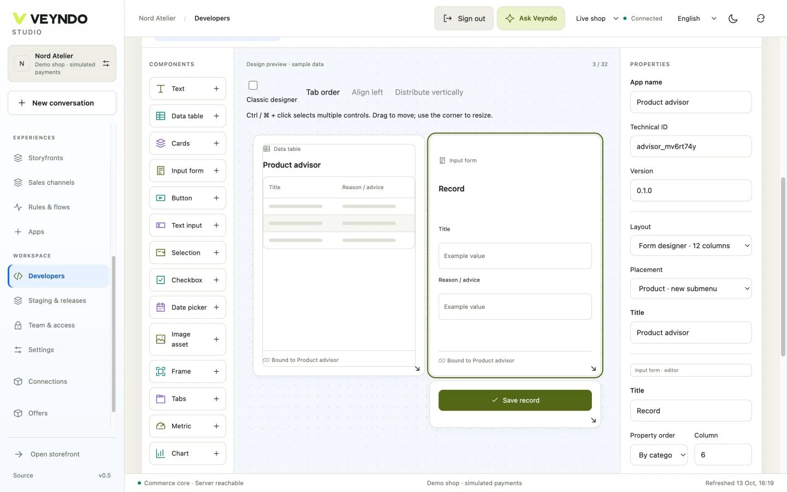
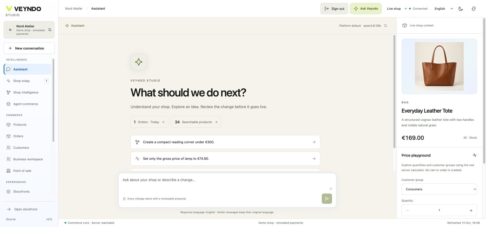
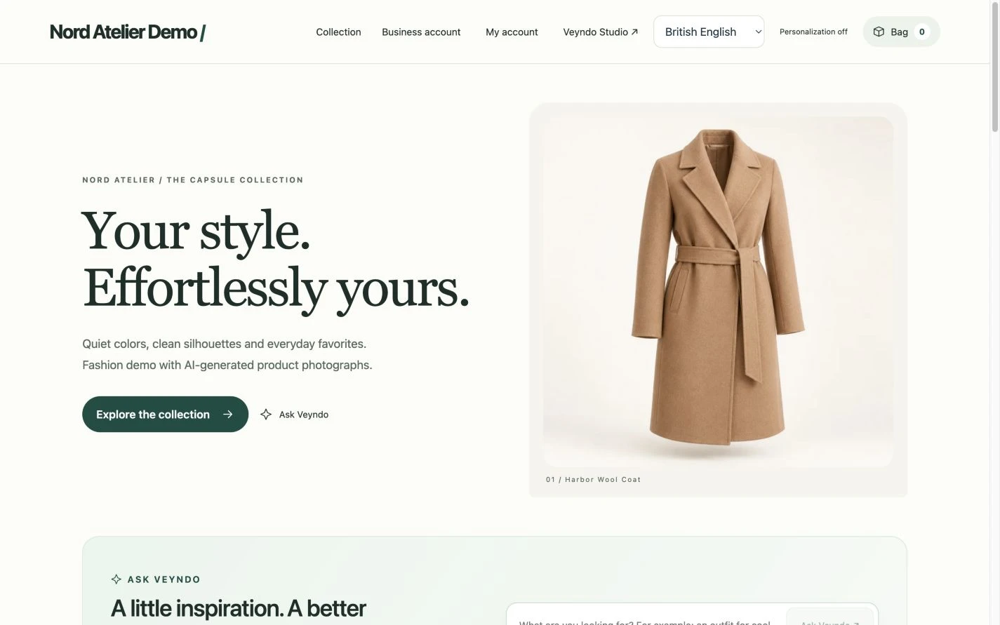
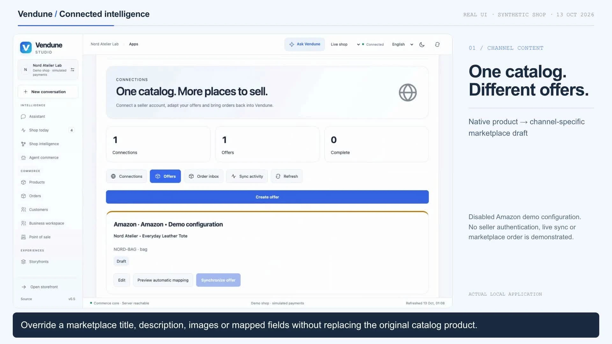
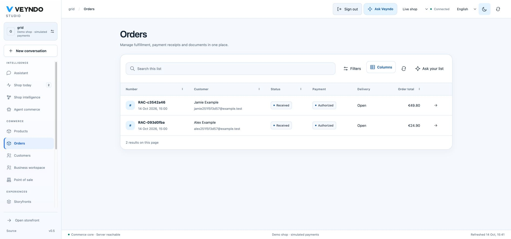
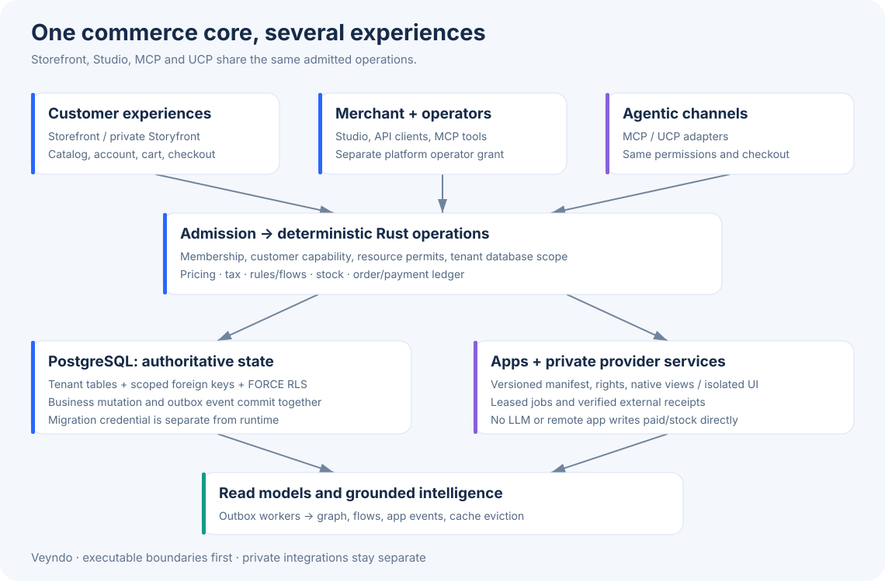

<p align="center">
  
</p>

<div align="center">

# VEYNDO

**Commerce, rebuilt for the AI era.**

[](https://github.com/sthamann/veyndo/actions/workflows/verify.yml)
[](https://sthamann.github.io/veyndo/docs/)
[](#current-boundaries)
[](LICENSE)

[Try one complete round](docs/first-tour.md) · [Watch the tours](#see-it-in-action) · [First contributions](docs/early-contributors.md) · [Feature guide](docs/features.md) · [Architecture](docs/production-architecture.md) · [Documentation](https://sthamann.github.io/veyndo/docs/)

</div>

**A new Rust commerce platform with AI woven into the business itself.**
Veyndo brings products, business knowledge, merchant work, shopper advice, agents,
automation and apps onto one connected foundation. Studio, HTTP, MCP and implemented
UCP routes call the same native commerce operations. Products, prices, inventory,
permissions and revisions stay authoritative in the Rust core.

**Our ambition: the most advanced publicly developed commerce platform for the AI era.**
Built in public, self-hostable and adaptable under the [Sustainable Use License](LICENSE).

## AI-first, all the way through

| What makes the platform different | How it works today |
| --- | --- |
| **Rust at the foundation** | Native commerce and standard connector services run in Rust, with PostgreSQL transactions, durable events and a shared business-operation registry. [Architecture](docs/production-architecture.md). |
| **Knowledge inside commerce** | Products, documents, confirmed claims and selected app data provide connected context for merchant planning and shopper advice. Retrieval and source review feed the existing action path. [Connected intelligence](docs/cognitive-commerce.md). |
| **Agents in the actual business** | Studio, HTTP and MCP use the same permitted operations; implemented UCP checkout and B2B negotiation adapters reuse native carts, quotes and orders. Connect Claude Desktop and authorized ChatGPT/Claude remote clients, or develop with Codex and Claude Code. [Connections](docs/connectors.md) · [UCP B2B](docs/b2b-ucp-negotiation.md). |
| **Automation with business context** | Visual Flows connect order events, rules, delays, documents, AI proposals and installed app actions through durable execution. [Automation](docs/automation.md). |
| **A new app model** | Apps bring typed data, native interfaces, actions, knowledge relationships and optional bounded Wasm hooks. Visual App Studio and coding agents edit one executable Manifest, with real private previews and immutable releases. [App Studio](docs/app-studio.md) · [App platform](docs/app-platform.md). |
| **Toward autonomous commerce** | Reviewed proposals, explicit price corridors, margin rules, daily budgets and controlled layout experiments are implemented. Continuous agents working toward whole-business goals are the next horizon. [Current scope](docs/cognitive-commerce.md#audit-completion-tracker). |

Use OpenAI, Anthropic or configured local models through shared inference settings.
Commerce remains usable without a model. Hosted chat clients need their own secure
connection and account-side setup; [connection requirements](docs/connectors.md)
are explicit.

## See the foundation in action

[](https://sthamann.github.io/veyndo/docs/assets/showcase/build-and-automate.mp4)

[Watch the 29-second actual-UI recording](https://sthamann.github.io/veyndo/docs/assets/showcase/build-and-automate.mp4)
· Synthetic shop · Edited recording · Simulated payments

**Try one complete round:** start your own synthetic shop, change a product in a
private sandbox, inspect the difference and publish the selected change.
[Start the local tour](docs/first-tour.md) · [Connect an agent](docs/agent-workshop.md)
· [Build an app](docs/app-studio.md).

Have a question or an example? [Join the discussion](https://github.com/sthamann/veyndo/discussions).
If this direction is useful to you, star the repository to bookmark it and help other builders discover it.

## One connected business

| Foundation | What you can do |
| --- | --- |
| **Commerce** | Manage products, variants, customers, orders, currencies, taxes, shipping, payments and documents through shared native operations. |
| **Intelligence** | Connect private and published sources, inspect retrieval, review proposals and set limits for bounded autonomy. |
| **Agents** | Expose authorized HTTP/MCP actions and scoped UCP checkout paths using the same ownership and revision checks. |
| **Experiences** | Build storefronts and connected experiences for human shoppers while keeping machine access tied to authoritative commerce data. |
| **Apps & automation** | Design typed apps visually or with coding agents, test real records privately and run durable event-driven Flows. |
| **Agentic grids** | Search, filter and sort orders/products/customers, arrange columns and review natural-language filter suggestions through the same native APIs. [Guide](docs/agentic-grids.md). |
| **Control** | Use team permissions, private sandboxes, selected releases, version history and central model settings. |

[](docs/ui-experience.md)

## Get started

**Container tour:** Git + Docker Compose + OpenSSL; no Rust/Node build or model download.

```sh
git clone https://github.com/sthamann/veyndo.git
cd veyndo
./scripts/try.sh
```

Open `http://127.0.0.1:8788/`. The image is Linux amd64; see
[availability, exact version pins and the complete walkthrough](docs/first-tour.md).

**Build and develop from source:** Rust stable 1.96+ · Node.js 22+ · Docker Compose · Python 3

```sh
git clone https://github.com/sthamann/veyndo.git
cd veyndo
./scripts/dev.sh
```

Open [the storefront](http://127.0.0.1:8787/) or
[VEYNDO Studio](http://127.0.0.1:8787/#merchant). Choose **Create shop** to create
your owner account and a separate shop. The included Nord Atelier fashion demo,
variants, bag and simulated checkout work without a model download or provider key.

Try one complete round: select a coat size → place a simulated order → inspect it
in Studio → create a sandbox → change a product → review the selected release.

The first start builds the application and starts PostgreSQL/Qdrant. Credentials
are generated in ignored `.env`. Keep the terminal open; Ctrl+C stops the app and
retains the database. [Setup and troubleshooting](docs/quickstart.md).

<details>
<summary><strong>Add intelligence or connect an agent</strong></summary>

- Configure Ollama, OpenAI Responses or Anthropic Messages centrally. Cloud charges
  and API credentials are separate from consumer chat subscriptions.
  [Model setup](docs/connectors.md#models-inside-the-merchant-chat).
- Connect a local MCP client. Hosted clients additionally need a reachable HTTPS
  endpoint and client-side registration; OAuth clients need an appropriate gateway.
  [Agent connections](docs/connectors.md#claude-desktop--local-mcp-clients).
- Run another instance with separate ports, credentials and volumes.
  [Independent development instance](docs/quickstart.md#run-a-separate-development-instance).

</details>

## See it in action

Fresh VEYNDO captures use an isolated synthetic shop. Payments are simulated;
recordings are edited for readability and are not latency measurements.

[](docs/features.md#storefront-and-shopping)

**Connected knowledge:** inspect source ownership, review a demonstration source
and keep autonomy limits visible. Retrieval is distinct from model-weight training.
[Watch](docs/assets/showcase/connected-intelligence.mp4) · [Knowledge guide](docs/knowledge-workspace.md).

[](docs/assets/showcase/connected-intelligence.mp4)

**App Studio:** visual controls and coding agents share one executable manifest.
Test a product-bound record in a private preview and save an immutable draft
version. Saving a version and publishing it are separate actions.
[Watch](docs/assets/showcase/app-studio.mp4) · [Build five useful apps](docs/app-tutorials/README.md).

[](docs/assets/showcase/app-studio.mp4)

**Agentic grids:** search the full permitted order, product or customer directory,
arrange your columns and review AI filter suggestions before applying them.
The same native APIs and current access checks serve people and agents.
[Illustrated guide](docs/agentic-grids.md).

[](docs/agentic-grids.md)

[Full feature tour](docs/features.md) · [Video transcripts and capture boundaries](docs/video-tours.md).

## Intelligence with permission to act

**Ask VEYNDO** keeps workspace context, conversations, evidence and reviewable
proposals together. Authorized changes use the same permission and revision
checks as manual edits. Translation and image jobs produce private drafts.

Knowledge combines native products, uploaded sources, curated relationships,
observed purchases and explicitly configured app evidence. Public product answers
recheck supplied sources and current products after inference. Withdrawing a source
removes its eligible public evidence. Private merchant knowledge stays private.

Durable Flows connect events, conditions, delays, documents and configured app
actions. Execution traces expose results and failures. Bounded price autonomy uses
explicit guardrails and daily budgets; enabling it is an operator decision.

[Connected intelligence](docs/cognitive-commerce.md) · [Automation](docs/automation.md) · [Agent commerce](docs/connectors.md).

## Build experiences and apps

Use visual form controls, typed data, grids, code-behind and deliberate HTTP/MCP
permissions. Private previews execute real records. Compare a stage to its baseline
and publish selected changes; product-content releases preserve live inventory.

Connected Storyfront experiences can embed the shared checkout and verify order
completion before updating their bag. Human shoppers and agents reach authoritative
commerce owners through their respective interfaces.

[App Studio](docs/app-studio.md) · [App SDK](docs/app-platform.md) · [App security](docs/app-security.md) · [Experiences](docs/experience-integration.md) · [Checkout continuity](docs/storyfront.md).

## Operate across channels

| Area | Guide |
| --- | --- |
| Products, variants, media, translated content, categories and domains | [Product management](docs/product-management.md) · [Channels](docs/channel-management.md) |
| Customers, accounts, orders, fulfillment, invoices and downloads | [Merchant operations](docs/merchant-operations.md) · [Partial packages and provider-neutral shipping](docs/shipping-workflows.md) |
| Countries, destination taxes, shipping, payment and currencies | [International commerce](docs/international-commerce.md) · [Currencies](docs/currencies.md) |
| Native POS with shared orders, stock and documents | [Point of sale](docs/pos.md) |
| Business units, permissions, budgets, catalogs, quotes and approvals | [B2B commerce](docs/b2b-commerce.md) · [EDI](docs/edi.md) |
| Independent marketplace adapters and explicit seller configuration | [Marketplaces](docs/marketplaces.md) |
| Consent-bound visitor journeys and semantic observations | [Visitor intelligence](docs/behavior-intelligence.md) |
| Shop lifecycle, inherited models, diagnostics and tenant admission | [Platform operations](docs/platform.md) |

Studio supports English, German, Spanish and French, with separate dynamic content
locales. Connected providers require their own configuration; installing an app
does not silently connect an external account.

## Inside the foundation

**Rust + PostgreSQL + private Qdrant + bounded Wasm policies.**
PostgreSQL owns orders, stock, users, app records, knowledge and queues. Qdrant is a
rebuildable retrieval index; candidates are checked against current records and
publication state. Workers handle events, payments, translation, knowledge and media.
External calls stay outside database transactions.

[](docs/production-architecture.md)

[Architecture](docs/architecture.md) · [Source map](docs/source-map.md) · [Security](docs/security.md) · [Tenant isolation](docs/tenant-isolation.md).

Personal merchant and operator accounts share optional authenticator protection,
one-use recovery codes and revision-checked password recovery through the existing
verified identity service. [Account setup, source owners and test boundaries](docs/account-security.md).

Verification includes Rust/frontend checks, real PostgreSQL integration, selected
original-PHP comparisons and Lean/mutation checks for named pure policies. These
checks have bounded scope; they do not establish full-system production maturity.

[Testing](docs/testing.md) · [Formal verification boundaries](docs/formal-verification.md) · [Shopware parity](docs/shopware-parity.md) · [Dated workload measurements](docs/benchmarks.md).

[System consistency audit](docs/system-consistency-audit.md): shared contracts,
the current component/version/sandbox matrix, 49 isolated-suite checks, repaired
permission/discovery defects and remaining history, Storyfront and deployment boundaries.

Customer history, invoices and digital files require an immutable purchase-time
account binding; matching an old guest's email does not grant ownership. Paid
guest files retain their exact original cart capability.

## Current boundaries

| Area | Current scope |
| --- | --- |
| **Autonomy** | Authorized actions, durable workflows and bounded controls. Continuous autonomous optimization of an entire business remains a development goal. |
| **Production readiness** | Working prototype. Complete spend controls, relocation/failover and broader operational acceptance remain additional work. |
| **Payments & providers** | Simulated/manual payments, native PayPal and versioned payment-app contracts. Real provider outcomes require configured providers and separate acceptance. |
| **Protocols & compatibility** | Selected native Shopware behavior and HTTP/MCP/UCP capabilities; complete plugin/DAL/CMS compatibility and full protocol conformance are outside this slice. |
| **Apps & deployment** | Declarative packages and independent services, signatures and pinned UI bundles. Hostile-code containment and arbitrary source builds remain deployment responsibilities. |

[Complete feature scope](docs/features.md) · [Current release](docs/current-release.md) · [Managed hosting](docs/managed-hosting.md).

## License and contributions

Source-available under the **[VEYNDO Sustainable Use License 1.0](LICENSE)**.
Run and customize your own stores, brands and apps. Competing shop platforms,
white-labeling and managed commerce/SaaS for independent merchants require a
separate written commercial license. This is not an OSI-approved open-source
license. Earlier MIT-distributed versions retain their rights; third-party terms
remain intact.

[License examples](docs/licensing.md) · [Contribute](CONTRIBUTING.md) · [Report an issue](https://github.com/sthamann/veyndo/issues/new/choose) · [Third-party notices](THIRD_PARTY.md) · [Changelog](CHANGELOG.md).
