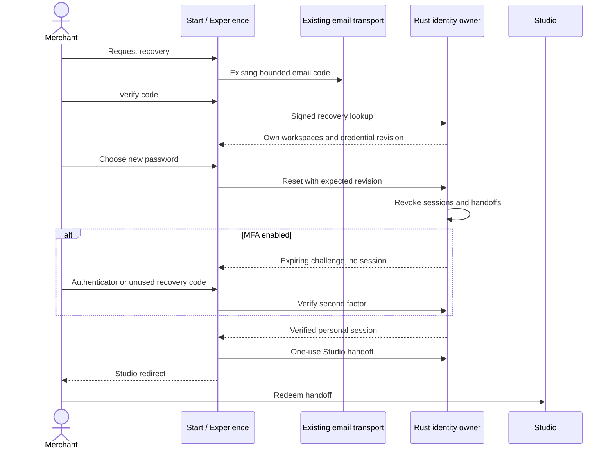

# Personal identity, recovery and two-factor sign-in

The native Rust account remains the owner of merchant passwords, active workspace
membership and personal sessions. The private Experience service verifies email
through its existing transactional email transport and sends short-lived signed
identity assertions. Neither an email link nor an app integration key is a Studio
session. Personal security is operational state, never sandbox configuration.

## Merchant and operator interfaces

**Team & access → Account security** and the operator console's **Account security**
view share one component and one native contract. Enter the current password,
add the displayed setup key to an authenticator (SHA-1, six digits, 30 seconds),
and confirm a current code. Eight random recovery codes are shown once. Store
them privately; each can be used once. Enrollment revokes older sessions, and
returns one newly verified session so the codes can be displayed before signing out.
Disabling protection requires the current password, a current authenticator or
unused recovery code and the current security revision.

Password login, verified email/social entry, welcome password setup, recovery,
additional-shop creation and Studio handoff all preserve the same factor gate.
A pending challenge never goes into merchant/operator bearer storage. Native
session responses carry `user.emailVerified`; local direct registration does not
pretend that an email was verified. Hosted Start/Experience use verified identity.

## Operator configuration

Keep `IDENTITY_BROKER_KEY` and `IDENTITY_BROKER_ISSUER` consistent between the native
owner and its approved private identity service. Set `IDENTITY_RECOVERY_URL` to
an HTTPS recovery entry without embedded credentials, query or fragment; the
hosted default is `https://start.veyndo.ai/recover`. `/api/auth/recovery` returns
`available: false` without a configured broker and valid destination. Recovery
needs the existing private email provider; no second mailer or public reset-by-email
endpoint is introduced. Back up the existing native encryption key with PostgreSQL;
factor secrets use the existing authenticated encryption owner.

Migration **091** adds operational factor/challenge state, email verification,
credential revisions and handoff-to-parent-session references. These identity
records use forced system-only RLS and are excluded from shop release/history
restore. A schema administrator still has trusted system authority. Password,
authenticator secret and recovery codes must never enter audit history or logs.

## Failure and admission behavior

- Factor challenges expire after five minutes, allow at most five attempts and are
  consumed with their verified code in the native transaction. An authenticator
  time step or recovery code cannot be reused. Drift is limited to one adjacent step.
- Enrollment expires after ten minutes; stale revisions roll back without consuming
  a recovery code. MFA can only be configured in a live personal workspace.
- A password reset compares the credential revision captured after verified email;
  a stale recovery continuation cannot overwrite a newer password. MFA stays enabled.
- App/integration credentials cannot configure personal MFA or mint a personal
  Studio handoff. A handoff is bound to a live parent personal session and expires
  after sixty seconds; logout/recovery/factor changes revoke it with that session.
- Experience continuation data is encrypted and expires. GET only renders a form;
  same-origin POST performs the action. A failed Studio handoff can resume after
  successful reset/factor verification, without repeating those mutations.
- A private Experience cookie is rechecked against its current native proof.
  Revoked proof cannot retain access to original Storyfront editors. Multiple auth
  reads of one HTTP request share admission; there is no cross-request rights cache.
- Creation retries refresh the current authenticated proof. Jobs preflight identity
  before paid brand/model work and pause for reauthentication if a factor is required.

## Source owners and verification

`src/auth/{totp,mfa,sessions,handoff,broker_recovery,broker_session,broker_credentials}.rs`
share the existing native account and middleware owners. `frontend/src/shared/auth/`
is the common merchant/operator client. Private forms, continuations, email-code
entry and current-cookie admission live in the private Experience repository.
Provider credentials and private source are not copied into this repository.

The registered `account_security` and `identity_broker` HTTP/PostgreSQL suites cover
native effects, foreign/forged/revoked proof, attempt/expiry/replay races, stale
recovery revisions, cross-shop admission and process restart. Frontend regressions
cover challenge/enrollment controls and storage boundaries. The private suite covers
email-code → recovery → MFA → interrupted handoff → one-use completion with actual
isolated storage and synthetic providers. These tests send no live email.

Lean covers the extracted Boolean factor-admission policy only. Cryptography,
PostgreSQL, email delivery, browser behavior and broker integration remain tested
trust boundaries; this is not a claim of universal identity-provider certification.
