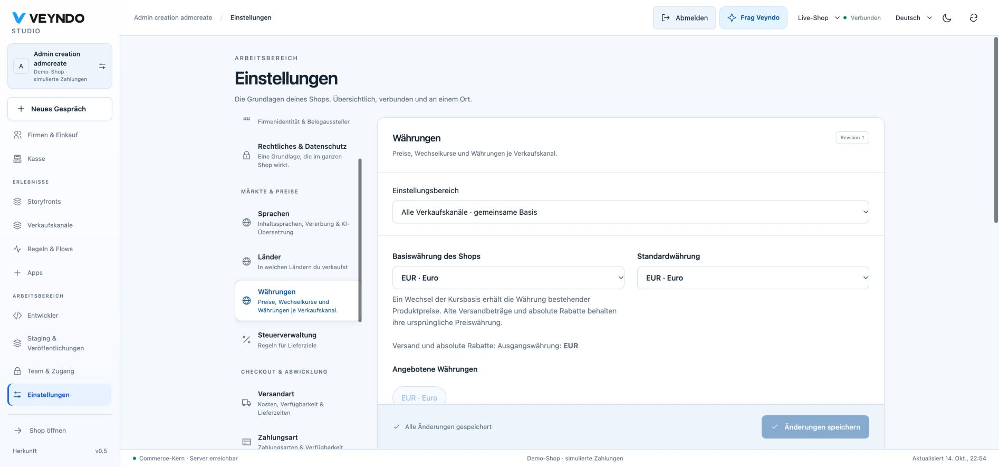
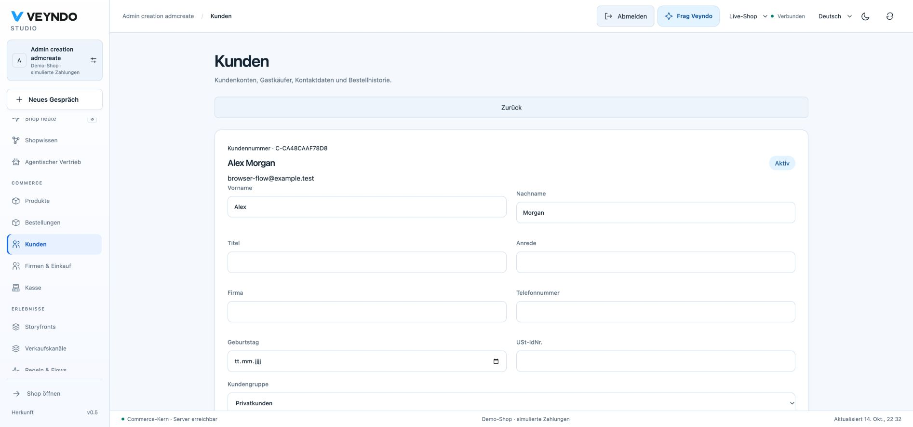
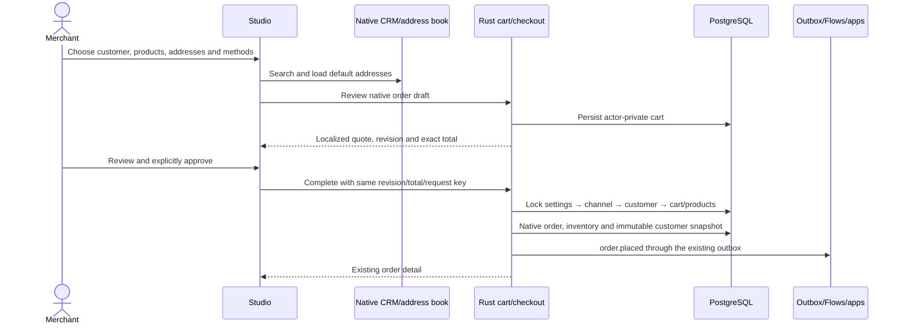
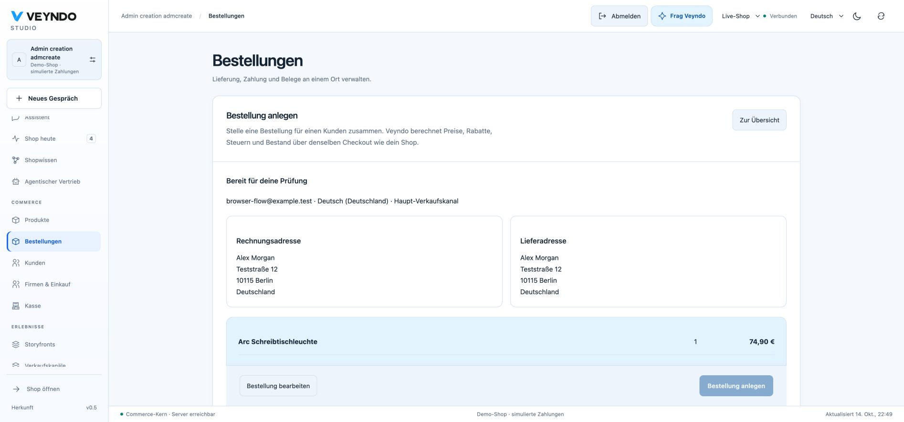
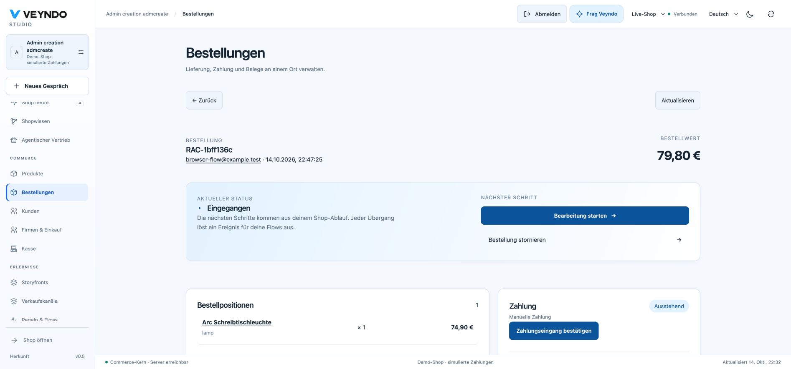

# Set up the shop, create customers and place reviewed Admin orders

Veyndo Studio groups settings in the order a merchant normally sets up a shop.
The same Rust owners remain authoritative; the navigation does not create another
settings store or another checkout. Interface copy ships in EN/DE/FR/ES. Content
translations continue to use one selected language and main-language inheritance.

## Find the right setting

| Group | Recommended order | What it controls |
| --- | --- | --- |
| Shop foundations | Company details → Legal & privacy | Company identity, structured address, document issuer, logo, translated legal content and consent/compliance policy. |
| Markets & pricing | Languages → Countries → Currencies → Tax management | Main/enabled content languages, delivery destinations/subdivisions, currency strategy and explicit destination tax rules. |
| Checkout & fulfillment | Shipping methods → Payment methods | Translated methods, country/rule availability, delivery costs and configured payment contracts. |
| Customers & business | Customer groups → Company purchasing | Gross/net pricing groups and the existing modular B2B feature policy. |
| Connected areas | Sales channels, Apps, Rules & Flows, Team, AI connections | Existing dedicated workspaces, visible only with their own read/manage permission. |

Use **Find a setting** to filter navigation. Unsaved changes stay subject to the
existing discard guard; international panels share their revisioned aggregate.
Settings history and channel inheritance retain their existing release contracts.
Currency settings have their own padded content region and a simple scope toolbar;
a content-language picker is omitted where there is no translatable content.
Price-generation jobs require catalogue rights in addition to settings admission.

On phones, a grouped settings selector keeps the actual configuration near the
top instead of making merchants scroll through the entire navigation first.

## Add a customer

1. Open **Customers → Add customer**.
2. Enter the contact, customer group and complete billing address.
3. Keep **Use billing address for shipping** or enter a separate delivery address.
4. Save. The native customer detail opens with both default-address assignments.
5. Use the existing address book, linked order list and version history for later edits.

Creation requires `customers.write` and `customers.pii`. Profile and addresses are
committed together through the existing contact/address owners. Duplicate email
and changed repeated inputs fail visibly rather than creating duplicate records.
A stable request key admits an identical retry once. Customer-created/address events
join the existing PostgreSQL outbox. This creates a **CRM profile, without issuing
a customer password, login session or storefront access**. Existing account identity
and historical purchase ownership are never reassigned from matching email alone.

## Create an order on behalf of a customer

1. Open **Orders → Create order**.
2. Choose a public, active storefront/headless sales channel, order language and currency.
3. Search an existing customer. The native bounded picker resolves names, email and
   customer number; its address defaults are loaded. With customer-write rights,
   create a customer here and return to the same selected product list.
4. Search products/SKUs, choose actual variant rows and quantities. Enter or change
   billing/shipping addresses, a configured delivery/payment method and coupon codes.
5. Select **Review order**. The native quote shows localized item names, delivery,
   tax and exact currency total. This has not yet placed an order or consumed stock.
6. Confirm the customer's authorization and obtained current legal acknowledgements.
   Digital immediate delivery needs its separate explicit acknowledgement.
7. Select **Create order**. Open the normal order detail, linked customer, immutable
   documents, delivery/payment workflow and event history.

The draft is an actor-private **native cart**, not another order ledger. API and MCP
use `merchant.order.context`, `.review`, `.complete` and the same domain operations.
Required scopes are `orders.write`, `customers.read`, `customers.pii`, `catalog.read`;
reading the resulting order additionally needs `orders.read`. Creating a customer
inside it additionally requires `customers.write`. Safe creation choices do not
require broader settings/channel-management permission.

Current manual orders allow configured **manual** and **simulated** payments.
Manual payments remain pending; simulated payments are demonstration transactions.
They do not charge a real provider or mark an invoice paid. Buyer-completed payment
links, arbitrary custom lines and manual per-line price/tax overrides are future
work; the UI does not offer controls that bypass the pricing owner. Coupon discounts
and existing native quantity/group/currency pricing are supported.

The final payment-mode guard runs again under native locks before any provider path;
its small Boolean property is extracted and checked in Lean. SQL, authentication,
provider protocols and whole UI correctness remain outside that proof.

## Isolation, history and sandbox boundaries

- A private draft token is insufficient for normal cart/checkout, account logout
  or purchased downloads. Internal admission, current rights and the creating
  merchant are checked. Actual account-bound purchase access remains valid.
- Customer edits/checkout share settings → channel → customer → cart lock order.
  Admin orders for one customer acquire the customer write lock up front; two
  parallel orders cannot deadlock while upgrading a shared read lock.
- Final checkout rechecks active/public channel policy, selected products, customer
  facts, native prices and the reviewed revision/total. Repeated completion returns
  the same order; later customer eligibility changes do not create another purchase.
- CRM profile/address history keeps its existing CAS/restore policy. Financial and
  operational orders remain history-readable and change through workflow commands;
  they are never rolled back or released as configuration.
- In a private sandbox, synthetic customer/order records stay in that tenant. The
  configuration release mechanism does not copy customers, orders or inventory
  movements into the live shop. No real payment service is called by this adapter.

## Comparison and remaining configuration work

The layout and workflow were compared with the official
[Shopware settings reference](https://docs.shopware.com/pdf/en/shopware-6-en-features-commercial.pdf),
[Shopware Admin order guide](https://docs.shopware.com/en/shopware-6-en/orders/create-order-in-admin),
[Shopify draft-order guide](https://help.shopify.com/en/manual/fulfillment/managing-orders/create-orders/create-draft)
and [Shopify store details](https://help.shopify.com/en/manual/your-account/manage-orgs-and-stores/manage-store-details).
This is a scoped implementation, not a claim of full platform parity.

| Area | Veyndo now | Further work, not represented by dummy controls |
| --- | --- | --- |
| Identity, language, markets, money and tax | Existing company/legal/international settings; now grouped and searchable. | Configurable shop time zone, business calendar and broader currency-specific display/rounding policy. |
| Checkout and delivery | Shared availability/rules, shipping methods, provider contracts and exact native review. | Shipping zones/package/carrier policies, buyer-completed manual-order payment links and deeper account/guest checkout policy. |
| Customer/business policy | Configured translated groups, address defaults, B2B feature switches and per-unit purchasing rules. | Customer invitation/activation for a CRM-only profile, segmentation/retention automation UI. |
| Documents and communication | Existing issuer snapshots, immutable receipts and native event/app delivery. | Configurable numbering/template preview and email-template workspace in one clear settings section. |
| Shop appearance and discovery | Existing live/sandbox experience and source owners, sales-channel domains and content. | More accessible SEO/indexing, navigation/search and storefront-form policy controls. |

## Verification

`scripts/admin_creation.py` is registered with the existing integration runner. It
uses isolated synthetic shops and real Rust/HTTP/PostgreSQL operations: customer
creation/defaults/replay, native quote/order/stock/customer binding, compound role
admission and MCP schemas, wrong actor/foreign tenant/stolen tokens, parallel orders,
customer edits, deactivated-customer replay, private channels and purchased downloads.
The unit/UI suite covers explicit quote review, guarded cancellation and separate
customer forms. Existing checkout, CRM/history, account and POS suites remain required.
No paid inference, real payments or real customer email is used in these fixtures.

## Browser walkthrough and capture boundary

The 14 October 2026 Chrome walkthrough created **Alex Morgan** in an isolated local
shop, confirmed both default-address assignments, placed a German manual-payment
order for a lamp (**74.90 EUR + 4.90 EUR delivery = 79.80 EUR**), opened its native
order detail, and followed its customer link back to the linked order history.
The payment remained pending. Mobile settings/customer/order views were checked at
390 × 844 without document overflow; shipping and representative product/app/channel
views were also inspected. These captures use synthetic data and do not certify every
Admin dialog or a live payment provider. The persisted HTTP suites separately exercise
current rights, negative ownership, concurrency and replay behavior.

[Mobile settings](assets/admin-20261014/settings-mobile.png) ·
[Mobile customer](assets/admin-20261014/customer-mobile.png) ·
[Mobile order review](assets/admin-20261014/order-mobile.png)
