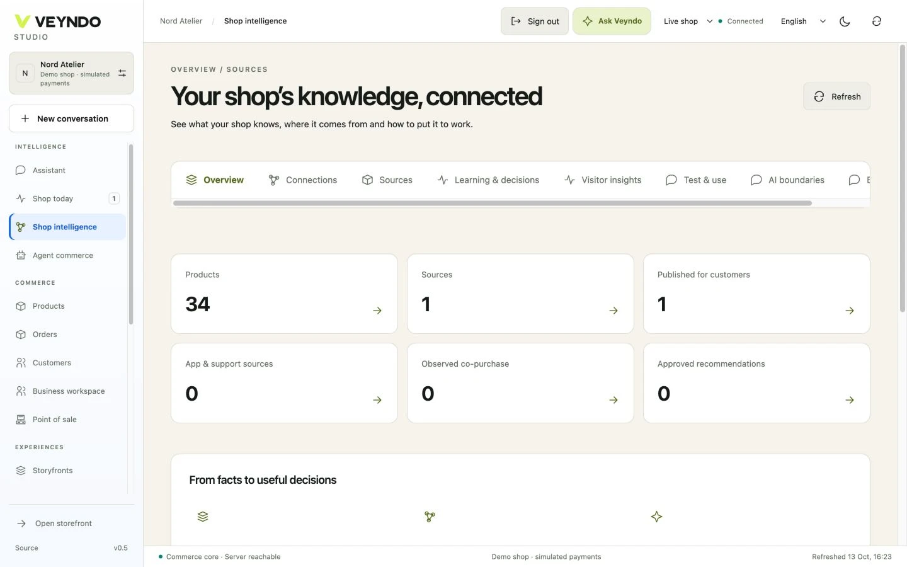

# Give a commerce agent a bounded job

The useful question is what an agent can read, propose and actually change in one
shop. Veyndo's HTTP, MCP and Studio interfaces reuse native commerce operations.
Try this workshop only in your own synthetic local shop.

## Prepare the existing connection

Complete the [first local tour](first-tour.md). Follow the exact
[client and provider setup](connectors.md) for your installed MCP client. A local
bridge needs the Rust service already running. Hosted clients need their own
reachable HTTPS connection and registration; localhost is not remotely reachable.
Provider API access is separate from consumer chat subscriptions.

For Veyndo's native planning operations, use a [dedicated bounded agent key](agent-authority-controls.md)
with only the required read scopes and assistant access. It cannot apply a business
change; perform that review in the merchant's personal Studio session. An ordinary
integration key is not an unbudgeted model credential. The allowance covers Veyndo's
central model calls, not independent model usage inside an external MCP client.

## Read, propose, inspect

1. Ask the connected client to list a small number of products in your shop and
   identify one exact product and revision. Inspect the actual tool result.
2. Ask it to propose a short, clearly fictional care note for that product. State
   that it must not apply or publish anything yet.
3. Inspect the fields, product identity and proposed change. A prose claim that
   something was saved is insufficient: check the tool result and native product.
4. If you intentionally approve a change, use the documented native action with
   that shop's permitted identity. Verify the saved native record in Studio.
5. Revoke the relevant right in a separate restricted test identity and repeat
   the operation. A denied change must leave the product unchanged.

Use only your own synthetic records for the counterexample. Never publish tokens
or turn another merchant's identifiers into a test target.

## Why the underlying contract matters

An MCP tool name is a transport entry, not permission. Current membership, domain
rights, tenant identity and revisions belong to the native operation. Read access
does not grant write or publication access. Private sandbox differences and
publication also require the respective domain rights.

Retrieval supplies eligible evidence; it does not train model weights. Sources,
proposals and actions are distinct steps. See the [intelligence guide](cognitive-commerce.md)
and [system consistency audit](system-consistency-audit.md) for actual ownership
and remaining gaps. This workshop is not complete MCP/UCP conformance or whole-system
security certification.

[Share a bounded agent use case](https://github.com/sthamann/veyndo/discussions)
with the input, permitted action, observed native result and source version.
