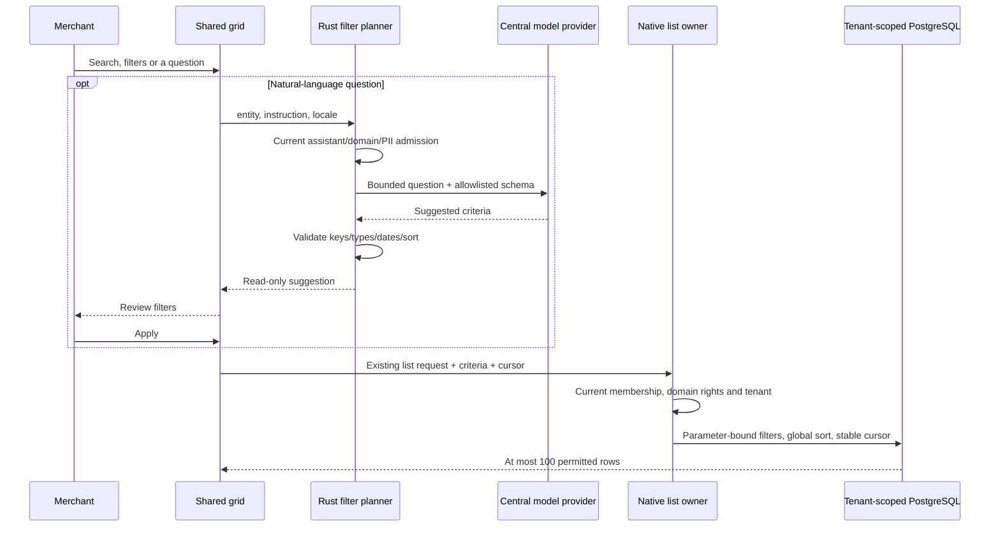

# Agentic Studio grids

Orders, products and customers now share one grid instead of separate fixed lists.
People and agents use the same native filter/sort contract. The grid never owns
prices, customer identity, order states or a second database.

## Use the list

1. Open **Orders**, **Products** or **Customers** in Studio. Search runs on the
   server, across the entire permitted directory, with a short input debounce.
2. Open **Filters**. Orders support customer-name/email text, order/payment/delivery
   states, channel ID and an inclusive UTC date range. Products support active status,
   category and low stock. Customers support registered/guest contacts, active status
   and configured groups. Applied filters appear as removable chips.
3. Click a sortable column to switch ascending/descending order. Pages are sorted
   before the cursor is applied; the browser never sorts only the visible page.
4. Open **Columns** to hide/show columns, move them with arrows and change density.
   Drag a table heading to reposition it. Keyboard and touch users can use the arrows.
   The details action stays available even when the original name/number column is hidden.
5. Open a record and return to its list. The workspace retains the current criteria
   and page cursor in memory. Reloading resets search; no customer names or search text enter browser
   preference storage.

Column layout/density is a device preference scoped by origin/shop/sandbox and
list ID. It contains column IDs only, not records, credentials, business configuration
or release units. This is deliberately distinct from entity history and staging.

## Ask your list

With `assistant.use` and the list's current domain rights, open **Ask your list**:

- “Show all orders from customer Alex Example.”
- “Show active products with low stock.”
- “Find guest customers.”

The central configured model receives the explicit question, entity, current date
and allowlisted criteria schema. It receives no fetched customer/order dataset.
The request can itself contain names or other data you type; it goes to your configured
model provider. No separate provider credential or browser-side model client exists.

The model returns typed filter suggestions. Studio shows them for review and
**Apply filters** issues an ordinary native list read. Unsupported constraints must
be reported instead of silently dropped. Invalid fields/types/dates/sort keys are
rejected. Provider failure leaves manual search/filtering available.

The customer filter matches text in the immutable order customer snapshot (name/email)
and legacy contact fields; it does not claim to disambiguate people with identical
names. Exact email text can narrow the result. Category/channel/parent references
must be explicit IDs; the model must not fabricate IDs from display names.
Product-name sorting uses the same native language inheritance as the displayed name.
Each page reads current committed data; edits during browsing can move a row, so refresh
the list when you need a new view. Dates use UTC. Amount sorting compares displayed numeric order amounts, not economic
value across currencies, and performs no conversion or aggregation.

## One native contract

`POST /api/merchant/grid/plan` and MCP `merchant.grid.plan` share the same owner.
Manual execution continues through `/api/merchant/orders`, `/customers`, `/products`
and `merchant.orders`, `merchant.customers`, `merchant.products`. The MCP schemas
use the same grid field registry. No model-produced SQL, tenant/principal field,
write action, approval bypass or automatic purchase is accepted.

Planning requires `assistant.use` plus `orders.read` or `customers.read` with
`customers.pii`; product planning requires `catalog.read`. Ordinary list reads
retain their existing domain/PII requirements. MCP discovery and direct invocation
apply current rights. Model calls reuse central inheritance, process admission and
fleet-wide tenant leases. Sandbox reads use the existing environment context;
operational orders/customers are not copied into a stage.

## Reuse and boundaries

`frontend/src/shared/grid/` owns presentation, layout, debounced paging and review.
Domain directories supply columns, allowed filters, existing request functions and
native navigation. New entity directories must reuse it rather than copying a list.
Bundled controls are translated into EN/DE/FR/ES. Merchant content and app labels keep
their existing main-language inheritance.

Declarative app table blocks also reuse the column/density/expanded-row shell and
retain their native inline forms and current app actions. Their existing indexed
filter/action contracts are preserved: this change does not silently add arbitrary
full-text search, sorting or model planning to every installed app. Metrics tables,
variant draft editors and document/line-item summaries are not global entity directories.

The SQL owners retain bounded pages and tenant predicates. The default customer
email path keeps its existing per-branch limits. Non-default sorts can still require
PostgreSQL to sort eligible rows; this release does not claim a million-row latency
benchmark or replace the existing database/resource limits.

## Verification

The `grid_directory` suite creates an isolated database, real customers and simulated
orders via Store API, and calls actual Rust HTTP/MCP plus a loopback model provider.
It verifies global filter/sort paging, schema/output rejection, provider failure,
current domain/PII rights, foreign tenants/cursors and empty operational staging.
It sends no paid model, live payment or real customer data. Provider fixtures verify
wire/admission behavior, not the semantic quality of a particular live model.

Frontend regressions cover sorting, filters, keyboard ordering, drag headers, layout
persistence, explicit AI review, unknown-field rejection, permission presentation,
stale response fences and native app forms. Browser acceptance uses the same
synthetic native orders and local model provider. [Measured tests](testing.md).
