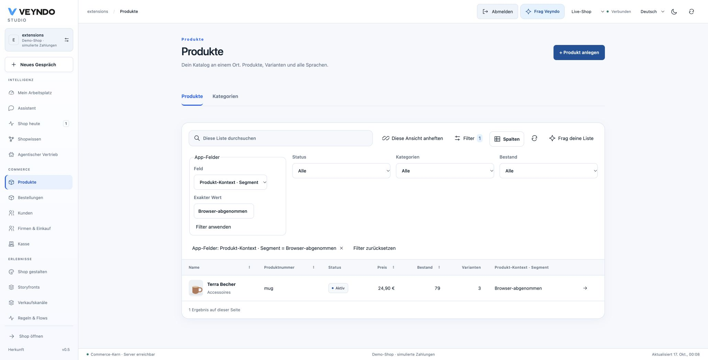

# Extend products, customers, orders and companies

Apps can add namespaced fields to native shop objects without changing their SQL
schema or replacing their business rules. The optional version-1 `extends`
contract binds one app record to one native object. Each app keeps its own field
names, revision, history and package version.

This guide describes the implementation and registered local acceptance. Hosted
acceptance remains recorded separately in [current status](status.md).

## Start in App Studio

1. Open **Data models** and select the model you want to attach.
2. Under **Extend a shop object**, select Product, Customer, Order or Company.
3. Add the business fields: for example a segment, an internal note or a typed
   approval classification. The editor creates the unique native anchor and
   compiles the appropriate native read/write permissions.
4. Save a version and test in the existing private environment. Installation and
   publication still require explicit consent and current permissions.
5. Open the native object's administration page. Its fields use the existing
   typed app-record form and the shop's content-language picker. There is no
   technical record-ID chooser in this single-object editor.

An installed binding cannot silently switch to another object or another anchor.
That requires an explicit offline data migration. Adding optional ordinary fields
uses the existing compatible schema-upgrade path. AI presentation edits preserve
existing bindings, field types, references, permissions and lifecycle contracts.

## One storage and write path

```json
{
  "name": "product_context",
  "label": {"en-GB": "Product context", "de-DE": "Produkt-Kontext"},
  "extends": {"version": 1, "object": "product", "field": "native_id"},
  "publicRead": false,
  "fields": [
    {"name": "native_id", "kind": "string", "required": true,
     "indexed": true, "unique": true, "coreReference": "product"},
    {"name": "segment", "kind": "string", "indexed": true}
  ]
}
```

`company` binds to the existing `b2bCompany` reference. The anchor must be a
required, indexed, unique, non-translated string. A tenant-aware native foreign
key checks the target. The fixed shared unique index prevents two app records for
the same object in this model, including concurrent writers. Separate apps can
extend the same native object without overwriting each other.

The four existing physical app tables remain unchanged. There is no table,
column or index per installed app, merchant, model or package version. See
[shared storage and quotas](app-data-storage.md). Saves, stale-revision rejection,
record history, language validation and the atomic `app.record.changed` outbox
continue through the existing app data owner. An extension write does not change
native stock, prices, payment state or the native object's revision.

The example package
[`extensions/apps/object-context/manifest.json`](../extensions/apps/object-context/manifest.json)
declares all four object types, localized fields, read/write actions and graph
mappings. It contains the business example; Core only implements the generic
binding and admission.

## Current rights, not inherited authority

Every extension action is private and uses the existing native list/save handlers.
Manifest validation requires these current rights, independently of app metadata:

| Object | Read | Write, in addition to read |
| --- | --- | --- |
| Product | `catalog.read` | `catalog.write` |
| Customer | `customers.read`, `customers.pii` | `customers.write` |
| Order | `orders.read`, `customers.pii` | `orders.write` |
| Company | `b2b.read` | `b2b.manage` |

An action may require additional rights. Native projections and filter admission
honor them; inaccessible extension models are omitted, even when the native object
is readable. A reader sees no write action. Generic app endpoints, gateway calls
and history retain their own existing admission as well. Agent identities never
inherit the installing owner's authority.

These fields are merchant-private. Storefront product responses, buyer UCP
responses and guest CRM contacts do not acquire this private projection. A guest
contact has no immutable native customer ID and is never matched by an unverified
email. Public app presentations continue to use their explicit public model and
surface contracts. `mcp=false` disables the declared direct app tool; it does not
turn already-authorized native object data into a separate secret store.

## Grids, search, API and agents

Native Admin product, customer and order lists and detail responses include
`extensions`, namespaced by app and model, with current record/package revisions.
Company list/detail operations use the same projection through the B2B gateway.
The existing MCP native operations consume those same owners.

Product/customer/order grids discover optional app columns from authorized native
metadata. Select them in the existing column picker and arrange them with the
same layout controls. Exact manual filters use the shared native predicate before
pagination, rather than filtering the current browser page.



*17 October: actual browser acceptance in an isolated synthetic shop. The product
was edited through its native app form and then found by this server filter. This
is a local acceptance image, not a hosted-payment or capacity claim.*

`appFilter` is a JSON array encoded as a query-string value, with one to four
conjoined predicates:

```json
[{"app":"object_context","entity":"product_context",
  "field":"segment","value":"wholesale"}]
```

Only declared indexed, non-translated string/integer/boolean fields are admitted.
All identifiers and values are bound parameters; caller identity and SQL are not
accepted. The admitted package digest fences the predicate against a changed
package. The existing fixed app index/reference projections do the lookup.
There is no app-field range sort, arbitrary SQL or implicit full-text index.
Company data is available through native B2B list/detail; it does not yet have the
same generic grid/filter presentation as the three existing directories.

Reviewed grid plans receive only current readable app field definitions, never
private record values. The versioned `grid-filter@1` prompt can propose exact app
filters alongside native constraints. The returned proposal is validated against
the installed model and the current user's rights; human review still precedes
execution. Prompt ID/digests use the existing inference evidence. Provider fixture
tests prove wire/admission behavior, not general model accuracy.

Native app reads and object projections include bounded namespaced graph nodes
and native-reference edges, with source app, package version, record and revision.
An explicit ontology mapping selects properties; otherwise an extension model has
a typed private projection of its declared fields. This is a read projection over
the same records, not another graph database or confirmed product evidence. It
does not automatically turn private fields into public buyer facts or add them to
all existing graph visualizations.

## Sandbox and publication

Product and company extension data can accompany catalog/company configuration in
a private environment and be selected for publication through the existing typed
app writer and current domain rights. Company roots clone before their app
references. Publication retains native/app CAS and package fences.

Customer and order extension records are operational. They are excluded from
configuration snapshots, cloning and release selections, so a design publication
cannot copy customer data or rewind a live order. Their app definitions can still
be developed and versioned privately. Test customer/order behavior with synthetic
objects created in that environment.

The small operational-versus-configuration admission predicate is extracted to
Lean and has a negative mutation. That property does not prove the surrounding
SQL, UI or complete application.

## Bounded reads and acceptance

Native projections accept at most 100 objects, show at most 24 readable extension
models, and cap embedded field bytes to 32 KiB per record and 512 KiB per native
page. Each object's complete embedded envelope is additionally bounded to 64 KiB.
Omitted data is reported by `omittedExtensions` and explained by the detail UI;
use the app's own paged read for complete records. Grid planning receives at most
128 readable indexed field definitions within 16 KiB. Existing installation/storage quotas remain
in force. These are prototype limits, not measured enterprise capacity.

Registered regression `app_core_extensions` exercises actual PostgreSQL/HTTP/MCP
writes and all four native object projections; exact filters; public and foreign
shop denial; native/custom read scopes; immediate role revocation; read-only
writes; unique anchors; incompatible upgrades; private clone and selected release
without copying live customer/order records. Frontend tests exercise actual form
submission, CAS continuation, read-only controls and typed grid filters. Existing
app/schema/relation/ontology/staging/tenant/B2B suites remain required.
