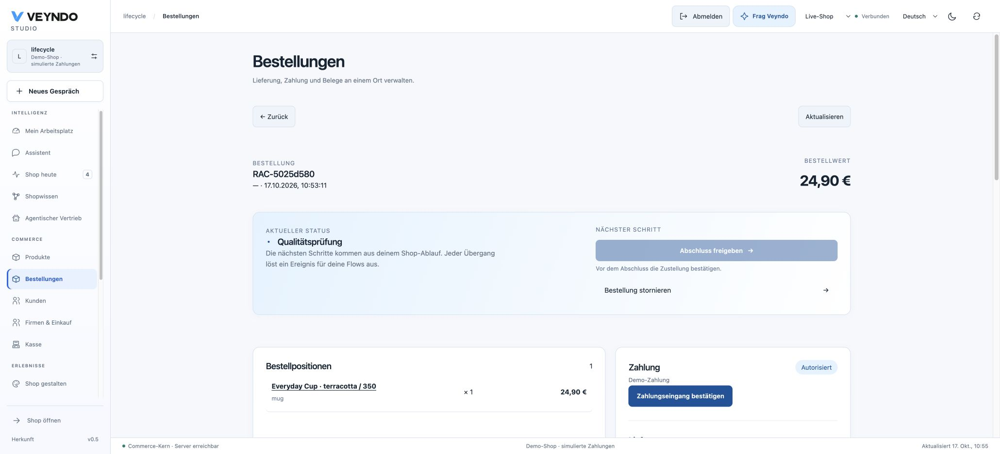
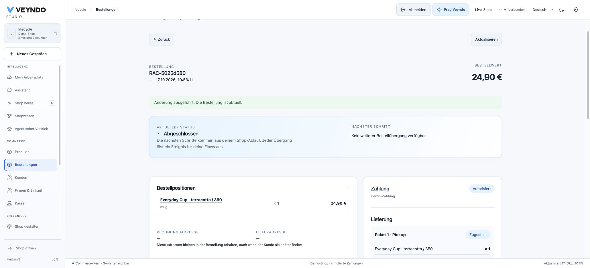

# App-owned order and quote workflows

An app can add named review steps to **native orders and quote requests**. The
same order detail, RFQ inbox, HTTP operations, MCP tools, Flow actions, history
and transactional outbox remain authoritative. This is a declarative extension;
the app does not receive SQL access or replace checkout.

The [production-review example](../extensions/apps/production-review/manifest.json)
adds a quality check before order completion and a technical review before a
merchant prepares an offer. Its business vocabulary belongs to the app package.

## Build and try a workflow

1. Open an app in **App Studio → Connections → Order & quote workflows**.
2. Choose Order or Quote request and add a review workflow. Rename its steps,
   edit their labels in the selected content language and connect them.
   Every new state and action needs a label in the shop main language. Both
   immutable development builds and installation reject incomplete labels; other
   languages inherit the accepted main-language value.
   Changing the shop main language or publishing that change also checks active
   workflow labels. Translate the app first; existing accepted objects retain
   their original language snapshot.
3. For an order, optionally insert a step instead of the native **Start
   processing** or **Complete order** edge. Competing replacements are rejected.
   Cancellation and financial operations cannot be replaced.
4. Select additional current team permissions and supported native checks.
   These checks can restrict an edge; they cannot approve a native denial.
5. Save a new immutable app version, review its permissions and test in a private
   environment. Publish the selected app package through the normal release review.
6. Create a new native order or buyer RFQ. Its next actions appear in the existing
   order or quote view. Reload after each decision to use its current revision.

Visual edits, agent JSON and exported coding-agent tasks use the same `lifecycles`
property. Existing AI presentation edits preserve an accepted lifecycle contract;
they cannot silently remove its rules. A new source-agent proposal remains a
reviewed version change, not an automatic live migration.

These are unretouched local Chrome captures from 17 October, synthetic order
`RAC-5025d580`, reference app version 1.0.3. The browser sent the real native
shipment and completion commands. The EUR 24.90 purchase used simulated payment;
the captures are not hosted acceptance or evidence of a real provider charge.

## Versions belong to the running object

Each newly created order or RFQ with an active app lifecycle stores a bounded `nativeLifecycle` snapshot in
its existing operational record. It includes the native machine revision, main
content language, namespaced states/edges and the exact app version and canonical
digest behind each contributed edge. Package rows are locked through object
creation, so an upgrade cannot replace a definition halfway through acceptance.

**Updating, publishing or deactivating an app affects future objects. Existing
objects keep their accepted declarative definition.** They still require the
actor's current rights and the current native financial/fulfillment checks. This
preserves a way to finish work without running removed app code. It deliberately
does not retrofit new rules onto historical objects. Orders predating this contract, and new orders without an active order-lifecycle app, retain the existing shop-machine behavior. Ordinary manual shop workflow changes therefore keep their original semantics.

Order activity records the contributed app/version/digest for an accepted
transition. RFQ history and messages preserve the actor, from/to state and source
policy; `b2b.quote_changed` and native order events use the existing outbox.
Customer projections expose translated state labels and main-language fallback,
not internal app policies or additional permissions. Native directories display
accepted labels even after a package is upgraded or removed.

## Contract and safety boundary

`Manifest.lifecycles` contains at most one version-1 declaration for each of
`order` and `quote`. Each permits eight local states and 24 transitions. Local
IDs are at most 16 characters; the host creates stable app-namespaced IDs. All
custom states must be reachable and lead back to a native state. Across active
packages, admission allows eight lifecycle apps, 32 states, 100 edges and at most
60 KiB of serialized machine data. No per-app tables or indexes are created.

Installation requires explicit digest-bound `commerce.lifecycle` consent,
`settings.write`, the relevant `orders.write` or `b2b.manage`, and every additional
declared transition permission. Native order mutation also requires current
`customers.pii`, matching its full private response. Quote transitions require
current merchant B2B and PII authority; buyers cannot invoke merchant review steps.
Extra scopes are checked again when an edge is offered and executed.

Version 1 supports these **fixed, host-derived facts**:

| Order checks | Quote check |
| --- | --- |
| `payment.ready`: confirmed paid/captured, or explicit simulated authorization | `quote.message`: the buyer supplied a nonempty request |
| `delivery.delivered`: every native shipment is delivered | |

There is no arbitrary expression, SQL, network request, payment receipt or shell
guard. Order completion still needs native payment and delivery readiness;
cancellation still uses native refund, delivery, inventory and budget rules.
Apps cannot mark quote states as offered, accepted or ordered. A reviewed request
returns to `requested`; only the existing merchant offer operation creates a
currency/quantity/expiry-bound offer, and only its original buyer/cart may accept.
Native approval, budgets, stock and checkout still decide the eventual purchase.

The extracted `native_lifecycle_admissible` property proves only that app checks
cannot turn a false native-admission/right/guard input into approval. Snapshot
SQL, membership checks, graph validation, HTTP, UI and deployment require their
own regression evidence. This is not a proof of arbitrary app code.

## Verification and delivery

The registered `native_lifecycles` HTTP/PostgreSQL suite covers real app consent,
orders, native completion denials, stale revisions, foreign shops, current role
changes, MCP completion, pinned old/new versions, conflicting replacements,
invalid financial quote states, real buyer/company/cart RFQs and selected package
publication. A fifth main-language case rejects missing Italian state/action
labels in builds and installation, then creates an Italian-bound native order.
Rust tests add malformed/dead graphs and unsupported guards; UI
tests cover shared compilation, connected editing and regional label fallback.

Read [current status](status.md) for the deployed image and hosted acceptance.
A successful local run or an updated guide does not deploy a runtime. Historical
whole-business replay, arbitrary isolated Rust/TypeScript builds and managed
service/cell provisioning remain separate parts of the
[full app programme](app-system-status.md).
