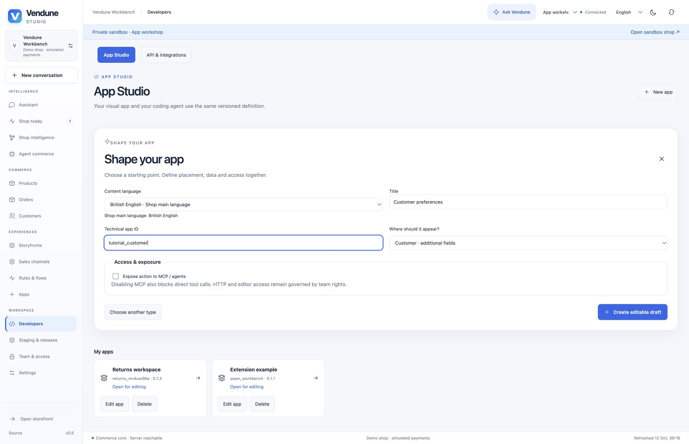
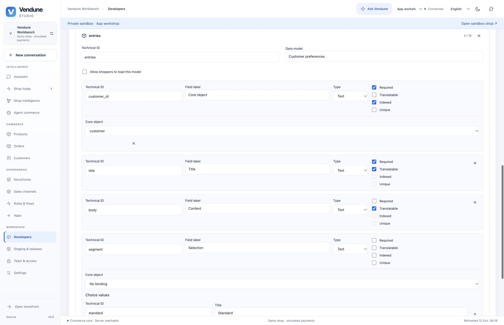
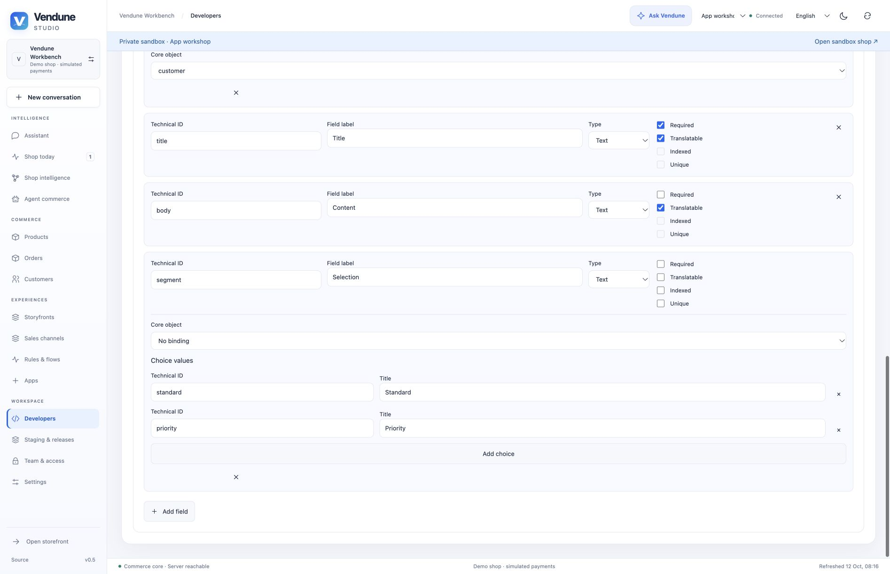

# Workshop 3 — Customer preferences in the existing editor

Create a private customer section with merchant notes and a **Standard/Priority**
choice. The app stores these fields in its own model and links them to an owned
customer. It does not make private customer data public or duplicate the CRM.

[Workshop setup and release steps](README.md) ·
[Installable customer example](../../extensions/apps/assistant-examples/customer.json)

## 1. Configure the assistant

Open **Developers → New app → Admin app**. Enter **Customer preferences**, choose
a unique technical ID such as `tutorial_customer`, and select **Customer ·
additional fields**. Leave **Expose action to MCP / agents** disabled. Create the
editable draft; resolve the replacement prompt only after saving earlier work.



## 2. Keep the customer relation; edit labels and choices

In **Data models**, the assistant supplies required indexed `customer_id` with
**Core object → customer**, translated `title` and `body`, plus `segment` choices.
Keep **Allow shoppers to read this model** off. Rename the displayed labels to
**Preference subject**, **Merchant notes** and **Service level**.



For `segment`, retain technical values `standard` / `priority`; edit their
displayed labels through **Content language**. Changing a caption is not changing
stored choice identity. An unknown choice is rejected by the native validator.



An optional new field can be added with **Add field**. For example, add a boolean
`contact_requested` with a translated label. This records a merchant workflow
request; it is not legal marketing consent and must not replace the existing
privacy/consent owner.

## 3. Place the form and set rights

In **Design**, retain the customer context on table/form blocks. A **Selection**
control can bind to `segment` in that same form. In **Connections**, inspect the
**Customer · additional fields** surface and its actions. Reading requires
`customers.read`; saving requires `customers.write`. Keep public, MCP and AI
access separate and off unless the intended capability is reviewed.

The generated form already uses the native write action. Additional independent
inputs join it only when the model and current record resolve to one form. Do
not turn customer IDs into freely editable text controls.

## 4. Test the actual customer placement

Save/install the version in staging with two synthetic customers. Open customer
A, add a subject/note, select **Priority**, save and reopen. Customer B must not
show A's app record. Try a read-only teammate and verify saving is denied. An
anonymous storefront request must not reveal either customer's records.

Switch to German/Spanish content labels and check main-language fallback. Release
the app package separately from test records, then open **Customers → customer**
with the intended live team role.

## Ask the coding agent

```text
Improve this private Customer preferences app. Add an optional contact_requested
boolean and a translated display label. Bind it to the existing customer form;
keep customer_id, existing choices, stored field types and action rights. Use
customers.read and customers.write. Do not expose personal records to the
Storefront API, MCP or AI automatically. Do not treat this field as marketing
consent. Keep implementation and resources in the app's own directory.
```

## Ownership and regression evidence

The canonical assistant produces a normal Manifest. The repository keeps an
installable result under `extensions/apps/assistant-examples/customer.json`.
`app_assistants` tests real customer/order fields, scope checks, private reads,
MCP opt-out and foreign-reference rejection. The screenshots are actual draft
setup/model views, not evidence that every merchant has installed the example.

[Next: Scheduled review](scheduled-review.md) · [All five workshops](README.md)
