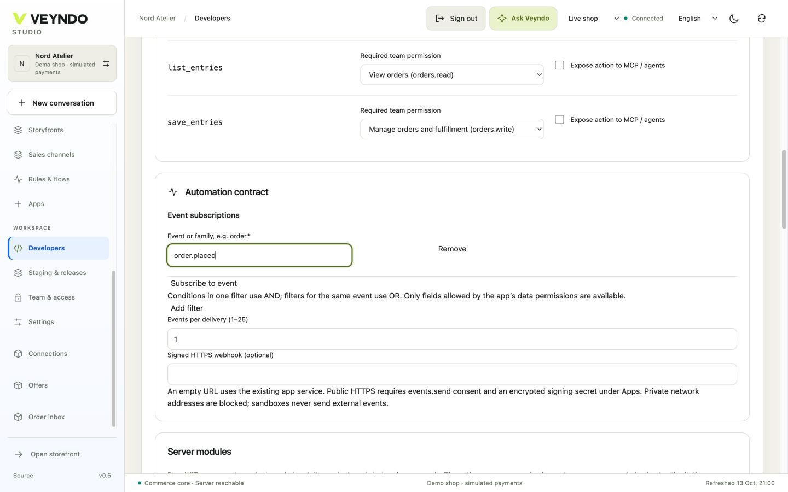

# Workshop 5 — ERP order handoff with a managed workspace

Build an editable mapping workspace and a contract for order-event delivery and
explicit synchronization. The visual app defines data, UI, rights and actions;
an independently deployed, approved service implements actual ERP behavior.
The pattern is not a ready-made integration for every ERP product.

[Workshop setup and release steps](README.md) ·
[Canonical starting package](../../extensions/apps/erp-handoff/manifest.json)

## 1. Open the contract and mapping UI

Choose **Developers → New app → ERP handoff**. The pattern includes private
records, a table/form/save workspace, the `synchronize` service action and an
`order.placed` subscription. In **Data models**, keep stable technical IDs and
add fields for the integration you actually need: for example a merchant-owned
mapping label and an ERP-side identifier. Do not store credentials as app records.

Version 0.2.0 already includes a required indexed `order_id` with **Core object →
order**. The synchronization button validates the same editor and forwards its
owned order ID. Existing pre-0.2 mapping records need an explicit migration that
fills genuine owned order references before schema approval.

## 2. Inspect subscriptions, actions and rights



In **Connections → Automation contract**, inspect `order.placed`, permitted
filters and **Events per delivery (1–25)**. An empty signed-webhook destination
uses the configured app service. A public signed HTTPS destination additionally
needs `events.send` consent and its encrypted signing secret; do not enter an
internal/private-network address as a merchant-controlled destination.

`synchronize` is private, Flow-enabled and requires `orders.write` in the starting
pattern. Its declared input is `{ "payload": { ... } }`. List/save of mapping
records and the native surface already use `orders.read`/`orders.write`.
Keep customer records out of public routes. MCP exposure and merchant-AI tool
selection remain independent decisions.

## 3. Implement and approve the external service

Keep its Manifest, service, assets, translations and tests under
`extensions/apps/<your-erp-app>/` or its separate private repository. Use the
existing [app service/action contract](../app-platform.md) and
[event receiver SDK](../../extensions/sdk/events.py), not a new core route.
The included [Rust adapter](../../extensions/apps/erp-handoff/README.md) is a
runnable implementation in this package. Its SQL receipt store, provider calls,
configuration and tests stay there. The shared signature verifier is
[`extensions/sdk/rust-events.rs`](../../extensions/sdk/rust-events.rs); the
independent Python example remains an optional extension example.

The operator obtains the reviewed package digest through the existing core:

```sh
target/debug/veyndo --app-digest extensions/apps/erp-handoff/manifest.json
```

For an edited/generated app, hash its **actual exported package**, not the unedited
starting pattern. Configure the service through operator-owned `APP_SERVICES`:

```json
{
  "YOUR_ACTUAL_APP_ID": {
    "url": "https://erp-app.example.test",
    "token": "SERVER_SECRET_INJECTED_BY_OPERATOR",
    "approvedDigests": ["RUST_CANONICAL_PACKAGE_SHA256"]
  }
}
```

These are placeholders, not usable credentials. Native workspace UI needs no
custom UI URL. If supplying an opaque custom UI, additionally configure its
exact approved bytes/digest through the existing UI contract. Follow
[service security and callback scope](../app-security.md); a merchant-provided
app ID cannot authorize a new service URL or operator identity.

The service validates the gateway identity/envelope, persists a stable event
idempotency key, translates the order into the ERP's schema and records the
actual external result. An event subscription and a manual `synchronize` action
are separate entry points; do not blindly perform the same external operation
from both. Use a durable service inbox/result for retries and reconciliation.

## 4. Test delivery, restart and denial

Use F5/staging for the managed editor and mapping records; remote calls and
external event delivery are blocked in private previews. For actual integration,
use a disposable live **local** test shop with an approved local fixture service
as the existing integration suite does. Place a simulated order. Verify the
event contains the permitted payload, reaches the expected app/tenant, and
persists one service receipt. Replaying/restarting must not duplicate the external
effect. Missing service configuration must fail visibly rather than pretending
the ERP received the order.

Test the action with allowed and read-only roles; a foreign shop cannot invoke
your installed service or read its records. A callback key grants only explicit
approved app/tenant/package operations, not unrestricted Admin API access.
Publish the reviewed package only after its service configuration and real
integration tests are ready. Test ERP Sandbox/Live separately with approved data.

## Ask the coding agent

```text
Extend this ERP handoff app with private order-bound synchronization cases,
translated status labels and the existing mapping workspace. Preserve existing
field types, service actions and order.placed subscription. Keep MCP/public
access off. Use the current app event SDK and operator-approved service gateway.
Persist deduplication and explicit failed/uncertain results inside the app service.
Keep every app file under its package; add no ERP implementation to the core.
Return the Manifest proposal plus service implementation and integration tests.
```

App Studio can review/import the Manifest; it does not deploy arbitrary service
source. The independent build/deployment and operator approval remain explicit.

## Ownership and regression evidence

`extensions/apps/erp-handoff/manifest.json` owns the starting UI/schema/event
contract. `app_assistants` exercises service-runtime packages with native managed
views and real local service calls; `app_events`, `app_callbacks` and `services`
cover scoped delivery/callback behavior. These fixtures do not establish parity
with a commercial ERP or a successfully deployed custom service.

[All five workshops](README.md) · [Complete app contract](../app-platform.md)

## Run the included adapter

Follow the package README for its app-only database role, schema and operator
configuration. Its POST export expects a JSON `receiptId`; its reconciliation GET
expects the ERP's receipt for the same stable idempotency key. Concurrent manual
and event requests share one durable claim. Timeout or malformed confirmation is
shown as uncertain and requires explicit reconciliation, never blind retry.
The registered `erp_handoff` test runs real Rust processes, PostgreSQL forced RLS
and a local ERP fixture, including restart and denied foreign access.

Optional signed incoming delivery uses `/signed-events` with a configured
`webhookSecret`. Model/MCP exposure stays off unless independently reviewed.
An app receipt is not a payment receipt or a second Commerce order ledger.
