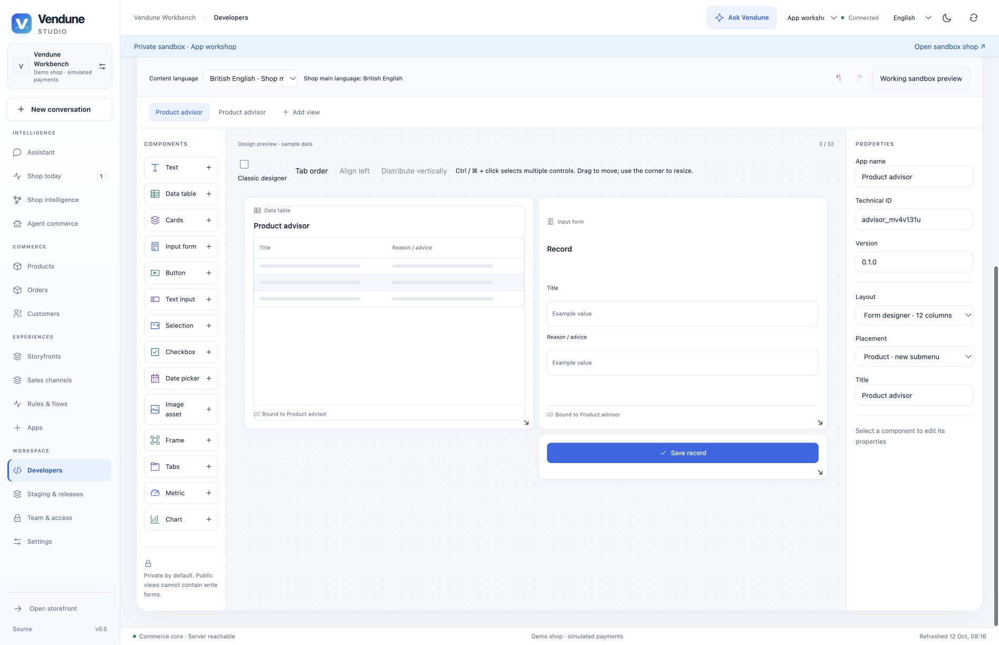
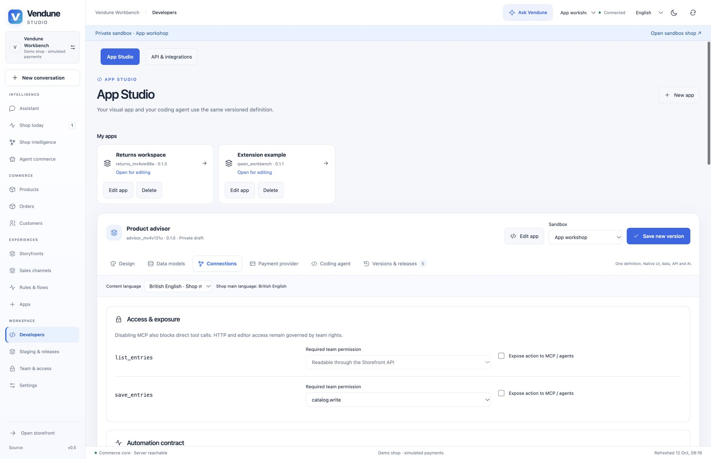

# Workshop 1 — Product care advisor

Build a product editing tab for care instructions and a read-only card on its
product detail page. A merchant manages the advice; shoppers read only explicitly
published product-bound records. No separate frontend database is introduced.

[Workshop setup and release steps](README.md) ·
[Canonical starting package](../../extensions/apps/product-advisor/manifest.json)

## 1. Start with the pattern

Open **Developers → New app → Product advisor** under **Start with a working
pattern**. Confirm draft replacement only after saving other work. The pattern
opens two views: a private workspace and a shopper view. Its generated app ID is
unique; use that actual ID when configuring API or AI access later.



*Actual Design preview. Grey rows and “Example value” are labelled sample data;
they are not saved advice.*

## 2. Shape the fields and interface

In **Data models**, keep the required indexed `product_id` with **Core object →
product**. Rename the displayed model label to **Care guide**. Keep the technical
field IDs stable; set `title`'s label to **Care topic** and `body`'s label to
**Instructions**. Both accept translated content.

In **Design**, select the private view. The pattern already includes a data table,
record form and Save button. Change their captions through the property inspector.
The form and table retain `product_id → productId` context; the selected product
is not an arbitrary editable cross-shop ID.

Switch to the shopper view and retain read-only cards. Do not add a write form
to this public placement. The private surface is **Product · new submenu** and
the public surface is **Product detail**.

## 3. Review exposure and optional intelligence



In **Connections**, verify these separate choices:

| Setting | Value for this workshop |
| --- | --- |
| Model `publicRead` | Enabled for the advice model only |
| `list_entries` | Public, read-only, product-bound |
| `save_entries` | Private, requires `catalog.write` |
| Admin surface | Requires `catalog.read` and allows list/save actions |
| Product detail surface | Allows only the public list action |
| MCP and merchant AI | Off initially; select deliberately if needed |

To let authorized merchant AI consult the guide, select the list tool and model
in **AI & MCP tools**. MCP discovery is a separate per-action setting. You can map
selected fields under **Knowledge graph mapping** with an app-owned node type;
see the [ontology-care example](../../extensions/apps/ontology-care/README.md).
This exposes current app records with their rights/revisions. It does not certify
care prose as a verified product fact or train model weights.

## 4. Test and publish

Follow the [common preview/release loop](README.md#the-same-release-steps-for-every-workshop).
Install into a staging environment containing a synthetic product. Open
**Products → that product → the new app tab**. Save **Washing** / **Wash at 30 °C;
air dry**, close and reopen it. Verify the same saved record appears. Switch the
content language, add its translation, then check main-language inheritance for
an untranslated field.

Publish the package and deliberately select the advice records intended for
shoppers. Open that product's detail page and check its card. A different product
must not display this guide. An anonymous shopper must not save a record; a
catalog-read-only teammate must not update it either.

## Ask the coding agent

```text
Extend this Product advisor Manifest into a care guide. Retain product_id and
product context, the private editing tab and the public read-only product card.
Rename displayed labels, not technical IDs. Add an optional translated warning
field and show it in both views. Preserve catalog.write on saving; leave MCP off.
Use the selected shop languages and main-language inheritance. Keep all app files
under the app's own package. Return a reviewed Manifest edit, not core changes.
```

Review new fields/surface/action exposure before accepting the generated edit.
Saving a care guide alone does not provide conversational shopper AI. For that,
use the existing [product knowledge and answer path](../knowledge-workspace.md)
with its source visibility and configured inference.

## Ownership and regression evidence

The starting model, UI, AST and access declarations live in
`extensions/apps/product-advisor/manifest.json`; the picker clones it through the
shared compiler. `app_studio` and `app_assistants` exercise product mounts,
revisioned writes and public/private actions. `app_ontology` separately exercises
authorized graph projection. The screenshots show the current editor, not a real
customer publication or a paid model call.

[Next: Returns workspace](returns-workspace.md) · [All five workshops](README.md)
