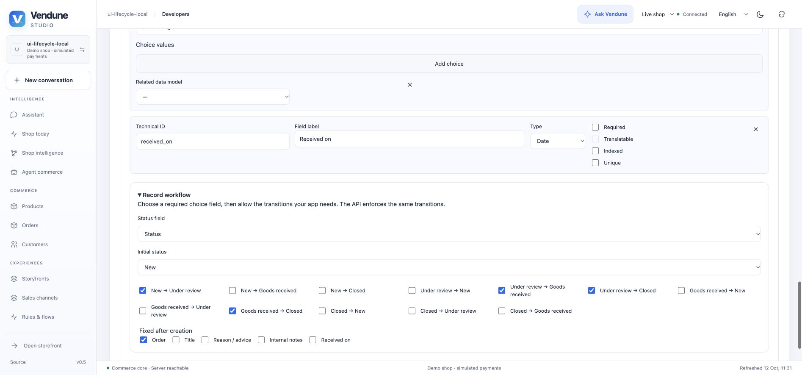
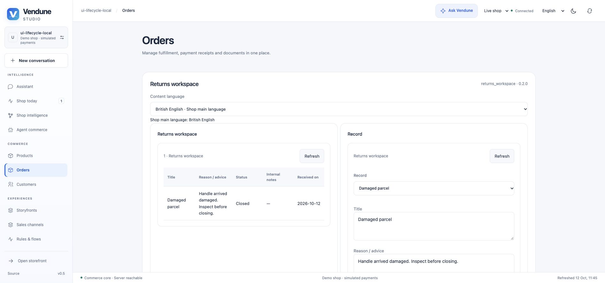

# Workshop 2 — Private returns workspace

Add an order-bound case form for return reasons, review status and internal notes.
Use it inside the order editor, with app-owned storage and existing team rights.
This app handles cases; financial refunds remain in the payment state machine.

[Workshop setup and release steps](README.md) ·
[Canonical starting package](../../extensions/apps/returns-workspace/manifest.json)

## 1. Choose the order-bound pattern

Open **Developers → New app → Returns workspace**. In **Data models**, inspect the
six existing fields before adding anything:

| Field | Purpose | Contract |
| --- | --- | --- |
| `order_id` | Owning order | Required, indexed, `coreReference: order` |
| `title` | Case subject | Required, translated |
| `body` | Reason | Translated |
| `status` | Review state | Required choice: `new`, `review`, `received`, `closed` |
| `received_on` | Date received | Optional date |
| `notes` | Internal working notes | Private plain text |



*Actual 12 October local editor. The app owns its states and immutable order
reference; the shared API enforces the same contract. No returns implementation
files or arbitrary columns are added to the core order module.*

## 2. Edit the workflow visually

In **Data models → Record workflow**, inspect the initial state, allowed transitions
and immutable order reference. The package already owns `new → review → received → closed`
and the alternative `review → closed`. These are enforced by the host transaction;
a payload cannot skip them.

In **Design**, keep the table and form bound to `order_id → orderId`. The Save
button has three instructions: validate the form, call `save_entries`, refresh
the table. Double-click it to inspect code-behind. This pattern's BASIC equivalent is:

```vb
Validate editor
Call save_entries(editor.Record)
records.Refresh
```

It is a bounded encoding of the shared AST. It cannot run arbitrary VBA or call
an undeclared refund endpoint. Add translated captions such as **Return cases**
and **Review case** through the current content-language selector.

In **Connections**, retain **Order · additional section**, `orders.read` for the
surface/list action and `orders.write` for save. Model public access, public
routes and MCP exposure stay off. Enable a Flow action only deliberately; a Flow
still needs current action rights and a valid order reference.

## 3. Exercise the installed staging app

F5 verifies the private runtime, but a fresh F5 environment may have no orders.
For the complete order integration, use a staging environment with a synthetic
order, save the app version and approve its installation there. Open
**Orders → that order → Returns workspace**.

Enter **Size exchange**, reason **The ordered size does not fit**, status **New**
and an internal note. Save, reopen the order and confirm persistence. Change the
status to **Under review**, save, then select Received and Closed with one save per transition. No page
reopening is needed; the form retains the confirmed revision. The record selector
also lets you create another case for that order. This is the case status; the
original order/payment status and amounts must remain unchanged.



*Actual local app at order RAC-cbcfc9f0. New, Under review, Goods received and
Closed each required one save. The received date and Closed state survived
reload; the original order and simulated authorization were unchanged.*

Try the app with a read-only teammate. The editor must not authorize saving.
Attempting a foreign order reference must fail at the backend, without creating
a case for the other shop. Follow the common release steps and release the
package separately from synthetic case data.

## Ask the coding agent

```text
Extend this Returns workspace with a
translated inspection summary. Keep order_id immutable as the owned order
reference. Add a bound date picker in the existing form and retain the validated
save/refresh handler. Keep all records private, orders.read/orders.write rights
and MCP off. Do not initiate refunds or change order/payment states. Use the
same Manifest and app package; do not create a parallel returns subsystem.
```

Inspect how the new input joins the existing form buffer. It must identify one
matching model/record/form. Typing should remain local until the explicit save.

## Ownership and regression evidence

All pattern fields, UI and save instructions live in
`extensions/apps/returns-workspace/manifest.json`. The shared runtime validates
references, rights, revisions and bounded handlers. Frontend pattern tests and
the real `app_studio` / `app_assistants` PostgreSQL suites cover order-bound save,
denied writes and context isolation. No refunds are implemented by this example.

[Next: Customer preferences](customer-preferences.md) · [All five workshops](README.md)
