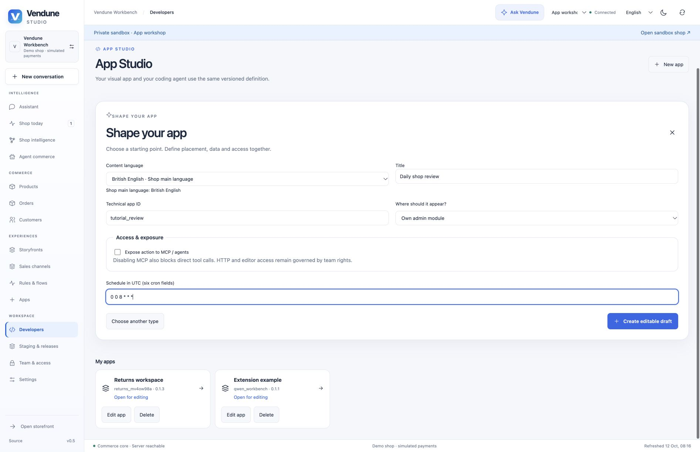
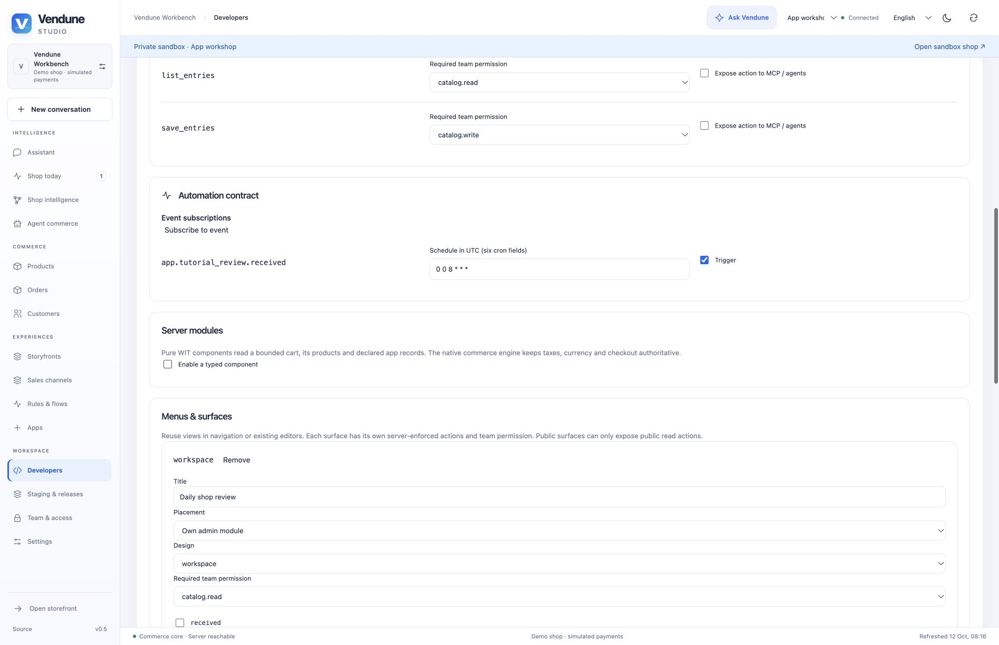
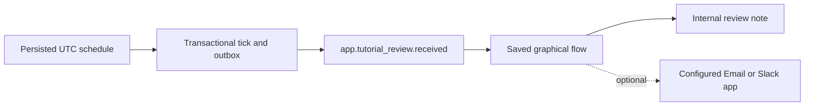

# Workshop 4 — A scheduled shop review reminder

Build a daily reminder with the native scheduler and graphical Flow Builder.
The app emits a typed event at 08:00 UTC; a flow records an internal review note.
Optional email/Slack delivery uses the existing configured connector apps.
The schedule is not a browser timer or an automatically generated stock analysis.

[Workshop setup and release steps](README.md) ·
[Installable scheduled example](../../extensions/apps/assistant-examples/scheduled.json)

## 1. Create the scheduled contract

Open **Developers → New app → Scheduled automation**. Enter **Daily shop review**,
technical ID `tutorial_review`, placement **Own admin module**, and cron
`0 0 8 * * *`. Leave MCP off. Choose **Create editable draft**.



The six fields are **seconds, minutes, hours, day, month, weekday**. `0 0 8 * * *`
means 08:00 UTC daily. It does not track a country's daylight-saving time.
The seconds field must be a single number. `0 */15 * * * *` emits every fifteen
minutes; `0 * * * * *` emits once per minute for a disposable local test.

## 2. Inspect the event and enabled schedule

Under **Connections → Automation contract**, the generated schedule targets the
declared emit action `received`. For this technical ID, the emitted event is
`app.tutorial_review.received`. Changing the app ID changes this event name; use
the actual installed ID in the Flow Builder.



The equivalent contract fragment is:

```json
{
  "schedules": [{
    "id": "recurring",
    "cron": "0 0 8 * * *",
    "action": "received",
    "input": {"payload": {}},
    "enabled": true
  }]
}
```

Keep the private data model for review notes. If changing schedule payloads through
the coding agent, preserve the declared action input schema. The backend accepts
at most eight schedules/app and commits a tick with its outbox event atomically.

## 3. Connect an explicit Flow action

Save/review/install the package. Open **Connections → Open Flow Builder**, or
**Rules & flows → Event flows**. Create a flow listening to the actual app event.
Add an **Internal note** action, such as **Review products, low stock and today's
orders**. Save the flow with translated title/message through the shared content
language selector. Do not make the `received` emit action recursively call itself.



For a Slack extension, use the bundled Slack app and the existing Flow action
with its configured target and consent; [connector setup](../connected-apps.md).
For email, use the existing [Email Delivery queue](../email-delivery.md). Do not
put SMTP calls, webhook secrets or a duplicate scheduler into the app Manifest.

## 4. Test the clock in the right environment

Design/F5/staging can inspect and validate the contract; private environments do
not run schedules or external deliveries. For clock acceptance, publish to a
**disposable live local test shop**, run the existing worker configuration, set
the one-minute test expression and wait for a due tick. Inspect **Flow executions**
for the saved internal note. Restart the owned test process and verify that the
same due tick is not duplicated. Then restore 08:00 UTC or disable the schedule
before leaving the test shop running.

A tick/event does not prove an external message arrived. If testing delivery,
use a local provider fixture or your specifically approved test destination and
inspect the actual provider result. Consumers are at-least-once; remote actions
still require idempotency and explicit handling of unknown outcomes.

## Ask the coding agent

```text
Keep this app's existing received emit action and native UTC schedule. Set it to
08:00 UTC daily and add translated review-note labels. Keep data private, MCP
off and the same action schemas. Explain the emitted event name and how to bind
an Internal note flow. Do not create a browser timer, SMTP sender or second queue.
Keep all resources under the app package. Return a reviewed Manifest edit.
```

## Ownership and regression evidence

The generated app's schedule/actions belong to its Manifest. The shared scheduler,
outbox and Flow owners execute the contract. `app_assistants` verifies actual
persisted ticks, private-stage suppression, replay and cold restart; `automation`
and `automation_lifecycle` cover the native Flow path. The current screenshots
show a configured draft, not a delivered daily notification.

[Next: ERP handoff](erp-handoff.md) · [All five workshops](README.md)
