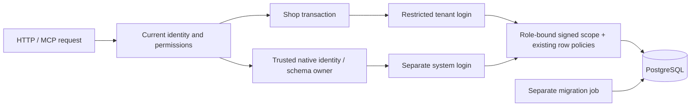

# Authenticated database scope

In enforced signed mode, the ordinary shop connection cannot promote itself by setting `rac.system` or
changing `rac.tenant`. Native identity, worker and schema owners use a separate
restricted system connection. Both remain subject to forced PostgreSQL row
security; the migration login is absent from an ordinary serving process.

## What is enforced

`scoped_pool` begins a transaction, binds its admitted tenant/actor and sends an
HMAC scope ticket through a bound parameter. The ticket is absent from SQL query
text in `pg_stat_activity`. Its signature binds the real database login, tenant,
actor, personal-session classification, key ID, expiry and nonce. Changing a GUC,
using an expired ticket or replaying a system ticket through the tenant login
does not widen access. Scope is transaction-local, including transaction pooling,
cancelled streams and connection reuse.

Migration 099 adds a **restrictive** authenticated policy alongside existing row
policies. Their conditions combine; existing domain and actor policies remain.
Private Studio workspace rows additionally require the signed personal actor.
An integration credential has a distinct actor classification and cannot assume
its creator's personal workspace. New app entity and relation tables receive the
same guard and tenant grants before installation commits. The tenant login owns
no app table and cannot create/drop tables or disable row security.

The tenant login cannot read global sessions, MFA, identity-provider bindings or
platform AI secrets. Merchant identity joins expose only member ID/name/email
columns under the current tenant. The language registry is a shared canonical
reference: a narrowly bounded native function registers deterministic language
IDs without allowing arbitrary global writes. Native inference resolves platform
credentials through its trusted owner; credentials never become tenant API data.

Connector tables retain their independent service role and queue owner. Core's
tenant login has no connector-table grants. This change does not authorize apps
to issue SQL or claim containment of arbitrary native service code.

PostgreSQL explains the relevant boundaries in its [row security guide](https://www.postgresql.org/docs/17/ddl-rowsecurity.html),
[restrictive-policy reference](https://www.postgresql.org/docs/17/sql-createpolicy.html)
and [secure function guidance](https://www.postgresql.org/docs/17/sql-createfunction.html).

## Coordinated deployment

1. Apply migration 099 in the existing owner migration job. It initially stages
   the additional guards so old running replicas keep working. It does not create
   a public endpoint, a password or another authoritative queue.
2. Prepare two distinct restricted login roles. The existing runtime login can
   remain the system login; it must not own core tables, inherit their owner or
   have superuser, RLS bypass or TRUNCATE privileges. A new tenant login must own
   no relations, inherit no roles and have no database/schema creation privileges.
   Passwords belong exclusively in deployment secrets.
3. From the migration job run `veyndo --database-authority configure SYSTEM_LOGIN
   TENANT_LOGIN`. This grants the selected tenant login only the scoped tables,
   safe reference reads and safe identity columns. App schema ownership remains
   with the native system owner. Migration authority can maintain those app tables.
4. Set `BOOTSTRAP_MODE=serve`, `DB_RLS_REQUIRED=true`, `DB_SCOPE_REQUIRED=true`,
   `DATABASE_RUNTIME_URL` to the restricted system connection and
   `DATABASE_TENANT_URL` to the tenant connection. Do not supply the migration
   `DATABASE_URL` to the serving container. Use `DB_SCOPE_STAGED=true` only during
   this coordinated rollout. The two pools share `DB_POOL_MAX` (minimum 4), rather
   than doubling the process/fleet connection budget.
5. Verify every replica uses the new code and connections. Then run
   `veyndo --database-authority activate` through the migration job and remove
   `DB_SCOPE_STAGED`. Startup rejects missing enforcement, role escalation,
   privileged identity grants or tenant tables lacking their restrictive guard.
   A staged deployment is not yet the enforced security boundary.

The CLI's `status` command returns enforcement state and role names, never keys.
New security-sensitive production access uses the normal explicit provisioning
approval; local fixture success is not evidence that production was switched.

## Rotation and verification

`veyndo --database-authority rotate` creates a fresh database-only signing key.
Running servers refresh every minute. Tickets live for five minutes; a retiring
key has a ten-minute verification overlap. A failed refresh cannot remove row
security: signatures eventually expire and access fails closed. Stored signing bytes are
zeroized on replacement/drop and excluded from debug output. This key is specific
to database scope; provider encryption and browser authentication have separate
owners and are not implied repaired by it.

`signed_runtime` repeats the existing two-replica production-foundation flow with
actual separate logins, restart, order/inventory, native documents, current rights,
outbox and app/schema/staging paths. Its SQL adversary connects as the tenant
login, rather than using `SET ROLE` on a migration session. It checks forged tenant
and system values, role-bound/expired signatures, private actor substitution,
identity/key access, DDL denial and key rotation after retiring-key expiry.

The canonical HTTP suite registry is also repeated against the signed runtime
(translation provider fixtures run separately). Existing pure Lean policies
remain unchanged; PostgreSQL, transport, signature integration and deployment
remain tested implementation, not a whole-system formal proof.
