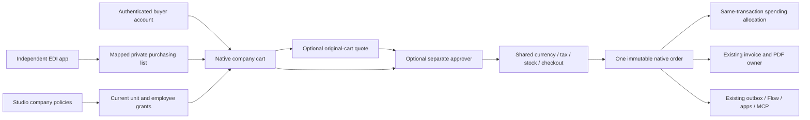
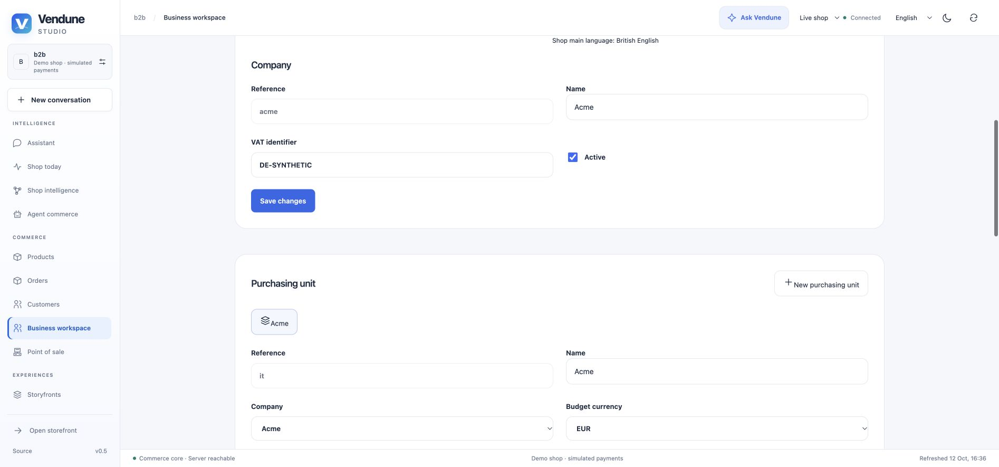
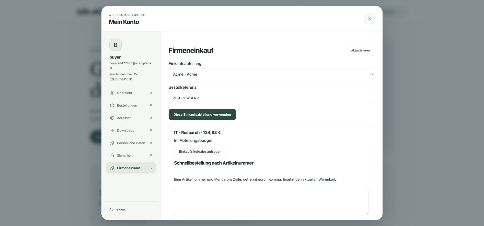
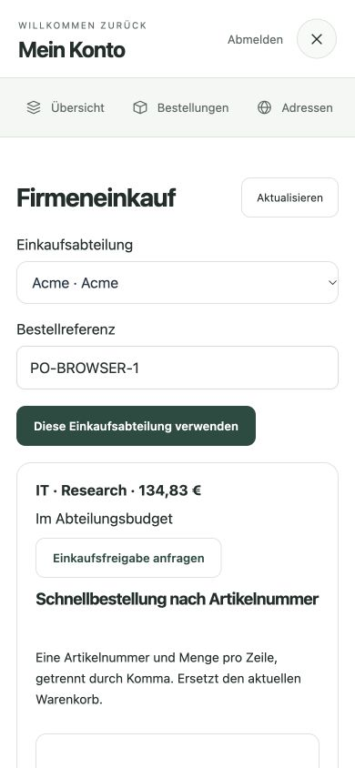
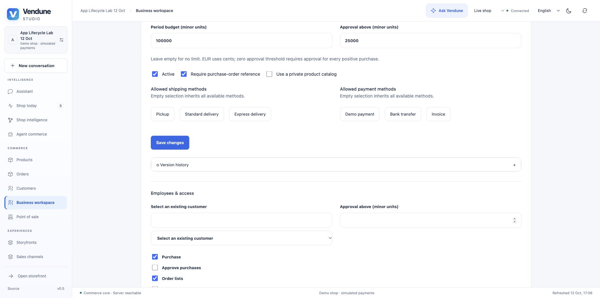

# Modular B2B commerce

Vendune supports company purchasing on the same catalog, currency calculation,
cart, inventory transaction, payment-provider contract, order and document owners
used by B2C and POS. A company is inside one merchant tenant. A sales channel is a
shared selling context; an unrelated SaaS merchant remains a separate tenant.

## Build only the modules a buyer needs

| Module | Configuration / actual behavior |
| --- | --- |
| Organization | Companies, VAT/external IDs, purchasing-unit hierarchy and cost centers. Names use one content-language editor and shop-main-language inheritance. |
| Employees | Assign existing customer identities to units, enable/pause access, choose buying/approval/list/RFQ/unit-order rights and an individual approval threshold. |
| Budgets | Optional unit budget in exact minor currency units, UTC week/month/quarter/year period and unit currency. Parallel orders serialize against the same unit; retries allocate once. |
| Approval | Optional unit and/or employee threshold. Another currently authorized employee approves the exact cart, prices, methods and current policy. Changes invalidate it; self-approval is denied. |
| Catalog | Optional private product selection, searched/paged by native SQL before results leave the server. Parent selection admits native variants; the cart rechecks selection. |
| Checkout policy | Optional required purchase-order reference and allowed shipping/payment methods, selected by their translated native names. Native destination rules still apply. |
| Buying tools | SKU/quantity quick order, private or unit-shared repeat-order lists. Shared reading does not authorize overwriting another buyer's list. |
| Quotes | Request an offer on a current company cart, exchange messages, let the merchant offer integer unit prices and an expiry, accept on the original buyer/cart, release or reject. Native tax, stock, methods and approval still apply. |
| Company history | Explicit unit-wide order permission, shared customer order details, native status/tracking projections and already-issued receipt PDFs. No matching by email. |
| Extensions | Private company/unit admin sections, a read-only authenticated buyer slot, native core references, scoped callbacks, Flow events and MCP commands. |

### Try it

1. Sign in to Studio with `b2b.manage`, `customers.write` and the necessary PII/catalog rights. Open **B2B → New company** and enter the name in the shop's main language.
2. Create a purchasing unit. Choose its currency, cost center and optional budget/approval threshold. Amount inputs explicitly use minor units: `100000` is EUR 1,000.00, not EUR 100,000.
3. Assign two existing customers: a buyer and a different approver. Keep independent rights explicit. Pause access instead of deleting historical identities.
4. Sign in as the buyer in the storefront. Open **Account → Company purchasing**, select the unit and enter a purchase-order reference. Add products, use SKU lines or a saved list.
5. Request an offer or approval. As the merchant, open the quote inbox; as the approver, open that unit's inbox. Review current line items and amount before approving.
6. Complete the ordinary checkout. The resulting order stores the company/unit/PO and consumes the approval/offer and budget atomically. Generate an invoice in the existing order detail; permitted unit colleagues can open the same PDF.

## Browser walkthrough — 12 October 2026

These unretouched captures show a synthetic local merchant and buyer. A unit cost-center edit persisted with actor/revision history; the buyer selected that unit, entered a PO, submitted two SKU lines and requested an approval. No external payment, email or model call was made.

Reopening the account preserves its current unit and purchase-order reference. The unit/PO restoration, independent employee grants, list ownership and one-field language inheritance have UI regressions; approval completion, native order, PDF and Flow effects have HTTP/PostgreSQL acceptance.

### Hosted configuration acceptance

The hosted B2B source tree from PR #93 passed both full CI runs, its migration job completed, and the Core reached Running, 1/1. A synthetic company and unit were saved through Studio, reloaded and reopened with their original EUR budget, approval threshold, cost center and required PO. During this test a digit-led UUID exposed an invalid generated reference; the shared generator now guarantees the native identifier contract, with a regression covering both editors. The capture uses explicit valid references. It confirms hosted configuration persistence, not certified EDI transport or a real provider charge.

## HTTP, MCP and app integration

Merchant commands use `POST /api/b2b/{operation}`. Buyer commands use
`POST /store-api/b2b/{operation}` with the current customer token and, for cart
operations, `sw-context-token`. MCP discovers the same `b2b.*` capabilities;
calling a tool never substitutes for a current customer identity or merchant right.
`b2b.configuration` projects only the shared main/content languages, enabled
currencies and method names; it does not disclose provider credentials.

Examples: `company.save`, `unit.save`, `member.save`, `catalog.save`, `contexts`,
`select`, `quick-order`, `list.save`, `list.apply`, `approval.request`,
`approval.decide`, `quote.request`, `quote.offer`, `quote.accept`, `unit.orders`.
Writes require expected revisions. Errors retain current state; clients must reload
and review a conflicting edit instead of force-overwriting it.

Apps can reference `b2bCompany` / `b2bUnit` through native tenant composite foreign
keys and mount `admin.b2b.company`, `admin.b2b.unit` or `account.b2b`. The buyer
slot is read-only; editable employee administration remains a merchant operation.
The EDI app uses the approved `b2b_requisition` callback to create a private buyer
list, never to impersonate a buyer and purchase automatically.

Events include `b2b.organization_changed`, `b2b.employee_changed`,
`b2b.catalog_changed`, `b2b.list_changed`, `b2b.approval_requested`,
`b2b.approval_decided`, `b2b.purchase_completed`, `b2b.quote_requested`,
`b2b.quote_changed`, `b2b.quote_selected`. Flow actions use the existing dispatcher.
App subscriptions require `events:b2b.*` (or an exact event) and `b2b.read`;
the app projection strips customer identity, addresses and private quote/cart tokens.

## Compared with established B2B suites

[Shopware B2B Components](https://docs.shopware.com/en/shopware-6-en/commercial-features/b2b-components)
and [commercetools Associate APIs](https://docs.commercetools.com/api/associates-overview)
are useful references for organization, employee and purchase authorization.
This is an independently implemented native slice, not copied proprietary code
or a claim of one-to-one equivalence. Vendune implements organization units,
explicit employee permissions, quick orders, repeat lists, quote negotiation,
threshold approvals and unit budgets in the connected path described above.

Still open: delegated buyer-managed employee invitations, sequential/multi-level
approval chains, aggregate parent budgets, negotiated contract catalogs,
credit limits and payment terms/dunning, customer-company addresses, PunchOut,
buyer-specific bulk import wizards, and partner-specific EDI/network certification.
Parent hierarchy currently organizes units; it does not imply role inheritance.
Budgets measure placed orders (including pending payment), not financial settlement;
only admitted order cancellation releases their allocation. Currency/period changes
are denied while unreleased allocations exist, preventing edits from erasing spending.

## Evidence and limits

The registered `b2b` suite uses actual HTTP/PostgreSQL, synthetic customers and
simulated payments. It checks foreign/self denial, stale approvals and quote offers,
parallel budget contention, private search/detail/cart scope, unit-cycle races,
revocation, current MCP schemas and existing unit receipt PDF access. EDI's own
suite additionally checks import → private list → native checkout and immutable
outbound documents after a gateway restart. No real partner transport is implied.

Two extracted production policies have Lean properties: no budget admission above
the remaining balance, and no unauthorized/self/stale approval admission. The
surrounding database, async code, provider APIs and UI are tested, not formally proved.
See [EDI](edi.md), [source ownership](../src/b2b/README.md),
[formal boundary](formal-verification.md) and [multi-currency](currencies.md).

The private-catalog check also filters variant siblings before detail pagination. A real B2B purchase emits `b2b.purchase_completed`; the isolated acceptance configures a standard Flow Builder action and verifies the resulting native order tag. Approval/RFQ snapshots exclude cart bearer tokens. Existing tenant business-price/Wasm policies remain active.
