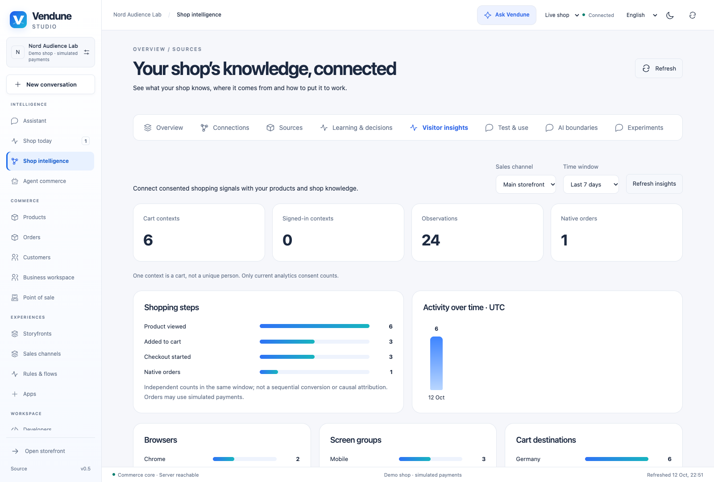
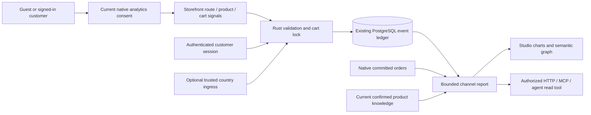
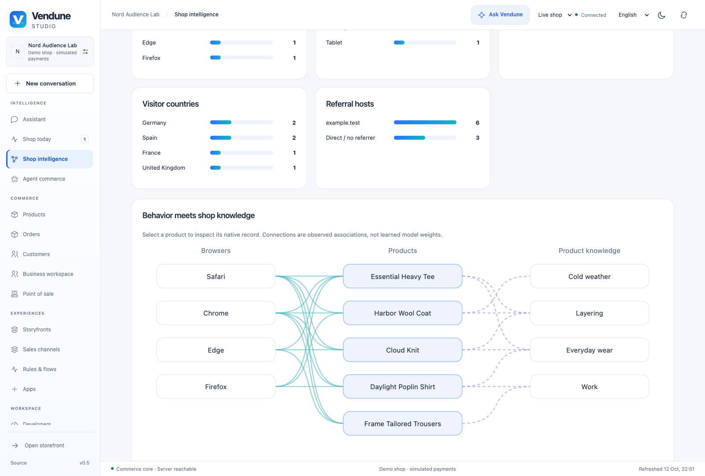

# Visitor behavior and shop knowledge

Vendune can record **consented first-party observations** for guests and signed-in
customers, then connect them to current products, native orders and the existing
semantic product graph. Open **Studio → Shop knowledge → Visitor behavior**.
Choose a sales channel and a one-, seven- or thirty-day window. This is a native
Rust feature with the same HTTP/MCP permissions as the rest of Studio.



*Isolated synthetic Nord Audience Lab: six admitted guest contexts, 24 observations
and one simulated native order. These are demonstration observations, not public
traffic or validated unique visitors.*

## Follow the real path



The graph shows browser groups → observed products → confirmed product intents.
For example, several consented mobile contexts may view the same shirt. Its
existing knowledge relationship may connect it to “everyday wear”. That is an
inspectable connection between observations and product knowledge, **not evidence
that the browser caused a purchase or that a model learned a new fact**. Behavioral
edges are derived at read time; private visitor histories are not permanently
copied into `knowledge_relations` or an embedding index.



*Solid edges represent consented observations; dashed edges come from existing
confirmed product knowledge. Select a product to open the native product view.*

## What is recorded

| Observation | Stored dimensions and meaning |
| --- | --- |
| Page/product view | Named surface and optional admitted product ID; no complete URL/query string |
| Cart increase | Product ID only after the native cart actually contains that product |
| Checkout opened | Observed checkout opening; not payment confirmation |
| Search used | Event only; no search text |
| Product question answered | Product ID only; no question or answer text |
| Browser/device | Coarse browser family and viewport class; no raw user-agent |
| Language | Native enabled content locale |
| Referrer | Optional external hostname only; no path/query |
| Cart destination | Current checkout country, explicitly separate from visitor geography |
| Visitor country | Only an authenticated, operator-configured ingress country; otherwise unknown |
| Customer association | Native authenticated customer ID, never a client-supplied identity |
| Purchase | Joined from a real committed native order; clients cannot post purchase events |

A **context is an existing cart context**, not a unique human. Anonymous users may
have several carts; login may rotate a cart. Reports count those contexts honestly.
The shopping-step cards are independent counts, not an ordered attribution funnel.
Bot detection, duration, abandoned-cart prediction, marketing attribution, session
replay and causal conversion/learning are not implemented by this slice.

## Consent, permissions and retention

The native frontend records after affirmative `analytics` consent and suppresses
channel preview and staging UI. The Rust endpoint rechecks current policy version,
receipt expiry, channel, cart and product admission. Consent withdrawal and writes
serialize on the same cart lock. Withdrawal deletes that context's analytics;
withdrawal of personalization remains independent. Completed carts cannot accept
new events. Records expire after the configured retention (default thirty days,
range one to thirty), are immediately excluded from read models, and are removed in batches of at most 1,000 by the existing minute worker.

**Settings → Legal & privacy → Privacy choices** controls native observation
activation, retention days and events per cart/hour. These fields belong to
`legal.behaviorAnalytics` in the existing revisioned commerce settings; sales
channel overrides inherit independently. Reports clamp their requested window to
current retention, and disabled analytics yields no eligible observations. The
consent response exposes `behaviorAnalyticsEnabled`; the native frontend obeys it,
and the server enforces it again. Changing legal configuration changes its policy
fingerprint, so an old optional consent cannot silently authorize a new policy.
Direct staging/preview capture returns 403, including custom API clients. Settings
can be reviewed/published from staging; observations cannot. Longer retention is
not enabled by this slice. Native expiration removes records in bounded batches;
policy changes do not claim an immediate physical purge of previously stored rows.

No new tracking cookie, fingerprint or stable cross-shop identity is introduced.
Raw IP addresses, raw user-agents, search/question text and arbitrary custom event
payloads are not stored. Identical event IDs are idempotent; conflicting replay
returns 409. A cart context admits at most its configured hourly limit (default
500, range one to 500). Reports and drilldowns
are bounded rather than returning entire histories.

`knowledge.read` permits aggregate reports. **`customers.pii` is additionally
required for individual timelines**; `customers.read`/`orders.read` govern native
CRM/order links. Customer references in these private responses may contain email
because the existing CRM route uses email as its key. They never enter the general
agent read-tool list. Deleting otherwise unreferenced products/customers clears only the corresponding
nullable analytics reference; removing a cart/channel removes its observations.
Existing financial dependency guards remain authoritative. Tenant RLS and composite
foreign keys protect cart, channel,
product and customer ownership independently of API object predicates.

A visitor can export or erase the current context through the same cart token.
This does not erase financial orders. Policy and consent configuration remain in
Vendune's existing legal settings; this feature does not certify legal compliance.

## Native API and MCP

| Interface | Scope |
| --- | --- |
| `POST /store-api/behavior/events` | Consented open cart, minimal typed event |
| `GET /store-api/behavior/events` | Current cart's unexpired observations, at most 100 plus truncation flag |
| `DELETE /store-api/behavior/events` | Current cart's analytics, personalization untouched |
| `POST /api/knowledge/behavior` | `knowledge.read`; days 1–30 and `salesChannelId`, default channel |
| `POST /api/knowledge/behavior/journey` | `customers.pii`; native hashed context reference |
| MCP `knowledge.behavior` | Same report, current permissions and channel/window |
| MCP `knowledge.behavior.journey` | Same private drilldown; hidden without PII permission |

Example event (send normal native shop/channel/context headers):

```json
{
  "eventId": "b3ade20709b64b7b943926ef58ac36a5",
  "kind": "product_view",
  "productId": "tee",
  "surface": "product",
  "viewport": "mobile"
}
```

The same report is available to the existing bounded merchant agent read loop.
No separate AI pipeline or automatic model training is introduced. Storefront capture
is installed in the **native Vendune frontend**. Storyfront, POS and other headless
frontends can use this contract, but require explicit consent-aware adapters; their
installation alone does not mean these observations are being recorded. This feature
is independent of the Google Analytics app and its opt-in tag/provider service.

## Trusted geography setup

Optional `BEHAVIOR_GEO_SHARED_SECRET` is server-only, 32–256 bytes. A trusted proxy
must strip client-supplied geography headers, authenticate its own requests with
`x-vendune-geo-token`, and supply a validated ISO country as `x-vendune-geo-country`.
It must resolve geography before proxying; Vendune does not install a GeoIP provider
or infer visitor location from the shipping address. Never expose this secret in a
browser bundle. Invalid tokens or unassigned country codes remain unknown. This
optional ingress has been tested with synthetic requests, not configured on public
hosting by this change.

## Owners and verification

- `src/cognition/behavior/{input,capture,geography,report,journey,mod}.rs` owns native admission, minimal observations, reports, private drilldown and retention.
- `migrations/081-behavior-intelligence.sql` extends the existing ledger and indexes without a parallel analytics database.
- `frontend/src/storefront/shell/BehaviorAnalytics.tsx` owns consent-aware capture; `ProductQuestion.tsx` emits only a successful product ID observation.
- `frontend/src/admin/intelligence/behavior/` owns the charts, semantic graph and linked private timeline; `behavior-i18n.ts` provides EN/DE/FR/ES vocabulary.
- Registered `behavior_intelligence` exercises actual PostgreSQL, consent, replay, native order/customer association, MCP, permissions, foreign tenants, expiration and bounded intake. `tenant_isolation` checks the new composite references; related legal/account/knowledge suites preserve existing behavior. UI regressions verify capture, navigation, translations and failure recovery.

This is tested behavioral functionality, not 100% coverage or a formal proof of the
SQL, browser, proxy or asynchronous worker. Existing extracted consent predicates
are reused; the new reporting adapters remain outside the Lean proof boundary.
