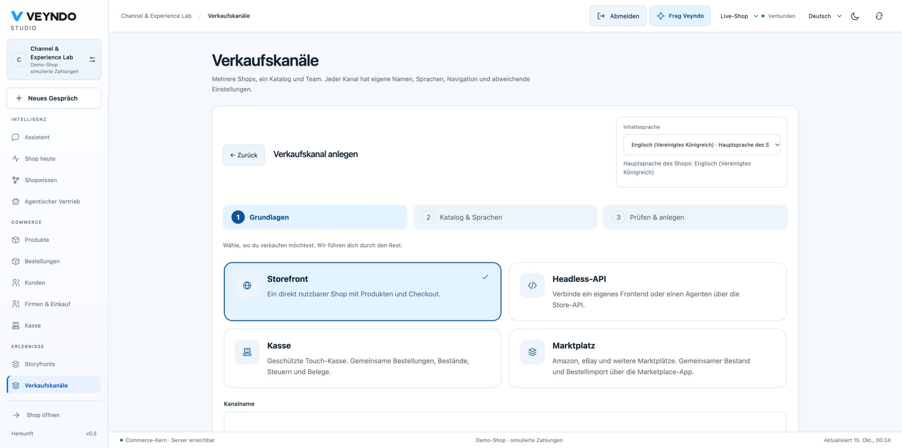
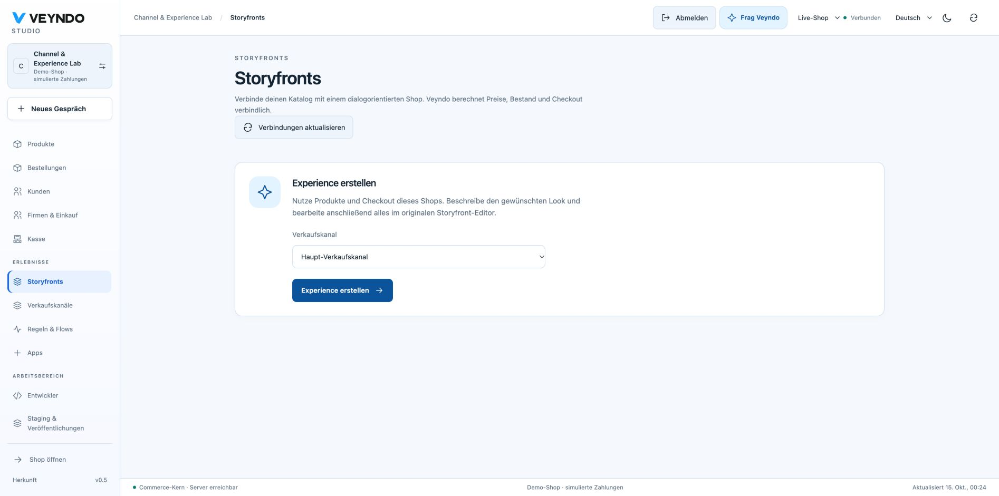
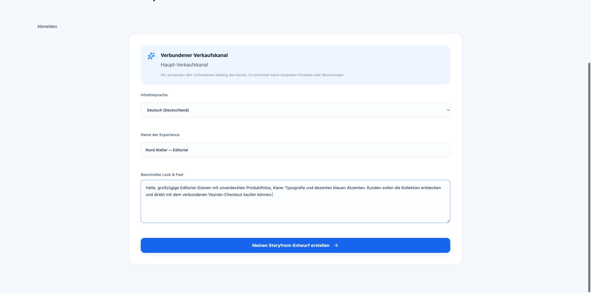

# Create a channel, connect a marketplace, build an experience

One shop can sell in several ways without copying its catalogue, customers or
orders. Sales channels select a native commerce context; independent SaaS shops
remain separate tenants.

## 1. Start with where you want to sell

Open **Sales channels → Create sales channel**. Choose Storefront, Headless API,
Point of sale or Marketplace. The cards explain the purpose and show the current
selection. A new draft hides its technical identifier and starts in the shop’s main
content language. Missing required fields are marked next to their controls.

Continue with catalogue/languages, then review. Whole catalogue and the main shop
language are selected initially. POS asks for its location; storefront/headless
channels expose public/private visibility. Marketplace/POS are authenticated native
integration contexts, not public Store API storefronts. Names use the shared
one-language editor and main-language inheritance.

After saving, a completion card offers the next step. **Manage channel** returns to
its existing revisioned editor, dependencies, history, inherited settings and
pause/delete actions. Creating a channel does not connect an external provider or
publish a Storyfront.

## 2. Enter Marketplace Studio in context

**Open Marketplace Studio** keeps the current Studio and channel. If the app is
missing, review its exact package and permission changes in the existing consent
dialog. If paused, activate it with app management permission. The app-owned
Marketplace panel then opens directly; **Connect marketplace** preselects the
channel you just created. Existing app deep links also open the selected app.

The independent Rust marketplace service still owns seller authentication,
projection, sync and inbox. Seller credentials are server-side aliases; enabling
an app is not a live Amazon/eBay/Kaufland account connection. Mapping previews,
explicit synchronization, reviewed paid order intake, invoices and Flow events
remain the [existing marketplace workflow](marketplaces.md).

## 3. Connect Storyfront to the shop you already have

Open **Storyfronts**, choose an active public storefront channel and select
**Create an experience**. Hosted Veyndo opens its existing Experience service with
public shop/channel identifiers. No bearer token or customer information is put
in this URL. If there is no Experience session, use your existing merchant login
or the configured verified email/OAuth path. You can sign out to switch accounts.

Confirm the experience name, select an enabled content language and describe the
look and feel. The service checks current Core membership, app/channel management,
settings read/write and catalogue read rights. Invalid/foreign/paused/private/POS
or marketplace channels are refused before a job is created. It never trusts the
URL as authority.

The existing durable creation job reuses the current tenant/channel and imports
that catalogue into the **original private Storyfront**. It does not create another
commerce shop or duplicate products. Retries reuse saved progress; a changed channel
revision requires review. Only enabled channel languages are imported. Continue
in the original Studio to edit, generate, preview and go live. Drafting is not
publication; native checkout, stock, prices and orders remain in Veyndo.

```mermaid
flowchart LR
    Admin[Storyfronts: select channel] --> Entry[Existing Experience sign-in]
    Entry --> Rights[Current Core rights and channel]
    Rights --> Job[Existing durable creation queue]
    Job --> Native[Original Storyfront import and editor]
    Native --> Publish[Original Go live and current admission]
    Publish --> Domain[Existing hosted frontend binding]
    Domain --> Checkout[Same Veyndo catalogue and checkout]
```

Rights are checked again at original Studio requests and after asynchronous live
confirmation before selecting its renderer or queuing welcome mail. Revoked access
cannot fall back to an owner broker exchange. Connected shops cannot use the old
separate React design mutation endpoints.

## Hosting and verification boundaries

Hosted `*.veyndo.ai` uses `https://experience.veyndo.ai/connect`. Self-hosters can
supply the public build setting `VITE_EXPERIENCE_ORIGIN` with a plain HTTPS origin
(loopback HTTP is allowed for local development). Server keys, seller credentials
and Storyfront implementation stay private. The normal storefront/POS/marketplace
channel creation flow does not silently install Storyfront.

Screenshots above show a disposable local shop. Browser checks cover native channel
creation, inline errors, in-place Marketplace installation/entry, channel
preselection, Storyfront entry, existing merchant login and actual queued creation.
The isolated private regression uses the original manifest adapter with local
protocol fixtures to reach `studio`, rejects changed jobs/current rights/revisions
and tests revocation during native live confirmation. It performs no paid model,
real seller, email or purchase call. Original hosted generation/publication and
seller acceptance require their configured live services; these screenshots alone
do not prove those external effects. See [channel security](channel-management.md)
and [the original Storyfront integration](storyfront.md).
