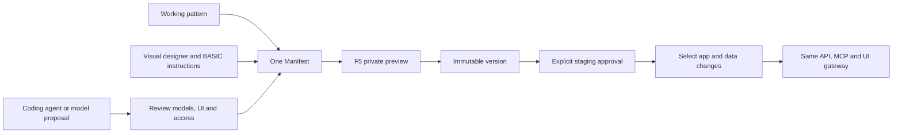

# Connected creation and app workbench — 12 October 2026

This change extends existing owners. It does not introduce a second app language,
translation queue, checkout or model registry. Hosted availability is a separate
acceptance step; the checks below use isolated shops and local provider fixtures.

## Build an app with a working starting point

Open **Developers → New app** and choose Product advisor, Returns workspace or
ERP handoff. Each opens an ordinary editable Manifest with translated labels.

| Pattern | Included | Explicit boundary |
|---|---|---|
| Product advisor | Owned product reference, private editor and public read-only product card | Advice content; an autonomous AI adviser requires its explicit app action/tool configuration |
| Returns workspace | Owned order reference, case reason, status and internal notes, validated save | Private merchant case handling; no shopper returns portal or automatic refunds |
| ERP handoff | Existing service/action contract and order-placed event subscription | An operator must deploy/configure the external ERP service; previews cannot contact it |

The existing Visual Basic-style designer, F4 property inspector, typed code-behind,
model workspace wizard, F5 preview, undo/redo, private drafts and versioned release
remain the same system. Buttons and fields bind to the real app gateway.
New data controls inherit the current product/customer/order binding when the
existing controls on that model agree. Changing the selected model uses that
model's binding. Ambiguous or unrelated bindings are not guessed; the property
inspector still lets you choose explicitly. Missing host context never triggers an
unfiltered request.

Both in-app model generation and coding-agent JSON imports now produce an explicit
review. They do not replace the current canvas automatically. A changed draft or
selected environment blocks acceptance. Rejecting a proposal keeps the current
draft; the immutable server build is still visible in version history and can be
archived through the existing controls.

Generation supports the native input/button/image/frame/tabs/KPI/chart vocabulary,
not only table/cards/form/text. A local model receives an 8,192-token output ceiling
for app definitions instead of the 2,000-token ceiling for smaller tasks. This is a
maximum, not a guarantee of complete or correct output. Model quality itself was
not benchmarked against a paid/live model in these hermetic checks.
Existing-app editing now asks for bounded RFC 6902 changes instead of rewriting the
entire Manifest. The model sends JSON-encoded patch values; Rust applies them to a
clone, preserves storage/access contracts and assigns the next free patch version.
The resulting normal Manifest passes the same native validator and immutable-build
path. Empty/no-op proposals, protected metadata, invalid pointers and destructive
schema edits fail before a build is saved. Creation without a current Manifest
continues to use the complete native schema. No second app language/runtime exists.

The initial full-regeneration Qwen checks did not reliably add the requested
controls. After targeted editing and concrete instruction/raster examples, a real
local Qwen 3.6 35B call added the requested notes textbox and validated save button
in 4.8 seconds, with all four configured translations and order context preserved.
The generated button saved an edited form in the real browser through the native
gateway; explicit control refresh now reloads persisted values and clears an old
record value. Typing remains local until an explicitly bound action runs.
This is one observed task, not a model-quality benchmark or general guarantee.
Preview and proposal review remain necessary; patterns are the deterministic start.

Existing app identity, persisted entities/field types, core references, validation,
public exposure and surface/action rights survive generated edits. External service
runtime, event/schedule/webhook metadata and manual actions are retained. The model
cannot remove persisted fields or silently expose private order/customer data.
Handlers of matching controls are retained recursively inside frames and tabs.
Invalid output is rejected by the existing native validator; no automatic paid
repair loop or arbitrary executable code is added.

## A connected merchant translation task

Enable the target language, then ask the merchant assistant to prepare missing
translations for the **whole catalogue**. Review and approve the proposed target.
The approval atomically creates one job in the existing translation queue. Repeated
approval returns the same task/job identity. No autonomous translation application
is permitted.

The applied proposal links directly to **Settings → Languages**, with the job
selected. Review the drafts and apply selected products with optimistic revision
checks. Existing translations are retained. Product history and restoration remain
in the native product owner. Changed settings invalidate stale proposals.

This is a catalogue translation task, not a claim that a collection-specific
France launch automatically configures domains, tax, shipping or sales channels.
Those remain explicit existing configuration operations.

## Creation recovery and personalization

The companion private Experience change records completed product IDs and caches
translations in the same encrypted leased job. Resuming skips committed products,
orders parents before variants and preserves the original Storyfront build/editor
path. Stage changes clear obsolete counters; displayed completed counts no longer
add one before a product actually finishes. Progress history is bounded to thirty
stage/detail transitions. Visual inputs are not refetched after a saved design
revision when publication can resume without them. Image requests retain their
existing unknown-outcome/paid-retry rules.

Storefront personalization now explains its category signals and explicitly states
that authoritative prices are unchanged. Local preference state is scoped to shop
and cart; delayed responses cannot reorder a different shop/cart. Withdrawal of
consent restores ordinary ordering. The response includes machine-readable signal
weights/window/scope, not a causal lift claim. Existing fixed-horizon randomized
layout experiments remain the measurement owner; no fabricated improvement is
reported.

## Responsibility and repeatable checks

| Owner | Change and evidence |
|---|---|
| `frontend/src/admin/developer/app-recipes.ts`, `AppRecipes.tsx` | Patterns compiled through the existing wizard; UI tests exercise an owned order-bound save without refund calls |
| `AppProposalReview.tsx`, `app-proposal.ts`, `useAppStudio.ts` | Explicit review, staleness protection and same native version lifecycle; frontend interaction tests |
| `src/developer/generation_edits.rs` | Bounded JSON Patch model wire, atomic Manifest edits and host-assigned versions; no app runtime |
| `src/developer/generation_contract.rs` | Existing schema/access/integration preservation; rejected removal/type-change unit cases |
| `src/planner.rs`, `proposal_apply.rs`, `translations/routes.rs` | One approved translation job owner; actual Rust/PostgreSQL planner/approval/restart/isolation suite |
| `src/experience.rs`, `usePersonalization.ts` | Explainable category ordering and scope/consent boundaries; existing controlled experiment suite and late-response UI regression |
| Private Experience `onboarding-catalog.ts`, `job-lease.ts` | Actual worker import loop checkpoint/retry and real leased PostgreSQL progress tests |
| Private Payments `onboarding_referral.rs`, `webhooks.rs` | Durable referral identity and disconnected-account guard; real private/public Rust/PostgreSQL local PSP contract |

Run the frontend suite, Rust units/clippy, and registered integration suites
`app_generation`, `translations`, `app_assistants`, `app_studio`, `app_preview`,
`checkout_handoff` and `cognitive_experiments`. Use a disposable database.
`app_generation` performs local HTTP inference contracts, not actual model inference.
The private repositories retain their own checks and native runtime acceptance.
The formal policy checks do not prove SQL, UI, model or external provider correctness.

Private Shopware Payments additionally verifies lost-referral replay, explicit
merchant disconnect, signed account callbacks, capture, authorize/void, pending
refund reconciliation, process restart and scoped SEPA input. Actual authorized
PSP Sandbox/Live onboarding, every browser wallet/3DS variant, load behavior and
complete original plugin parity remain separate acceptance requirements.

Local acceptance for this update: 193 Rust units; 414 frontend tests; four-language
localization and exact module inventory; 216 private Experience tests plus 17
integration cases, packaged-runtime boot and PostgreSQL process restart; eight
private payment units plus the actual two-service PostgreSQL/PSP-fixture path.
The documentation build verifies every Markdown source and its rendered page.
