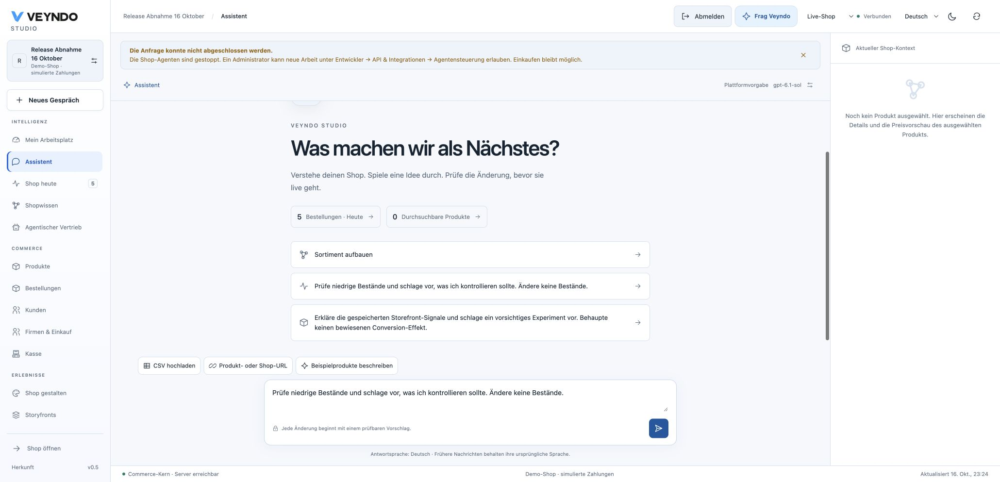
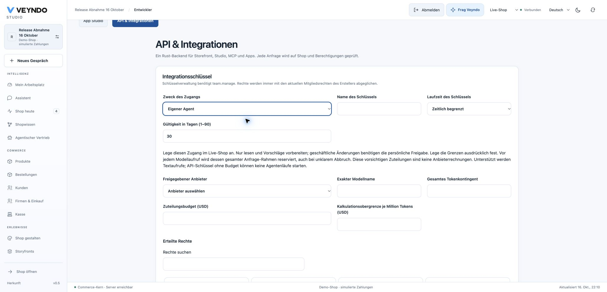
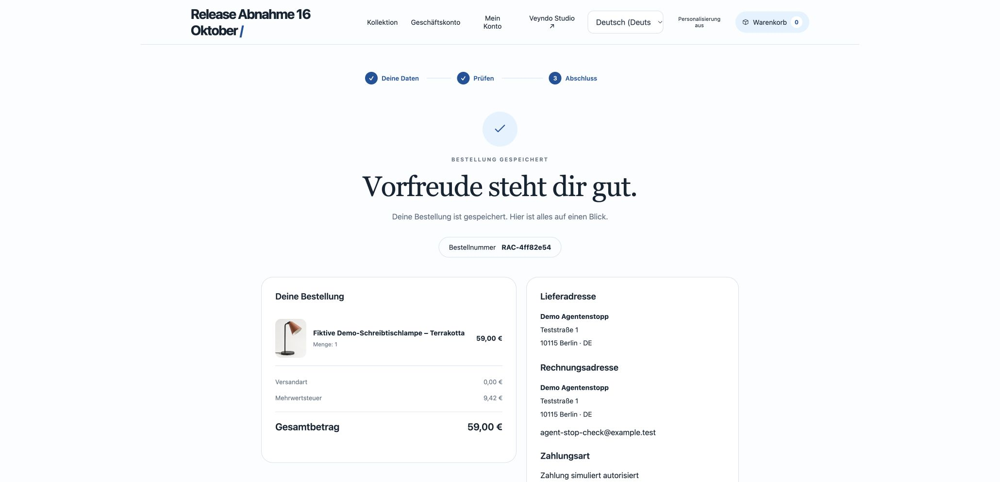
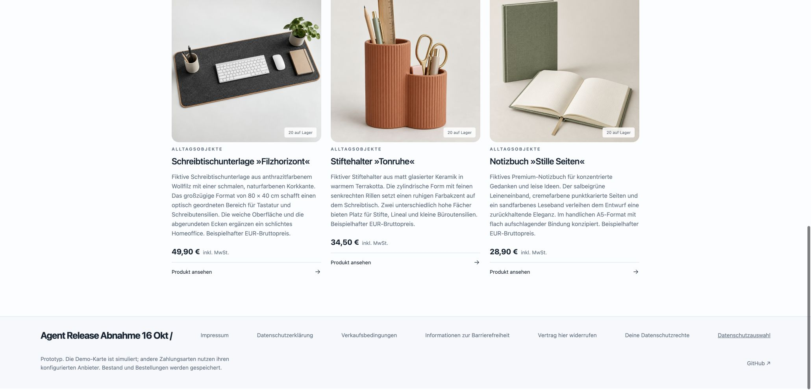
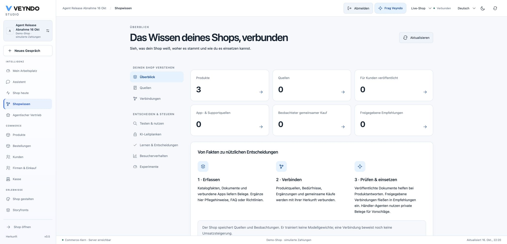
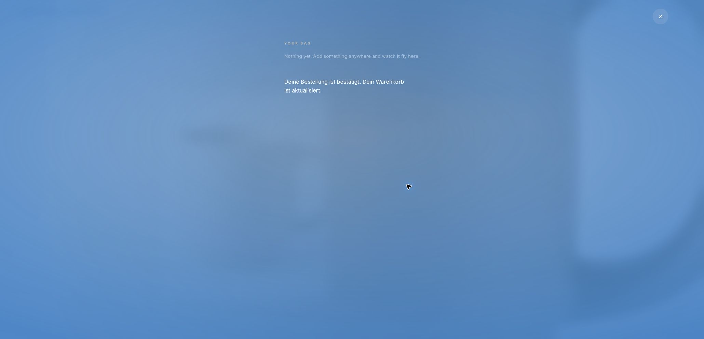

# Planning-agent control and hosted acceptance — 16 October 2026

## Release identity

The agent-authority implementation in [PR 148](https://github.com/sthamann/veyndo/pull/148)
merged as `dac31fa49aceabdd90973fe76abf757b9ea49978`. Its tree is identical to
reviewed head `593d954`; the [required complete CI](https://github.com/sthamann/veyndo/actions/runs/38955696471)
passed, with 274 Rust workspace tests and 623 frontend tests. Measured Rust line
coverage was 88.07%, frontend line coverage 66.76%; unchanged regression floors passed.
Those percentages have distinct scopes and are not proof of complete coverage.
The [merged-main full repeat](https://github.com/sthamann/veyndo/actions/runs/38958712373) also passed.

The protected sequential Northflank release `c8d19957-5c52-4cb2-925c-814c5d0164b7`
built `foamy-passenger-5421` from that exact main commit. A fresh PostgreSQL snapshot
`26-10-16-200716-backup` completed before migration job
`7e8c8d1c-fa08-440a-a81e-acf0070bb95b`. The job used the same commit and exited zero
with “Migration-only setup complete”. This version registers migration 104.
The deployed Core pod `vendune-core-5b7b5bdc9c-fdl2x` was observed running with
1/1 readiness and zero restarts; `/health` returned `status: ok`.
The original private Experience release remains `b40b386`.

## Verification repairs

Earlier failing runs remain visible. The large-future regression was repaired by
boxing the authority child before polling, without increasing worker stack limits.
Non-key live-root locks retain control serialization while allowing commerce
foreign-key reference readers; an actual held-reference test covers the former
lock inversion. The app-surface fixture now asserts that a generic unbudgeted key
causes no new model request or app mutation, rather than inspecting a preceding
owner's request. No coverage floor or admission requirement was relaxed.

## Actual public journeys on that image

| Journey | Observed result |
| --- | --- |
| Agent access UI | Dedicated-agent selection exposes explicit provider/model, token allowance, USD allowance and tariff; grants become planning/read-only. No production agent credential was issued for this test. |
| Personal stop and re-enable | Existing synthetic release shop displayed stopped state after confirmation; a new merchant-assistant request was denied. New work was subsequently allowed again; old cancelled work is not automatically restarted. |
| Shopping during agent stop | Native simulated lamp order `RAC-4ff82e54`, EUR 59.00, German saved confirmation and empty native basket while merchant agents remained stopped. |
| Fresh SaaS shop | `agent-release-abnahm-0054aa7088`: three fictional German stationery products, explicit preview acceptance and three generated product images. Studio one-use handoff completed; the three names/prices/stock matched the native product grid and public catalogue. |
| Shop knowledge | Fresh shop overview displayed three products, the grouped knowledge navigation and clear empty/source states. This is no claim of automatically learned commercial benefit. |
| Original Storyfront embedded purchase | Fresh normal Chrome tab: contact/address fields inside the original Experience iframe, simulated German cup order `RAC-d49d840f`, EUR 24.90, return to Experience, original bag “Nothing yet” and confirmed-order cart-update message. No switch to the standalone storefront was needed. |
| Password session | Existing password account in separate incognito: sign-in, reload persistence, sign-out and protected-route return to login passed. No password changed/saved; ordinary Google-owned merchant session remained separate. |

The stop rejection revealed an actionable-message gap: the old localized generic
permission text remained hidden under a technical-details disclosure. PR 149 is a
frontend-only correction for explicit localized stop/model/budget recovery guidance.
Its [required full CI](https://github.com/sthamann/veyndo/actions/runs/38961204495) passed with 627
frontend tests; it merged as `8b461a1e21cf4e09c9d577bb9d108f93b55f3f0b`, tree-identical to reviewed
`f31de10`. Protected release `7eb05704-1730-4d44-b414-fe90308ea0e4` built `bustling-bulb-1104` from
that exact merged main. Its fresh snapshot `26-10-16-210305-backup` completed before job
`d7f403ce-1a08-46dd-b3d0-490604671d45`, which exited zero with “Migration-only setup complete”. The
new pod `vendune-core-796566ffd7-djblz` reached 1/1 passing health checks with zero restarts and
`/health` returned `status: ok`. The public German assistant visibly explained the active stop and
the exact Developer → API & integrations → Agent control recovery path without opening technical
details. The stop was then explicitly lifted; the control displayed “Agenten dürfen arbeiten”. Old
cancelled work was not restarted. This message-only release leaves the earlier journey evidence and
its source boundaries above intact.

## Connected empty-preview follow-up

The final public stop check exposed another presentation error: an empty product
selection was described as requiring sign-in, despite a connected merchant session.
[PR 150](https://github.com/sthamann/veyndo/pull/150) separates those states in the
existing preview component and all four interface languages. Its reviewed source
`a20c14b` and merged main `35e12ee` have identical trees. The actual component test
covers both states; all 628 frontend tests in 112 files, production build, type
checks, localization, ownership and unchanged coverage floors passed. The
[required frontend CI](https://github.com/sthamann/veyndo/actions/runs/38967386410)
passed. This changes no Rust, SQL, credential, API or pricing behavior. Protected release
`46a64d18-3a0a-4f91-864c-2920deb23d2d` built `thankful-name-8063`, completed snapshot
`26-10-16-212111-backup`, then ran migration job
`43084fec-622c-4286-b2bb-c70830ec7a72` from that exact commit. It exited zero with
“Migration-only setup complete”. Pod `vendune-core-5889cfd6b9-n779m` reached 1/1
passing health checks with zero restarts; `/health` returned `status: ok`.

The public German assistant now explains an empty selected product while the
merchant remains connected, with no false sign-in request. A repeated stop blocks
a new request and visibly names the actual stop and recovery path. The control
was then explicitly enabled again and its old failure notice dismissed. No
production agent key was issued. The native/Storyfront purchase and login journeys
above retain their original earlier source identities; they were not relabeled as
new purchases on this presentation-only follow-up.

## Boundaries

These purchases used explicit simulated payment, not real money. Neither this
receipt nor the synthetic provider suites establish a complete real payment,
mail, invoice and refund journey. The new SaaS screen reported that the configured
mail provider accepted the access email; recipient inbox delivery was not inspected.
Apple callback configuration remains separately unresolved.

Agent allowances are conservative durable allocations, not provider invoices or
a global cap on every external/background AI service. No production agent key was
created to exercise the UI. Actual issuance, revocation, cross-shop isolation,
concurrent allocation, process restart and in-flight cancellation were exercised
through real Rust HTTP/PostgreSQL fixtures with synthetic providers, including
restricted tenant/system roles. The full app-concept programme remains bounded by
[the current status](../status.md), not declared complete by these journeys.

## Captured public results

