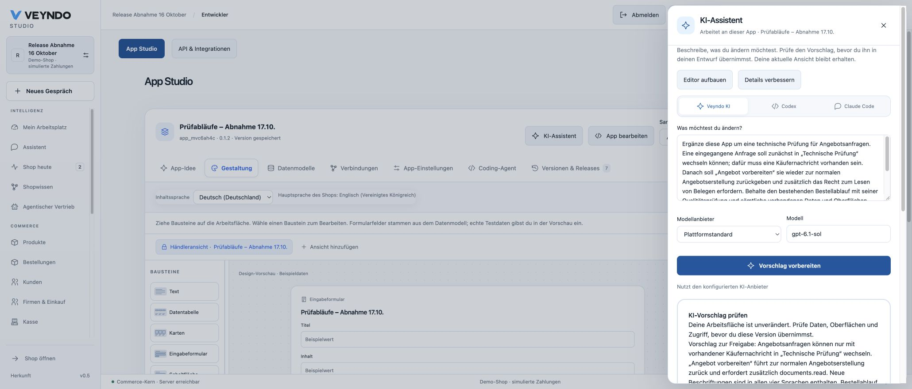
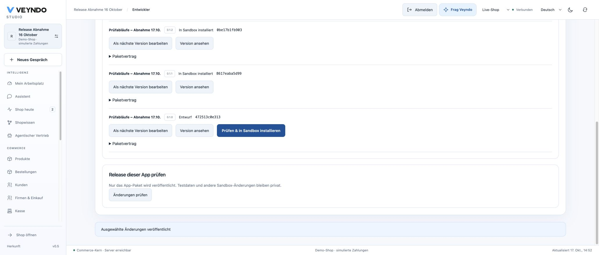
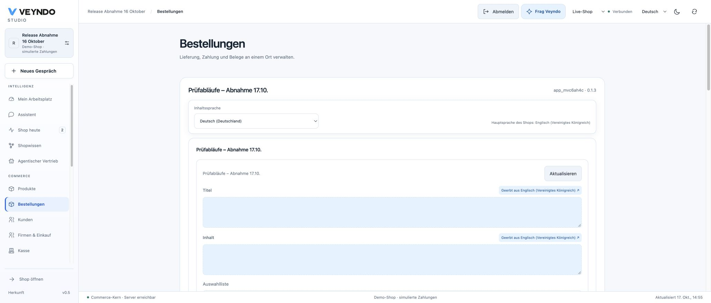
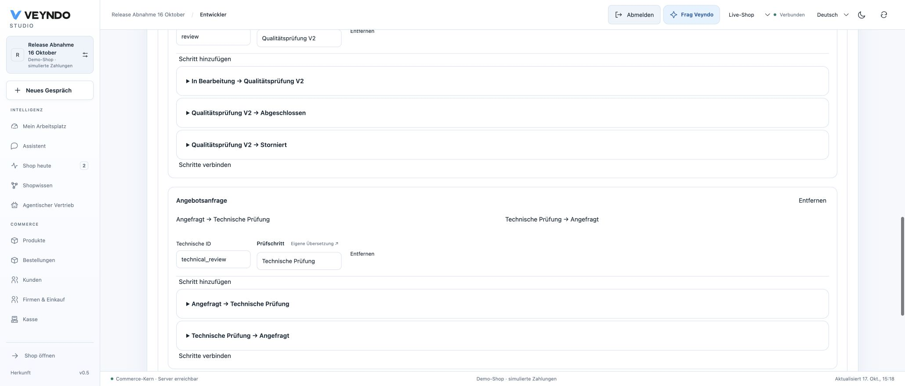

# Hosted App Studio workflow proposals — 17 October 2026

This receipt separates the public Core release, a configured-model walkthrough,
and deterministic provider fixtures. All business data belongs to the existing
synthetic **Release Abnahme 16 Oktober** shop. Payments are simulated.

## Original release and verification

| Item | Observed result |
| --- | --- |
| Source | [`7eb82c8`](https://github.com/sthamann/veyndo/commit/7eb82c85cae632cbb78174c93639da9553d30f78), merged by [PR 156](https://github.com/sthamann/veyndo/pull/156) as `6537ed1` |
| Source comparison | Candidate and merged main have identical Git tree `8b04c8adb71e662a1a9daa6b8929d87d8307d447` |
| Required CI | [39027714976](https://github.com/sthamann/veyndo/actions/runs/39027714976), successful; all registered HTTP, provider, browser-contract and tooling suites, 114 frontend files / 640 tests, unchanged coverage floors |
| Formal boundary | 59 extracted policies / 156,693 compiled Rust–Lean comparisons, no mismatch; mutation/binding/shortcut controls passed. Surrounding adapters and model output quality are not proved |
| Image | `distinct-roll-3524`, build successful in 8 minutes 36 seconds |
| Snapshot | `agent-workflows-20261017-7eb82c8`, completed 13:22:59–13:23:58 Europe/Berlin, 6 GB |
| Maintenance | Run `07d7eb83-3732-4bbd-a23e-21b5a6537e61`, successful in 16 seconds; migration-only setup completed at 11:44:09 UTC. This change adds no migration or physical app table |
| Core | `vendune-core-7c9554478`, pod `vendune-core-7c9554478-bmvmz`, started 13:44:30 Europe/Berlin; exactly one active instance, 1/1 passing, zero restarts |
| Public health/session | PostgreSQL health returned `ok`; the existing merchant session and saved app 0.1.2 survived reload after the release |

The redundant automatic main release `ddd52ee1-d83c-4d38-9b41-5b961fd0384d`
was aborted during its first build. The already verified equivalent image followed
the existing snapshot → successful maintenance → Core readiness sequence instead.

## Connected deterministic acceptance

The registered `app_generation` suite uses a local model-protocol fixture and real
Rust/PostgreSQL. It adds a native order review with `app-edit@2`, stages the
immutable build, explicitly installs it privately, publishes only that app package
and creates a native simulated order. The order enters the new review; missing
delivery blocks completion, and its accepted definition survives reload.

The versioned six-case adversarial corpus rejects weakened payment/delivery
guards, removed review states or extra rights, an identity swap, an unknown
native domain and an executable guard. Every hostile output also contains a valid
presentation edit: rejection remains atomic and creates no partial saved build.
Adding a missing quote domain preserves the existing order definition.

## Public configured-model walkthrough

**Not accepted on `7eb82c8`.** The configured platform model `gpt-6.1-sol` was
asked to add technical quote preparation to `app_mvc6ah4c`, preserving its existing
0.1.2 order workflow and all app data/UI. Two attempts returned HTTP 400. A scoped
browser network capture of the second response recorded
`Unsupported lifecycle edge, guard or permission`; the rejected model payload
was not returned or retained, so this receipt does not identify one particular
invalid field. No proposal was applied or published.

The failure message was also hidden behind the open assistant dialog. Closing it
revealed only generic input guidance. The shared schema supplied shape/limits,
but lacked the complete domain-specific native graph/replacement/scope context.
The follow-up derives that read-only context from the validator, distinguishes
failure categories and displays the localized refusal inside the dialog. Its
separate release and configured-model acceptance are recorded below; local fixture
success alone did not close the original public failure.

## Follow-up accepted on d939257

[PR 157](https://github.com/sthamann/veyndo/pull/157) merged as `80d4cd0`.
Candidate `d93925737b451498c7081273e57fdd8106fffaf4` and main share Git tree
`893782a4b43900409b1d26ebcd48c948da8d1c7c`.

| Item | Observed result |
| --- | --- |
| Required CI | [39031379568](https://github.com/sthamann/veyndo/actions/runs/39031379568), successful: all 100 registered suites, 114 frontend files / 640 tests, unchanged coverage floors, connected native generation/install/release/order tests and eight adversarial outputs |
| Prompt | Immutable `app-edit@3`; native graph, guards, replacement restrictions and scopes come from existing validation owners. Prior templates/corpus remain intact |
| Formal boundary | 59 extracted policies / 156,693 compiled Rust–Lean comparisons, no mismatch; mutation/binding/shortcut controls passed. No new pure policy or whole-adapter proof claim |
| Image | `fresh-corn-7134`, successful in 8 minutes 25 seconds |
| Snapshot | `app-agent-context-20261017-d939257`, 6 GB, completed 14:13:50–14:14:59 Europe/Berlin |
| Maintenance | `b1b4724b-5240-4507-a173-2ebbefdd10b8`, successful in 11 seconds; migration-only setup complete at 12:50:40 UTC, exit 0; no new migration/app table |
| Core | `vendune-core-59c66cdd5c`, pod `vendune-core-59c66cdd5c-7tl85`, started 14:51:20 Europe/Berlin; exactly one active instance, 1/1 passing, zero restarts; old deployment 0/1 |
| Health/session | PostgreSQL returned `ok`; the existing merchant session, selected app and saved build survived a fresh reload |

The redundant automatic release `6b4c90c2-449f-4252-b683-5735701a84b9` was
aborted during its first build; it did not execute the later backup/job/Core nodes.

### Original request, actual configured model

After the public reload, the **same original German request** was sent once to
the configured platform model `gpt-6.1-sol`. No JSON example, extra repair hint,
manual model-output correction or validation bypass was added. It returned HTTP
200 and a reviewable immutable draft **0.1.3**, build
`08c2ab9725bb41578a9f0c7e840ef3f0`, digest
`88d0381c6afd516a9059e556df466042424e3ccb8be7dbeef9650d61fdb7dbff`.

The new quote state **Technical review** uses
`requested → technical_review` with guard `quote.message`;
**Prepare quote** returns `technical_review → requested` with additional
`documents.read`. The new state/actions have en-GB, de-DE, fr-FR and es-ES labels.
Quote transitions omit `replaces`. The [captured result](agent-native-workflow-result-2026-10-17.json) records only synthetic workflow data and the actual build/digest, without credentials.

The old immutable 0.1.2 package was opened through its visible package contract
and compared directly with the returned proposal. Only **lifecycles** and
**version** changed; the existing order contract was exactly equal. Data models,
actions, access, surfaces and views were unchanged. Order completion retained its
payment and delivered-shipment guards.

### Explicit adoption, private install and selected publication

The proposal was explicitly adopted. Version 0.1.3 was installed in
**App-Felder Abnahme 17.10.**; native review selected only `app:app_mvc6ah4c`.
Explicit publication returned **Ausgewählte Änderungen veröffentlicht**.
Test records and unrelated sandbox changes were not selected.

Public order **RAC-ed46f0cf** was reloaded afterwards: EUR 63.90, its German
fictitious lamp label, delivered shipment, completed status and original
**Qualitätsprüfung V2** history were unchanged. The mounted app now uses 0.1.3;
that does not relabel the order's historical accepted workflow.

This accepts the configured-model proposal and real version/install/release path.
One successful request is not a model-quality rate. Native RFQ buyer/merchant
execution, guard denials and immutable snapshots have connected local/restricted
CI coverage; this receipt does not claim a hosted RFQ buyer negotiation or real
settlement.

## UI-caption follow-up accepted on e9369cf

[PR 158](https://github.com/sthamann/veyndo/pull/158) merged as `97c981f`.
Candidate `e9369cfce69fca0f4eb36ab2578013f67c84c3df` and main have the same
Git tree `07dbed74fe241aff4abf1531e0d6809ee6dc4b2d`. Source comparison against
`d939257` shows no changes in Rust, schemas, migrations, extensions or backend
build inputs; the change is frontend captions and documentation.

- [Required UI CI 39035006117](https://github.com/sthamann/veyndo/actions/runs/39035006117) passed: 114 frontend files / 641 tests, TypeScript/production build, unchanged coverage floors, architecture, localization and formatting. This 3-minute-12-second lane is not a new full-backend coverage measurement; the full 100-suite run above retains that boundary.
- Image **cool-grape-9915** built successfully in 8 minutes 16 seconds. The build metadata explicitly reported remote cache disabled.
- Snapshot **workflow-ui-20261017-e9369cf**, 6 GB, completed 15:04:46–15:05:47 Europe/Berlin, includes the published 0.1.3 app.
- Maintenance **5c978f1e-9175-4b09-8f34-d433100b7ed2** succeeded in 9 seconds; migration-only setup completed at 13:14:44 UTC, exit 0.
- Core **vendune-core-74445f5d59**, pod **vendune-core-74445f5d59-8gd7v**, started 15:15:38 Europe/Berlin: exactly one active instance, 1/1 passing, no restarts; the previous deployment is 0/1.
- Public Studio reloaded with the existing session and app 0.1.3. Both quote directions now show **Angefragt**, the rejected option **Abgelehnt**, and the merchant's **Technische Prüfung** label remains intact. The package wire IDs are unchanged. RAC-ed46f0cf still has EUR 63.90, completed status and its original review history after a fresh reload.

The redundant automatic release `5da76ba4-8e8b-4d39-993d-dae4fa6fbf18` was
aborted during its first build; the checked equivalent image followed the
successful snapshot/maintenance/readiness path instead.

### Separate repeat of the original embedded checkout

On **d939257**, a fresh original Lumen Storyfront tab was also operated using
ordinary native browser actions. Its existing unpurchased synthetic mug remained
one item at EUR 24.90. The checkout document again returned HTTP 200 but was held
at `Fetch.requestPaused` by the browser controller, leaving the iframe at
about:blank. The parent displayed its explicit retry message. Returning retained
the original one-item bag; no new purchase was created. This alternative attempt
is a recorded limit, not a new accepted embedded purchase or proof of a server
failure. The paused document was not bypassed or forcibly resumed.

## Acceptance limits

This release does not compile arbitrary app source, replay historical business
effects, settle real payments or certify every model output. Ordinary AI patches
can add a missing native domain; intentional changes to existing workflows use
the versioned workflow editor or reviewed coding-agent import.

The original embedded Storyfront purchase has not been newly accepted on this
image. The [previous workflow receipt](native-app-workflows-hosted-2026-10-17.md)
records the controller-held HTTP-200 iframe document and explicit parent timeout;
the [earlier successful embedded purchase](native-app-fields-hosted-2026-10-17.md)
retains its own source boundary. Neither result is relabeled as this release.

See [the workflow contract](../app-native-lifecycles.md),
[canonical status](../status.md) and [the remaining programme](../app-system-status.md).
