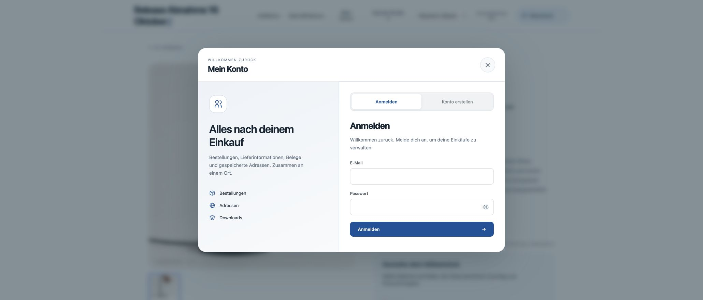
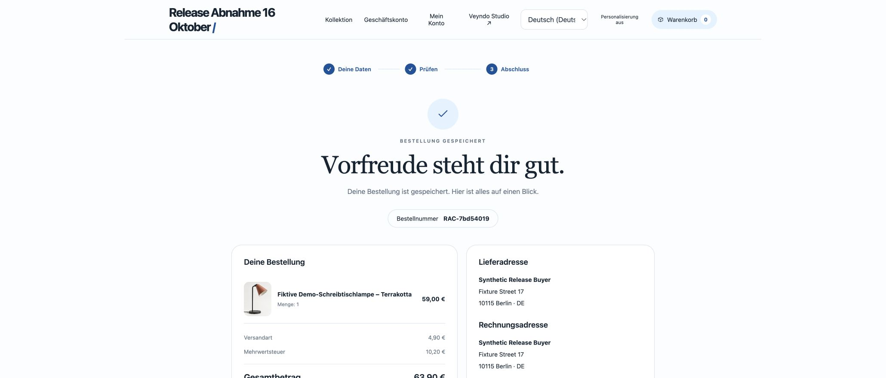
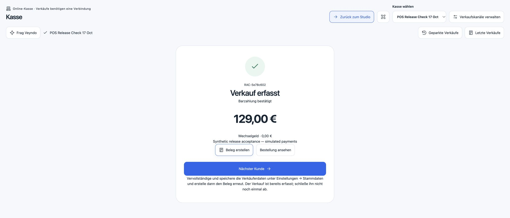
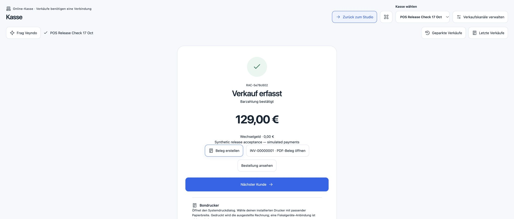
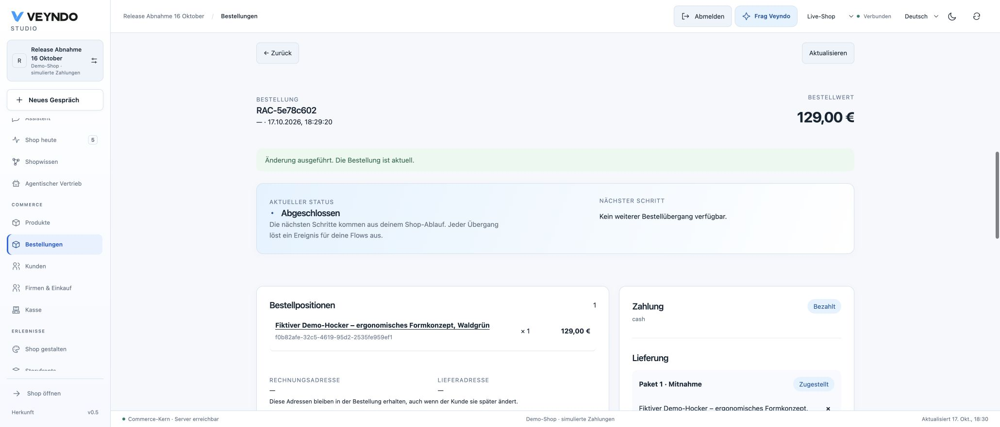

# Hosted buyer entry, checkout and POS receipt — 17 October 2026

This receipt concerns the existing synthetic **Release Abnahme 16 Oktober** shop.
The storefront payment is simulated; POS cash tender is fictional test input.
No actual money, external seller account or physical printer was involved.

## Release and verification

| Item | Observed result |
| --- | --- |
| Reviewed source | `eab353416d73ff548dfdd5f6e16867a4aab4c633`, merged by [PR 160](https://github.com/sthamann/veyndo/pull/160) as `0460521b21d3307d547e82b5e90c1cf67572b3dc` |
| Merge comparison | Candidate and merged main share Git tree `3d7220bacf4f7acdce94d766525ff9e89cd969e3` |
| Required CI | [39046224220](https://github.com/sthamann/veyndo/actions/runs/39046224220), successful: all 100 registered suites, 115 frontend files / 648 tests, unchanged coverage gates, separate restricted runtime and transaction-pooler profiles |
| Formal scope | 59 extracted policies / 156,693 compiled comparisons, zero mismatch; axiom, mutation and binding controls passed. This is not a proof of the entire server or UI |
| Measured line coverage | Rust 88.23%, frontend 67.59%, Python development/verification tools 84.19%; neither module inventory nor these percentages is 100% feature acceptance |
| Image | `busy-machine-7486`, source `ce5a710a5d8237e7e23414bc6626e374791442c6`, successful in 8m16s |
| Image comparison | Every Dockerfile input is identical to the verified source: frontend, Rust, crates, extensions, migrations, reference fixtures, manifests, licenses and Dockerfile. The later commit changes only CI review metadata and test documentation; whole image/main Git trees are not claimed identical |
| Snapshot | `business-entry-20261017-a4c821b`, 6 GB, completed 17:07:16–17:08:20 Europe/Berlin |
| Core | `vendune-core-c7d74d698`, pod `vendune-core-c7d74d698-6nnbl`, started 18:26:39 Europe/Berlin; one active instance, 1/1 passing, zero restarts; previous deployment 0/1 |
| Runtime boundary | Frontend-only behavior change; no new schema migration, credential, grant or production dependency. No maintenance job was required |
| Public gates | Health 200; anonymous platform overview 401; direct public registration 403. Merchant session and both prepared carts survived reload |

The redundant automatic release `a037ff20-9a25-4c80-a601-b5c33a83571a`
was stopped during its first build. Backup, maintenance and Core nodes had no
execution. Its duplicate build `spotless-yak-5132` was also stopped.

The earlier [failed run](https://github.com/sthamann/veyndo/actions/runs/39042533150)
retains its missing generated-inventory failure. The new early inventory check
initially also required the existing explicit workflow review to be recorded;
that refusal remains in [39045266588](https://github.com/sthamann/veyndo/actions/runs/39045266588).
The reviewed change only adds fail-fast checks, retaining all original proof,
integration and coverage work. No CI hash auto-refresh or lowered gate was added.
Both early checks passed before compilation in the final successful run.

## Buyer entry and preserved checkout

The old **Business account** header submitted shared demonstration credentials.
It now opens the existing customer dialog and retains company purchasing as the
destination. The public unsigned test opened an empty own-account form and sent
**zero** `/store-api/account/login` requests merely by opening it. Closing the
dialog preserved the one-item cart.

The lamp, contact/address, selected standard shipping and EUR 63.90 total were
prepared before the release. After reload and a new native review, one explicit
simulated purchase created **RAC-7bd54019**: one German-labelled lamp EUR 59.00,
shipping EUR 4.90, tax EUR 10.20, total EUR 63.90. The storefront bag became empty;
reloading retained the same confirmation. Shared POS inventory showed lamp stock
14, previously 15.

Signed buyer login, direct business destination, ordinary account overview and
logout were also exercised locally through actual Rust authentication using an
existing synthetic fixture. Unsigned entry forms passed in all four UI languages;
German was checked at
390px without horizontal overflow, and Escape returned focus to the entry button.
This is **not** a newly accepted hosted signed-buyer RFQ/approval journey.

## POS receipt through the existing document owner

Before release, a new EN/DE POS channel was created through the actual wizard.
A missing name was marked with `aria-invalid=true`; valid input reached the
focused register. Parking/resuming and a fictional EUR 129 cash sale produced
**RAC-1f203215** on the preceding `e9369cf` image. Its app review, delivery guard
and completion passed before release and retain that source boundary.

A second open POS cart survived the update. Its one explicit fictional cash
completion created **RAC-5e78c602**, EUR 129.00. With seller revision zero, native
receipt creation correctly refused. The new German UI named **Settings → Company
details** and explicitly told the cashier to retry only the receipt, preserving
the already recorded sale. Four transport regressions also cover EN/DE/FR/ES.

In the same synthetic shop, **Fiktive Veyndo Testwerkstatt** and a fictional
address/contact were saved in the common company basis, revision 1. Retrying the
receipt on the **same sale** issued **INV-00000001**, ID
`b2a392f3fa8d4600a85320878d0df855`. Repeating the button made only a GET and
returned exactly the same single invoice; no second POST or invoice was created.

The actual PDF download returned HTTP 200 / `application/pdf`, 1,153 bytes.
The downloaded file has a valid PDF header/end marker and parses as one page.
Extracted text contains the correct invoice, order, issuer, German product text,
EUR 108.40 net, EUR 20.60 tax and EUR 129.00 gross. The compact renderer currently
replaces some unsupported punctuation with `?`; Unicode typography remains a
known limitation. Physical receipt printing and fiscal certification were not tested.

The same invoice appeared in ordinary order administration. The order entered
**Qualitätsprüfung V2**; completion was disabled before delivery and enabled only
after native delivery confirmation. It finished as **completed / delivered** and
retained that state and invoice after a real reload. Its [accepted native snapshot](buyer-pos-lifecycle-2026-10-17.json)
pins app `app_mvc6ah4c`, version **0.1.3**, digest
`88d0381c6afd516a9059e556df466042424e3ccb8be7dbeef9650d61fdb7dbff`,
with `payment.ready` and `delivery.delivered` completion guards.

## Other observations and retained boundaries

- On the preceding `e9369cf` image, a synthetic marketplace channel saved and
  opened its own in-place Marketplace Studio setup. No app activation, external
  seller connection or synchronization was performed in that hosted walkthrough.
- The public grouped Shop knowledge/price-guardrail UI was visible, with product
  search and links to assistant, rules and settings. No pricing autonomy was enabled.
- The active backup schedule was rechecked: one daily **Snapshot at 00:00 UTC**,
  **seven days** retention; the retired Dump schedule is absent. Historical failed
  Dump entries/backups remain. The separate restore-drill database remains paused.
- Build cache remains **off**. No paid cache capacity was provisioned; no cache
  speedup is claimed.
- A fresh original Lumen Storyfront checkout attempt on `e9369cf` received HTTP
  200 and exact registered `frame-ancestors`, with no conflicting X-Frame-Options.
  The controller held the document response at `Fetch.requestPaused`; the iframe
  stayed `about:blank`. Parent retry/return retained its single EUR 24.90 mug.
  Interception/security was not bypassed, and **no new embedded purchase passed**.
  Earlier successful receipts retain their own source/date.
- Real provider settlement/mail/refund, hosted signed-buyer RFQs, Apple callback
  repair, arbitrary isolated source builds and historical business replay are not
  newly accepted by this release. See the [current status](../status.md) and
  [app implementation map](../app-system-status.md).
