# Configuration details throughout purchase — hosted 16 October 2026

This follow-up closes the presentation gap discovered in the [hardening acceptance](platform-hardening-hosted-2026-10-16.md).
[Exact build, test scope and capture hashes](configuration-summary-hosted-2026-10-16.json).

## Final merged main publication

Final Core **`c70f246`**, image **`mirthful-zipper-2487`**, is online with one
healthy instance and zero restarts. Its normal protected main workflow built the
exact source (9m24s), took a fresh PostgreSQL snapshot (1m09s), ran the migration
job successfully (22s) and waited for deployment readiness (1m35s). Separate
system/tenant database connections and migration 103 remain enforced.

PRs 143, 144 and 147 passed their required checks and merged normally. PR 147
adds translated, explicit recovery for missing lazy modules; 618 frontend tests
pass with the unchanged 100% workspace-boundary coverage gate. The first failed
coverage run is retained and was fixed with an actual reload-click regression.

A public general-offline navigation produced the separate API/workspace message;
returning online and explicitly reloading recovered the same signed-in shop and
customer view. The attempted browser asset-blocking rule did not reject a lazy
module, so this is **not** a public acceptance of the module-specific message.
Actual React.lazy rejection and recovery-click controls pass in the frontend
suite. Browser throttling was removed, blocking disabled and DevTools closed.

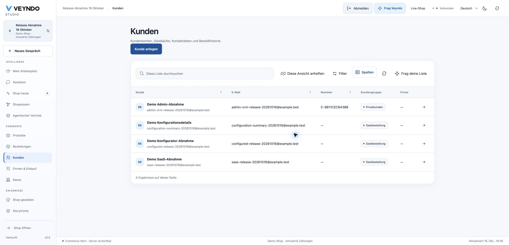

## Configuration purchase on its observed image

Core image `timely-zipper-1837`, source `12b2a6b`, started with one healthy instance,
zero restarts and a successful public health response. No additional migration was
needed. The PR head `4c1ee04` differs only in merged documentation.

A fresh public simulated order **RAC-75415aa4** shows **Eiche, 260 × 80 cm and EUR 48
surcharge**, EUR 397 total, in native checkout, confirmation and merchant order
details. The cart is empty afterwards. These are synthetic data and simulated
payment; they do not establish provider settlement, invoice or inbox delivery.

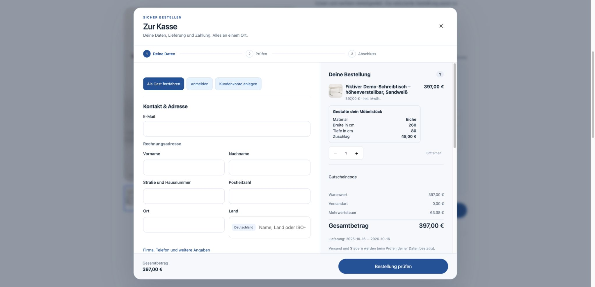

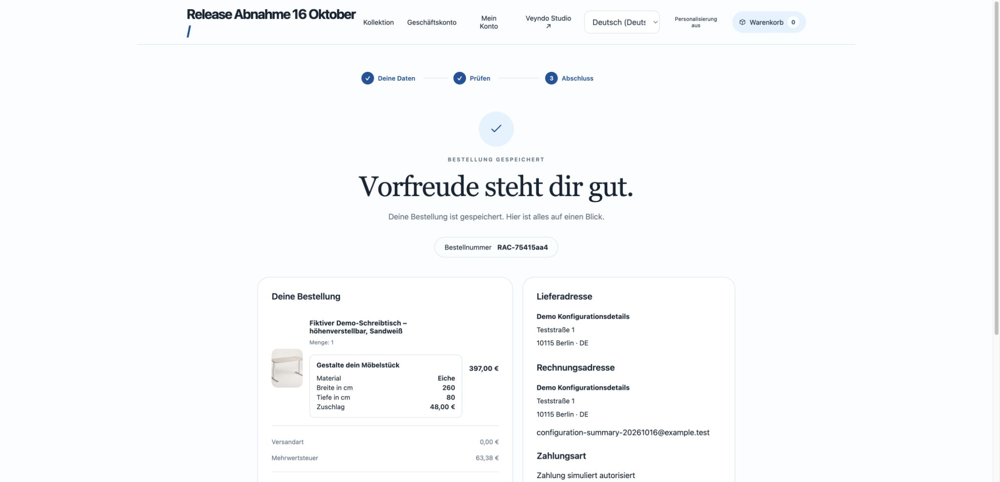

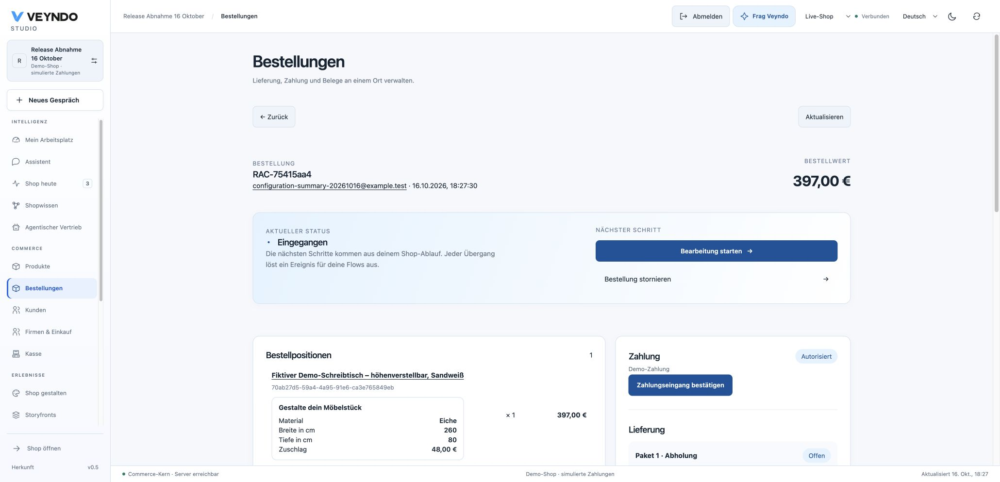

The server freezes only declared public input labels/values, public material names,
localized choices and the shop main-language fallback. Later app or library edits
cannot rename a completed purchase. New reorder quotes use current rules and fresh
labels. Existing purchases remain readable without fetching a newer package.
One shared display handles checkout, confirmation, native order and app purchase
history; no new app business rules, tables or authorization path were introduced.

Local actual PostgreSQL tests additionally cover independent B2B approval and
current-rule reorder, changed material/field names and original-order immutability.
All 612 frontend tests, two Rust regressions, workspace Clippy, structure/localization,
frontend build and explicit formal source review pass. The [full required follow-up GitHub repeat](https://github.com/sthamann/veyndo/actions/runs/38931681426)
passed and PR 144 merged as `deb452d`. Public browser outcomes remain separately
recorded above.

## Original Storyfront and release-queue boundary

The earlier native Safari comparison completed original bag → embedded contact/address → review → native
confirmation **RAC-a4727b33**, EUR 24.90, German product name, simulated authorization
→ return to original Experience → verified empty original bag. The iframe also
loads in the in-app browser. A tab-bound Chrome repeat remained at `about:blank`
despite a public HTTP 200 document with the exact parent framing policy; that
controlled repeat is not claimed passed or silently substituted with direct checkout.

To distinguish that control path, a fresh tab in **the same Chrome browser/profile**
was operated through native UI, without claiming it through tab debugging during
load. The original embedded journey passed: **RAC-0c3c77e8**, EUR 24.90, German
confirmation, return to Experience, original bag 0 and verified completion feedback.
Only after the purchase was the tab attached for content-only screenshots. No
server code, credential or browser security/framing setting changed between cases.

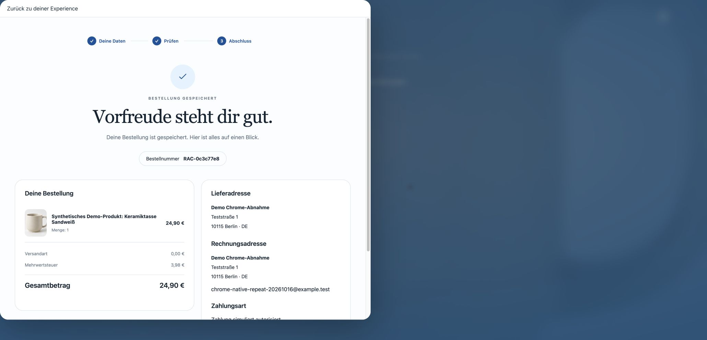

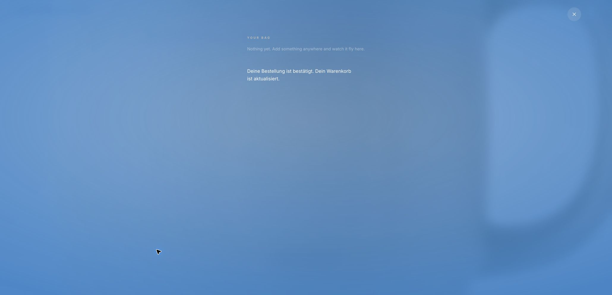

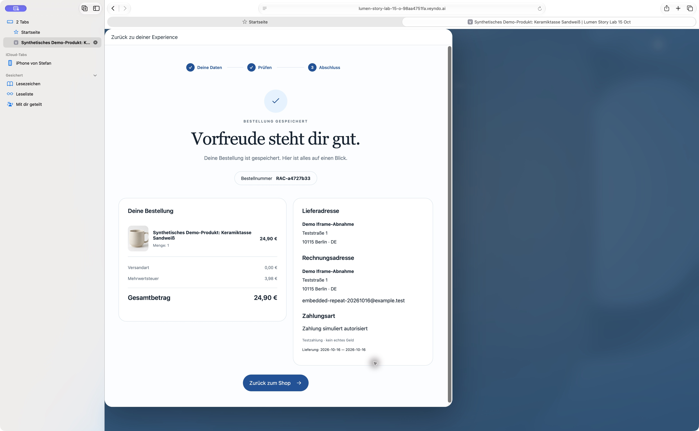

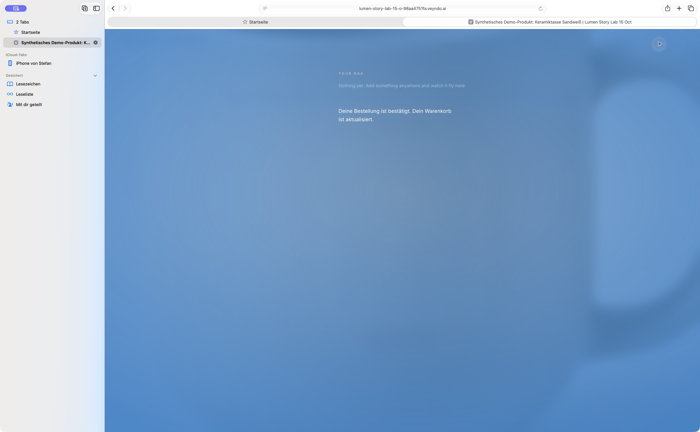

### Final pinned-image repeat

The separate Northflank main-release workflow temporarily replaced the manual
branch deployment while those comparisons ran. The queued main releases were
allowed to finish, then `timely-zipper-1837` was restored and the running source
was observed again (`vendune-core-75867998d-mhtcg`, 1/1 passing). This distinction
prevents the earlier comparisons from being silently attributed to another image.

On that pinned image, native Chrome completed **RAC-08a6f8d0**, EUR 24.90, German
confirmation **inside the original iframe**, then returned to the original
Storyfront with bag 0 and the verified completion feedback.

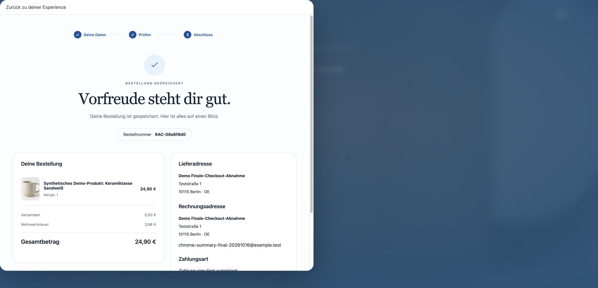

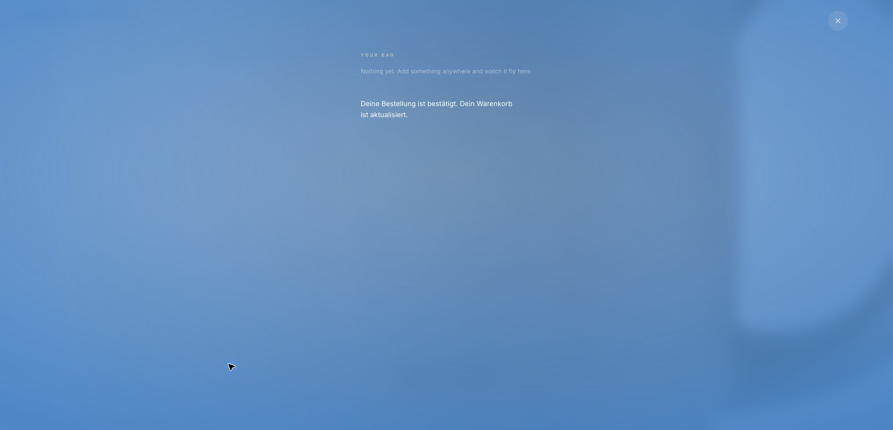

## Native Admin creation

On the restored pinned image, Chrome created a synthetic CRM-only profile and
standard address, searched and selected it for a manual order, selected German
order language, added one demo lamp, reviewed the native quote and saved
**RAC-41ad6146**, EUR 59. The customer received no password or shopper session;
no external payment provider was called.

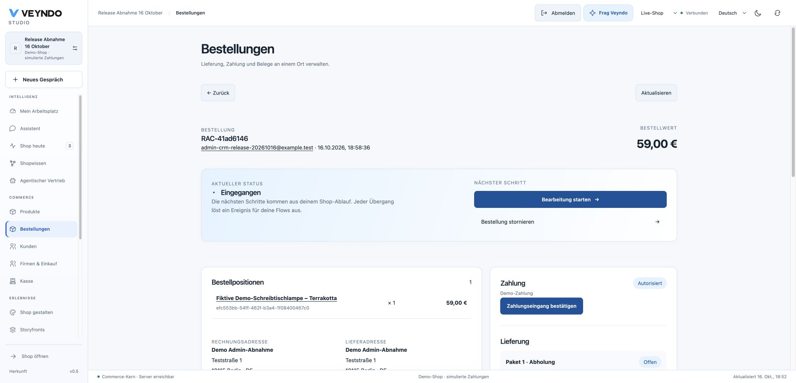
