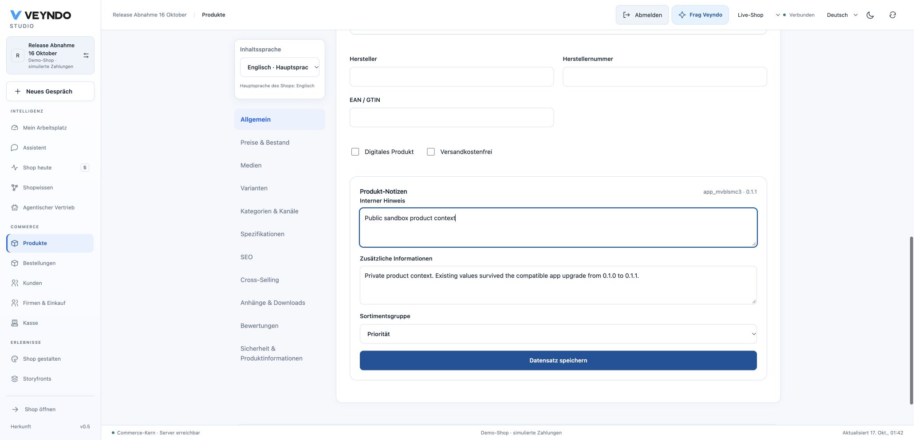
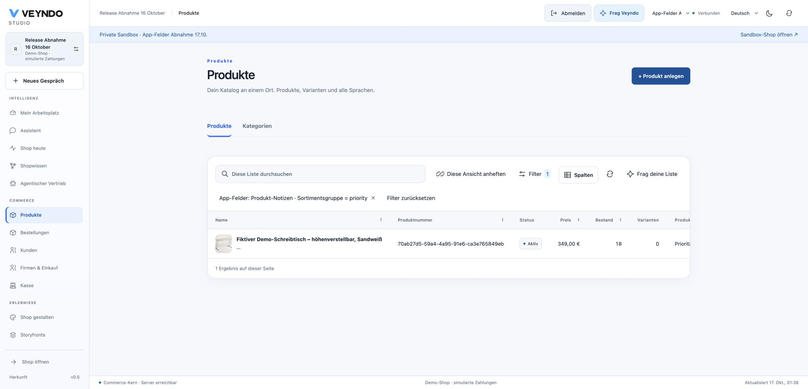
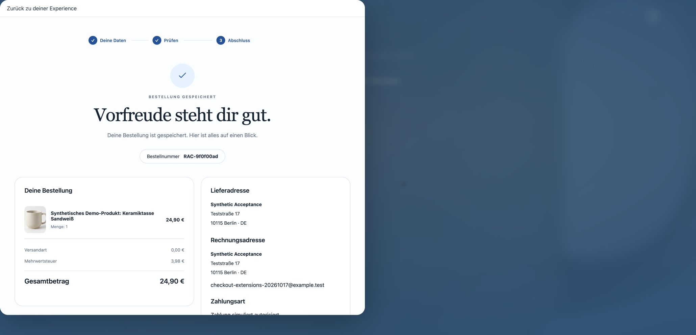
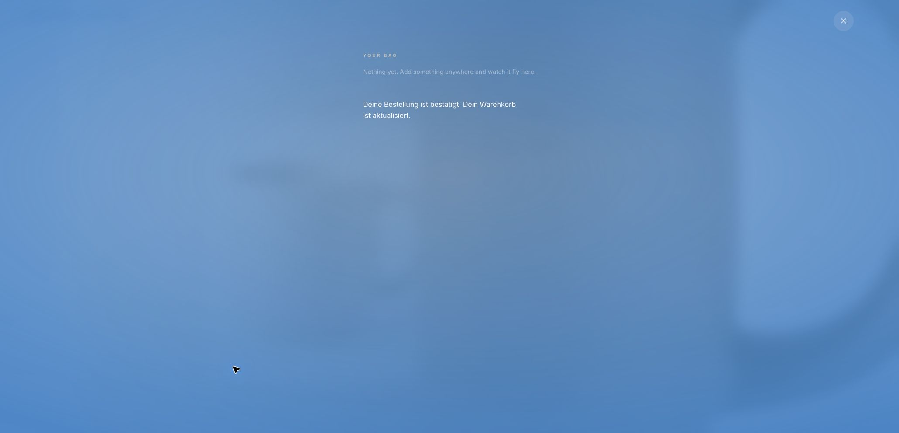

# Native app fields and repeated checkout — hosted 17 October 2026

This receipt records an actual public product-extension journey and original
Storyfront purchase. All contacts, products and payments used for acceptance are
synthetic. It does not close the complete business-capability programme.

## Delivered source and recovery chain

- [PR 152](https://github.com/sthamann/veyndo/pull/152) passed the complete required
  [Linux verification](https://github.com/sthamann/veyndo/actions/runs/38978370916)
  at `f627f9d69b3df34d3e5b31100dd6c12a3deef505` and merged as
  `be4d6cf9e7ea92f3c9600144d3cb6f730cfc8d64`.
- Both commits have the identical Git tree
  `aa608fbb05d2bc4d9bb8407088d14fc82fee7a80`. The prebuilt Northflank image
  `right-increase-7968` therefore contains the merged, verified source.
- A fresh managed PostgreSQL disk snapshot
  `app-core-extensions-20261017-f627f9d` completed successfully: 6 GB,
  01:07:56–01:08:54 Europe/Berlin. No schema migration was added by this release.
- The existing migration job used that exact image and completed successfully:
  run `31d6c179-01a3-4abc-89e0-114cdbd2a423`, 01:16:01–01:16:11 Europe/Berlin.
- Core deployment `vendune-core-5c559c9c86` started at 01:31:53 Europe/Berlin.
  Its new pod reached **1/1 passing with zero restarts**, and the public Core
  health endpoint returned its PostgreSQL-backed `status=ok` response.
- The redundant post-merge Northflank workflow
  `e804bc98-4871-47a7-81d7-2155350dd38b` was aborted after the equivalent manual
  backup/migration/deployment chain. Required GitHub checks and the independent
  main-branch verification, documentation and packaged-preview jobs were retained.
  The private Experience service remains the previously recorded `b40b386`.

The preceding failed verification at `e19f349` remains linked in the
[POS snapshot/startup recovery record](startup-pos-recovery-2026-10-17.md).
The fixed image is delivered; no production database outage was induced to
claim failover acceptance.

## Public app journey

In the existing synthetic **Release Abnahme 16 Oktober** shop, a new private
**App-Felder Abnahme 17.10.** environment was created through Studio.

1. **New App → Admin app** created an editable project, not an imported prebuilt
   package. Its model was bound to **Product**, and its segment field indexed.
2. Saving version **0.1.0** passed actual server admission. The generated native
   anchor retained real model labels. The version installed in the selected
   private environment.
3. The native desk product editor exposed the app fields. Its own save action
   stored the title, information and priority segment through the existing app
   record API, without saving native stock or prices.
4. A compatible **0.1.1** version added explicit German model/field labels. After
   installation, a newly loaded native product retained the original values and
   accepted a further revisioned save.
5. The native product grid exposed the optional **Produkt-Notizen ·
   Sortimentsgruppe** column. Exact value `priority` returned **one** product;
   `no-such-group` returned **zero**; clearing the filter restored **three**.
6. Before publication the live native product had no private-stage extension.
   The central release view then selected exactly the app package and its one
   product record. Publication succeeded, left no pending sandbox differences,
   and a fresh live product read showed version **0.1.1** and the saved values.

The accepted project is `app_mvblsmc3`; product
`70ab27d5-59a4-4a95-91e6-ca3e765849eb`; app record
`bb60c1d4-2878-4535-9f32-586a55a78643`. These are synthetic object identifiers,
not access credentials. The sample's UI/model/data remain in its app definition;
Core implements the generic binding and current-authority contract.

## Original embedded Storyfront checkout

A fresh native Chrome tab opened the existing **Lumen Story Lab 15 Oct**
Experience. The original Storyfront product was added to its own bag, and
**Checkout** opened the actual Veyndo iframe. Contact/address fields, privacy
selection, the reviewed amount and final confirmation were visible. Optional
tracking was rejected.

The result was order **RAC-9f0f00ad**, one synthetic ceramic cup, **EUR 24.90**,
German product name, and **simulated authorized** payment. The iframe's own
**Zurück zum Shop** returned to the original Experience. Its original bag showed
**Nothing yet** and the German confirmed-order/cart-updated message.

The fresh tab was not attached to the tab debugger during document loading.
After confirmation it was attached only to capture the existing page and complete
the return. This does not relabel earlier debugger-paused empty frames as passes.

## Verification scope

All **99 registered local suites** passed: 59 HTTP, 32 provider/worker, four
browser-contract and four tooling suites. The temporary checkout needed real Git
metadata, built frontend assets and the normal precompression step; those
preparation failures were retained and the affected/remaining registered suites
repeated without relaxed assertions. Complete Linux CI then passed independently,
including the full restricted-login and transaction-pooler repetitions, coverage
gates, **636 frontend tests**, formal negative controls and the original PHP
money comparisons. The local exact-money boundary checked **1,344 cases**.

Product, Customer, Order and Company bindings have actual local PostgreSQL/HTTP/
MCP/role coverage. This hosted walkthrough exercises the **product** lifecycle;
it is not a separate public acceptance for all four object editors, every graph
visualization, public UCP fields, arbitrary source builds or historical replay.
Real settlement, provider mail delivery, fiscal invoice/refund acceptance and the
Apple callback repair remain separate. See [current status](../status.md) and
the [app-system matrix](../app-system-status.md).
