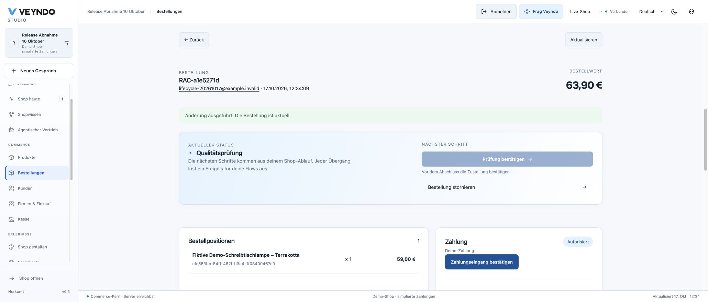
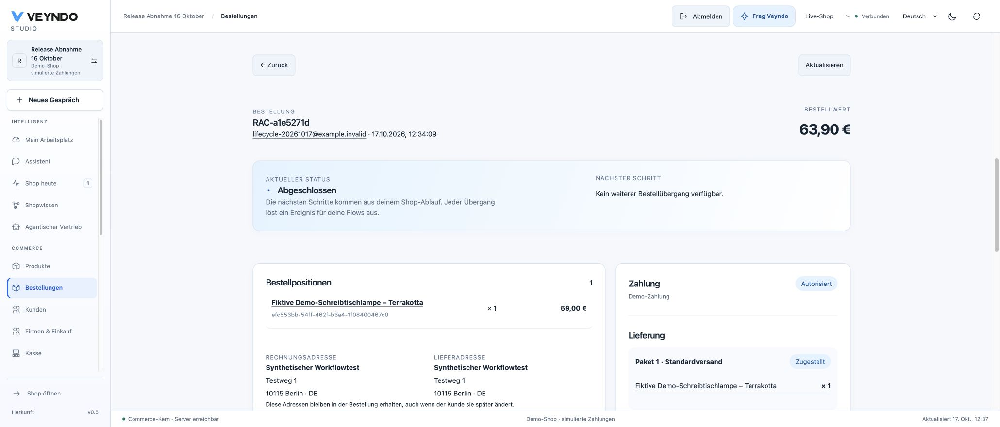
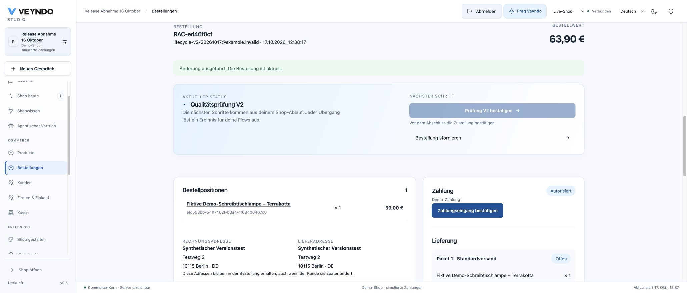

# Native app workflows — hosted 17 October 2026

This records the actual public creation, private installation, selected publication,
version upgrade and native order workflow. All contacts, products and payments are
synthetic. It does not close the entire business-capability programme.

## Delivered source and recovery chain

- [PR 154](https://github.com/sthamann/veyndo/pull/154) passed the complete required
  [Linux verification](https://github.com/sthamann/veyndo/actions/runs/39022266860)
  at `fdc70a2505d3bbeb918df43ae9289803b5ccca31` and merged as
  `c7c3afe2ebf716dfe60fc6621d5658b4d35834db`.
- Candidate, tested GitHub PR merge and merged main share tree
  `b673db1dd390a2956d7ba286134d777828f80eb3`. Northflank image
  `carefree-home-2228` contains that exact source.
- The managed disk snapshot `lifecycles-final-20261017-fdc70a2` completed:
  **6 GB**, **11:50:36–11:51:32 Europe/Berlin**, duration 56 seconds.
- The same image completed the existing migration-only job, including additive
  migration 105: run `e7aa7bbc-5bbc-4308-911a-958401f4e5c5`,
  a successful 15-second run, completion logged at 12:28:26 Europe/Berlin.
  No new app tables or database roles were added.
- Deployment `vendune-core-5bc88f7fd9` started at 12:29:39 Europe/Berlin.
  Pod `vendune-core-5bc88f7fd9-7l58b` reached **1/1 passing**; its readiness
  returned HTTP 200 and the public PostgreSQL-backed health endpoint reported `ok`.
- The redundant post-merge Northflank workflow
  `e9e3a5f2-efa3-45e3-abe4-a72e6462d428` was aborted during its first build.
  The equivalent checked snapshot/migration/Core chain above was retained.
  Required GitHub checks and independent main checks were not bypassed.
  The private Experience service remains `b40b386`.

The old failing daily dump schedule was removed after explicit approval. The
persisted daily **Snapshot at 00:00 UTC, seven-day retention** remains, as do
existing backups and databases. The release workflow also uses Snapshot. Snapshot
completion is not a restore-drill result; the separate restore-drill database
was observed paused and was not changed.

## Public App Studio and native order journey

The existing synthetic **Release Abnahme 16 Oktober** shop was used. App
`app_mvc6ah4c`, **Prüfabläufe – Abnahme 17.10.**, was created through the ordinary
visual workspace, with an additional native order area.

1. **Connections → Order & quote workflows** added the native order review
   starter. The state received English **Quality review** and German
   **Qualitätsprüfung** labels. The completion action received German
   **Prüfung bestätigen** and both payment-ready and delivery-delivered guards.
2. Version **0.1.1** saved through actual immutable server admission and installed
   into the existing private **App-Felder Abnahme 17.10.** environment. The central
   release review selected **only this app package** and published it successfully.
3. The public native storefront created **RAC-a1e5271d**, one fictitious desk lamp,
   **EUR 63.90** including EUR 4.90 shipping. Product name and confirmation were
   German; payment was explicitly **simulated authorized**; the native bag cleared.
4. Native Studio moved that order into processing, then **Qualitätsprüfung**.
   Completion was disabled with the explicit delivery-required explanation.
5. While that order was still in review, version **0.1.2** changed the German state
   to **Qualitätsprüfung V2** and the action to **Prüfung V2 bestätigen**. It was
   separately saved, privately installed and selectively published.
6. A fresh read of the original order displayed the current app area as 0.1.2,
   while its accepted native state/action retained **Qualitätsprüfung** and
   **Prüfung bestätigen**. After native shipment and delivery confirmation, its
   original completion action became enabled and completed the order. Reload
   retained completion and the original German history.
7. A new native purchase, **RAC-ed46f0cf**, EUR 63.90, instead received
   **Qualitätsprüfung V2** and **Prüfung V2 bestätigen**. It remained delivery-guarded
   and completed successfully after its own native shipment/delivery confirmation.

Full synthetic order IDs: `a1e5271d61ef4420bd10535848c06185` and
`ed46f0cfb22d411ca77ae2cf703bced6`. These are object identifiers, not credentials.
No live provider charge, real shipping booking or customer email was performed.

## Verification scope and preserved failures

The complete required CI passed **all 100 registered suites**: 60 HTTP, 32
provider/worker, four browser-contract and four tooling suites, including restricted
signed database roles, current rights, two replicas and transaction pooling.
All **114 frontend files / 640 tests** passed with unchanged coverage floors.
The formal boundary compared **59 named pure policies / 156,693 compiled cases**
without mismatches; mutation/binding/proof-shortcut controls passed. This proves
neither the whole server nor arbitrary app logic. Original PHP comparisons remain
required; 1,344 exact EUR money-boundary cases passed without a pricing rewrite.

Actual failing-before/passing-after regressions were retained for:

- B2B customer/unit lock inversion: one budgeted order and one conflict, no deadlock.
- Fifth shop-main-language admission and concurrent language/publication changes.
- Forced native-workflow edit/app-install interleaving: incompatible definitions
  cannot both commit; missing dynamic order action rights return 403.
- Duplicate native workflow editors in Connections.

RFQ preparation states, immutable offer/acceptance boundaries, API/MCP/Flow,
foreign tenants, current PII rights and accepted version retention have actual
PostgreSQL/HTTP/restricted-runtime evidence. This hosted walkthrough is an
**order** acceptance; it is not a separate public RFQ buyer walkthrough.
Historical business replay, isolated source compilation, real provider settlement,
Apple callback repair and fleet-scale/cell operation remain separate gates.

## Storyfront repeat on this image

The repeat on this exact image is **not accepted**. A fresh original Storyfront
product and bag reached the embedded checkout. The browser controller recorded
`Fetch.requestPaused` for the checkout **Document**, HTTP **200**, at
`https://app.veyndo.ai/checkout`; the child remained `about:blank`. The controller
reported that the document response was still being resolved and did not permit
raw continuation. No interception or security setting was disabled.

The real parent timeout then displayed a clear retry explanation and **Erneut
versuchen**. Returning to the Experience retained the unpurchased synthetic bag
item. Native Chrome control was also interrupted during a separate attempt.
These are preserved blocked attempts, not a completed embedded purchase or proof
that the same pause affects an ordinary unclaimed shopper tab. The two native
purchases above are separate successes. The earlier successful original embedded
purchase retains its separate [17 October receipt](native-app-fields-hosted-2026-10-17.md).

See [current status](../status.md) and [the app-system matrix](../app-system-status.md).
