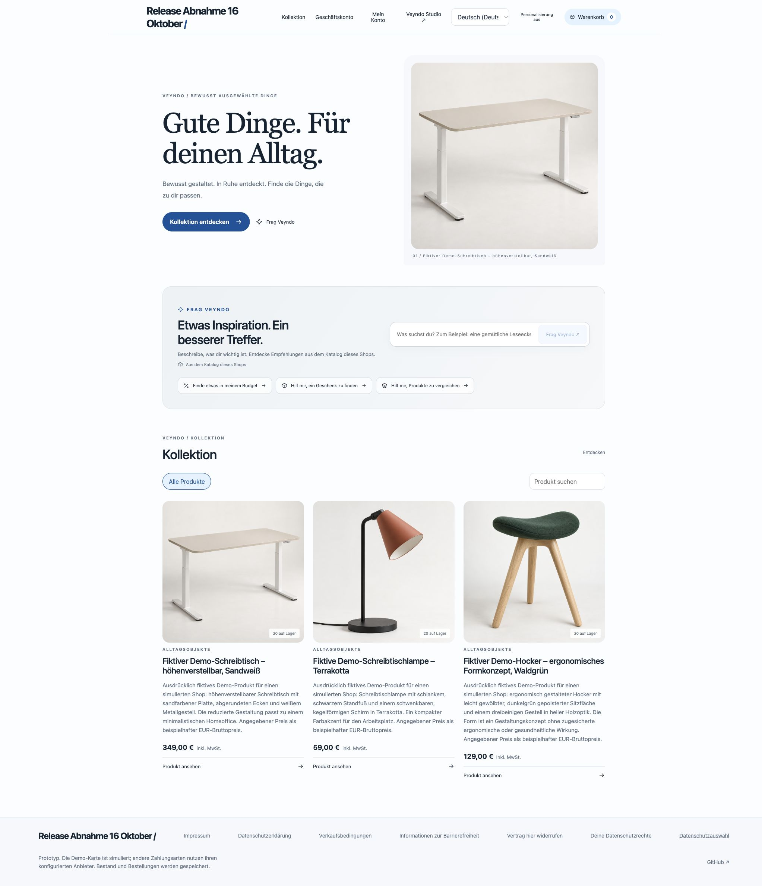
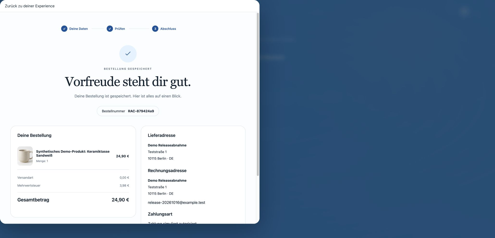
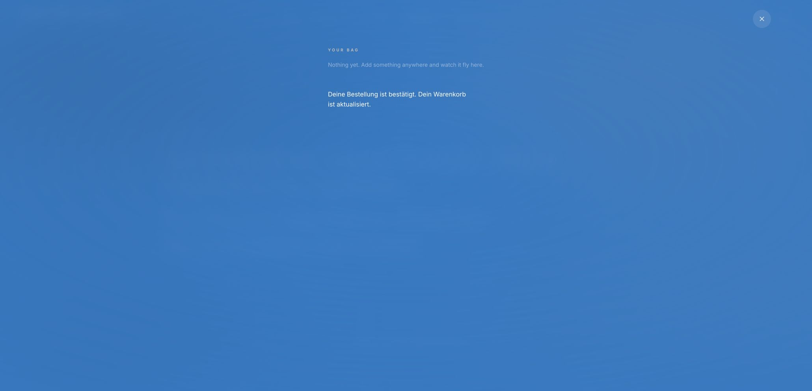
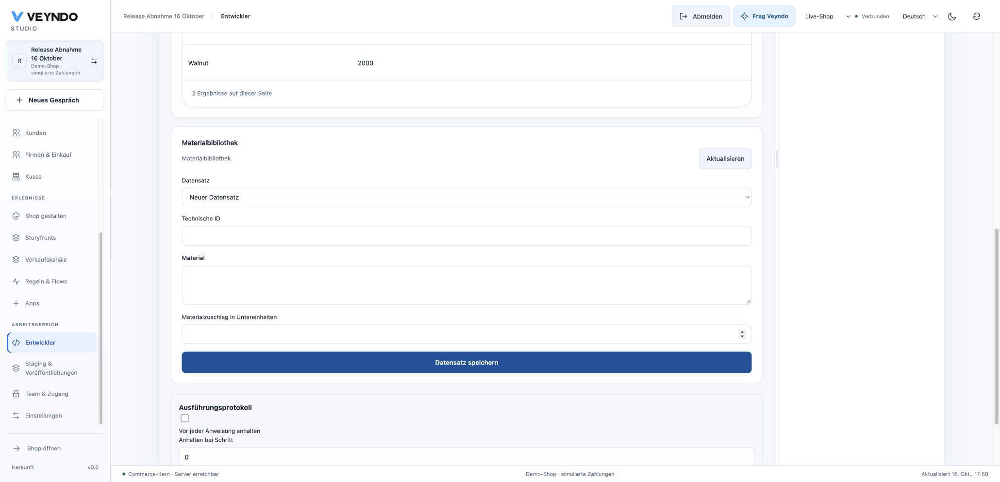
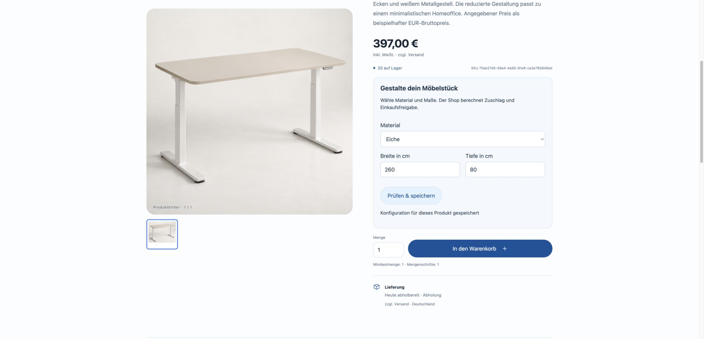

# Hosted hardening and app workflow acceptance — 16 October 2026

This dated receipt records the deployed runtime and actual synthetic browser journeys.
Use [Status](../status.md) for the current implementation boundary.
[Exact sources, build, migration and capture hashes](platform-hardening-hosted-2026-10-16.json).

## What ran publicly

Core image `steep-cushion-339` was built from `9846807`. The release head `7a4388d`
changes verification and documentation only relative to that image. After a fresh
snapshot, the Core and its internal workers were paused, migration 103 completed
with exit code 0, and the same image started as one healthy instance. Restricted
system/tenant connections and strict startup checks remain in use.

| Actual Chrome journey | Observed result |
| --- | --- |
| Standard SaaS creation | Three explicitly fictional AI products, reviewed German names/prices, three generated images, public shop and working merchant-Studio handoff. |
| Native SaaS checkout | `RAC-a1751108`, EUR 59, simulated authorization, empty cart. |
| Original Storyfront checkout | Contact/address and review loaded inside the original Experience iframe; `RAC-879424a9`, EUR 24.90, German product label and cleared original bag. |
| App builder to public product | Furniture pattern, real private material write, immutable version 1.0.0, sandbox installation and selected package publication. The private Walnut test record was not published. |
| Configured public purchase | Oak, 260 × 80 cm; EUR 349 plus EUR 48; native order `RAC-03606a05`, EUR 397. |

## What this does not establish

These purchases used simulated payment. They do not prove real settlement, inbox
mail delivery, invoice issuer configuration, refunds, disaster recovery or capacity.
The public configured purchase is B2C. Independent B2B approval, current-rule reorder
and old-order immutability have connected local PostgreSQL test evidence, not an
additional hosted business-approval acceptance in this receipt.

The browser check found a presentation gap: checkout and confirmation show the
correct configured price but do not yet list dimensions/material clearly. A shared,
immutable summary fix is under verification separately; these captures must not be
relabeled as evidence that it is already public.

The [full required GitHub repeat](https://github.com/sthamann/veyndo/actions/runs/38926129994)
passed at 16:20 UTC, including actual database/provider paths, formal negative
controls and unchanged coverage floors. PR 143 merged as `1725369`. Its preceding
run reached the final Outbox fixture and correctly refused the named CI bootstrap
database. The repaired workflow creates its own disposable database; the production-
database refusal and all registered suites remain. Local focused SQL/worker checks
and the explicit refusal counterexamples passed.
