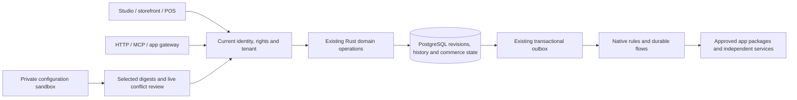

# Connected feature audit — 12 October 2026

This guide follows the **actual production owners** for POS, B2B/EDI,
marketplaces and visitor intelligence. It distinguishes native functionality,
private sandboxes, provider fixtures and external production acceptance.
A merged source change does not prove that a hosted service has rolled it out.

## One system, several surfaces

Protocol adapters do not create another pricing, stock, order, settings or audit
ledger. App-specific protocols, UI, assets and translations stay inside their
app package. [Full architecture](architecture.md) · [Source inventory](module-inventory.md).

## Integration matrix

| Feature | Native owner and app boundary | Versions and rights | Settings and sandbox | API, MCP and events |
| --- | --- | --- | --- | --- |
| POS | `src/pos/` adapts existing carts, checkout, inventory and documents; `frontend/src/admin/pos/` owns cashier UI | Channel/settings CAS and shared history; current POS/catalog/customer/order rights, explicit PII and discount authority | POS channel configuration is staged; selected channel release initializes native cash/pickup defaults. Live sales are operational writes, not configuration releases | `pos.*` tools delegate to the same native commands; ordinary order/receipt events, flows and app slots are reused |
| B2B | `src/b2b/` owns organization, grants, catalogs, approval, quote and spending admission | Company/unit CAS; shared HTTP/MCP history. Read requires B2B/PII rights; restore checks current `b2b.manage`. Financial decisions are inspection-only | Company/unit policies and product selection clone into staging and publish atomically through the native validators. Employees, orders, budgets spent, approvals, RFQs and lists do not clone | `b2b.*`, shared merchant history tools, explicit customer-session APIs, `b2b.*` outbox events and app surfaces |
| EDI | `extensions/apps/edi/` owns codecs, profiles, transport and UI | Installed manifest/digest, explicit consent, typed record revisions, tenant-bound partner/customer mapping | App configuration uses the existing app contract; native staging blocks external effects. A separate service build/deployment and partner acceptance are still required | Approved app actions, MCP discovery, requisition callback and native document export; no implicit buyer impersonation/purchase |
| Marketplaces | `extensions/apps/marketplaces/` owns seller APIs, mappings, offer overrides and independent Rust service; Core owns generic paid-order intake | Current package consent/key/creator rights, record CAS, unique source-order identity and transactional stock effects | Native channel definitions stage; seller credentials, external sync jobs and payments remain live-only. Amazon/eBay/Kaufland provider tests use local fixtures | App action/API/MCP discovery, native leased jobs, paid-order callback, guest customer, order history, invoices and `order.placed` flows |
| Visitor intelligence | `src/cognition/behavior/` derives observations/reports from the existing event ledger, carts and product graph | Current consent fingerprint; replay CAS; `knowledge.read` aggregates and additional `customers.pii` for journeys | Versioned inherited legal settings: enabled, retention 1–30 days, limit 1–500 events/cart/hour. API rejects sandbox/preview capture. Observations never publish | Native capture/report/self-export/erase APIs; `knowledge.behavior*` HTTP/MCP/agent reads; no additional AI truth store |

## What this audit repaired

1. **Publish permissions:** environment management alone no longer authorizes
   products or app records. Every selected unit requires its current domain right;
   flow actions require their own rights and bind the current publishing actor.
2. **Channel parity:** native edits and releases share channel validation and
   operational-type admission. New POS releases receive the native cash/pickup
   defaults even when only the channel is selected.
3. **Sandbox analytics:** direct Store API capture is rejected as well as UI
   suppression; callers cannot inject staging observations into live analytics.
4. **Inherited analytics controls:** native legal settings, channel overrides,
   consent disclosure, retention, reports, intake quotas, history and selective
   release share the existing owners. Policy changes require current consent.
5. **B2B history and staging:** Studio and MCP expose company/unit configuration
   history and validated restore. Staging publishes selected policies/catalogs
   parent-first while preserving live grants and spending. Live period/currency
   protections, stale stage digests and concurrent live changes remain enforced.
6. **Settings dependencies:** shipping/payment deletion counts B2B unit references;
   currency-definition removal checks unit currencies. Selective global-settings
   publication uses the existing monetary-storage/dependency guard too.

7. **MCP worker stack:** Linux coverage CI exposed a stack overflow on the POS
   cart tool. Shared capability routing now selects a boxed domain future before
   polling it, removing inactive domains from the common asynchronous poll frame.
   Existing rights, native domain handlers and transport contracts stay authoritative.

## Try the connected workflows

- **POS:** create a private environment, add a POS channel, select only its channel
  change and publish. Open the register in live Studio: cash and pickup should be
  available without a second payment setup. Complete a simulated sale and open its
  ordinary native order and receipt. [Full walkthrough](pos.md).
- **B2B:** configure a company, unit and employees in live Studio. Clone a sandbox;
  it contains policy/catalog configuration but no employees. Edit the cost center
  or product selection, review and publish just that unit. Live employee access
  and spending remain; its entity history identifies the publishing actor/source.
  [Purchasing and current limits](b2b-commerce.md).
- **Intelligence:** open **Settings → Legal & privacy → Privacy choices**, set the
  native visitor observation controls, then optionally override them per sales
  channel. In a public native storefront, review analytics consent, visit products
  and open **Shop knowledge → Visitor behavior**. Disabled/expired/private data
  must not appear. [Data and consent contract](behavior-intelligence.md).
- **Apps:** review provider/service permissions before installation, configure
  server-side credentials and use the package's own workspace. Local fixtures
  prove the integration path; real transport/seller/payment accounts require
  separate acceptance. [EDI](edi.md) · [Marketplaces](marketplaces.md).

## Verification boundary

The registered PostgreSQL/HTTP suites reproduce the denied write, inspect unchanged
live state, verify successful effects and test relevant stale/foreign cases.
Frontend tests cover the actual settings/history controls and consent behavior.
Architecture, multilingual UI, exact source inventory, explicit API permissions,
compiled Rust and existing extracted Lean policies remain CI gates.

These checks are **not 100% coverage**, whole-Core mathematical certification,
live seller certification or proof that every private Storyfront/Experience
container has deployed the new code. POS fiscal hardware/terminal acceptance,
partner-specific EDI validation, full marketplace fulfillment/refund sync and
consent-aware capture adapters for external frontends remain separate work.
[Current evidence and dated coverage](testing.md).

## UCP purchasing integration — 13 October 2026

The namespaced VEYNDO UCP extension connects existing quote conversations, integer-currency merchant offers, original-cart acceptance and separate approvals to the same checkout. Discovery, native Store/MCP commands, current-version selection, bounded public-profile HTTPS intake and canonical continuation links share existing owners. No second offer ledger or price engine was introduced. [Detailed contract and acceptance boundaries](b2b-ucp-negotiation.md).
