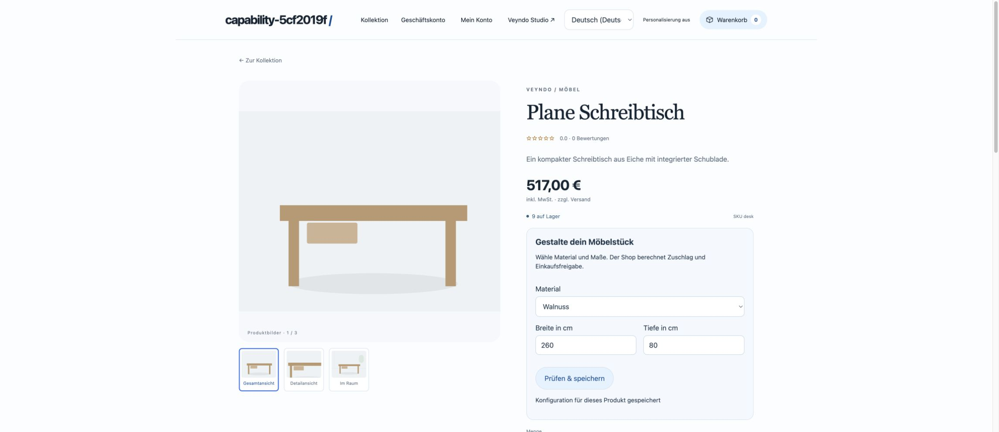
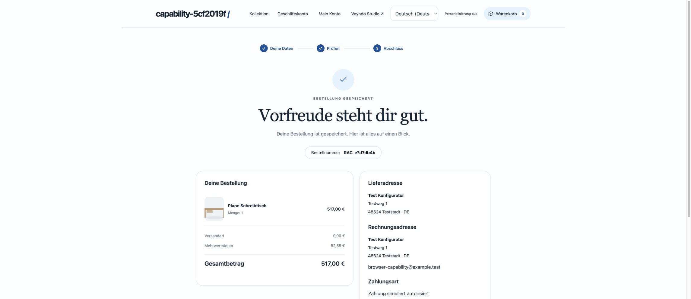

# Configurable furniture: one connected purchasing workflow

This app connects the material library, validated dimensions and a bounded price
rule with native company approval, checkout and reusable order lists. Its business
code and Manifest live in `extensions/apps/furniture-configurator/`. It adds no
physical database table and no second cart, price calculator or approval queue.

**Acceptance boundary:** the automated local HTTP/PostgreSQL workflow uses
simulated payment and synthetic customers. The [hosted app workflow](evidence/platform-hardening-hosted-2026-10-16.md)
now covers pattern creation, actual private material writes, immutable version,
reviewed sandbox install and selected publication. The [public summary follow-up](evidence/configuration-summary-hosted-2026-10-16.md)
completed Eiche, 260 × 80 cm, EUR 349 plus EUR 48, EUR 397 total with the choices
visible in checkout, confirmation and native merchant order. Independent B2B
approval/current-rule reorder remain connected local acceptance; real provider
settlement and the full [business-capability programme](app-system-status.md)
remain separate.

## Build and try it

For a standalone local Core, use its normal storefront address
`http://127.0.0.1:<port>/?shop=<tenant>&lang=de-DE`. The `/s/<alias>` path belongs
to a separately mounted Experience and is not a standalone Core storefront link.
Product price refreshes preserve configuration inputs and their saved confirmation;
the catalogue refreshes after cart changes and purchase. Completed-order choices
remain on the receipt rather than affecting a new catalogue purchase.

1. Open **Developers → New app → Configurable furniture**. This clones the
   app-owned pattern to an editable, namespaced Manifest. Review Business goal,
   assumptions, material model, actions and frozen examples. The contextual agent
   exports/imports the same definition; it does not receive provider secrets.
2. Create a private environment, save an immutable version and stage it through
   the ordinary consent/digest review. The material table and form use the existing
   native App Studio renderer. Add materials and their EUR-cent surcharges.
3. Test the product configurator. Select a material and enter integer dimensions
   in centimetres. The library loads bounded server pages and resolves an existing
   selected material by ID. Inputs and prices are validated again on the server.
4. For company purchasing, select a native company/unit and configure its approval
   policy, employee permissions, catalogue and budget. These are shared B2B rules,
   not duplicated app settings. A buyer cannot approve their own request.
5. Review the native cart and request approval. Approval binds the complete priced
   cart revision. Checkout rechecks the installed package, material revision and
   guest result before stock, order and spending commit together.
6. Save the current cart as a private or shared company order list. The list stores
   product quantities and configuration **inputs**, not accepted old prices.
7. Apply the list to a new permitted company cart. Current material/rule versions
   calculate a new price. Any necessary approval must be obtained for that cart.
8. Under the installed app's data view, open configured purchases. Cards retain
   the original material label, dimensions, source-currency fee, package version
   and rule revision. Open the native order for fulfilment and documents.

The installed app data editor uses the shared content-language selector and
translation fields. Full regional codes such as `de-DE` and the configured main
language work without creating short-code duplicates or copying inherited text
into new translations. Read-only controls remain disabled. A failed purchase-
history page request keeps the current page and its navigation position.

Sandbox testing excludes real orders/provider effects. The existing staging review
selects app package and material records separately. A live purchasing approval,
customer, order or spending record is never published from a sandbox.

## Actual local browser views

These captures use synthetic local data and simulated payment. They do not show
public deployment or an actual provider settlement. The standard product image
and specifications remain catalogue data; this pattern does not generate a 3D
render or rewrite product specifications from selected dimensions.

## The rule and its frozen checks

The bundled package supports widths 80–400 cm and depths 40–200 cm. A width **over
240 cm** adds EUR 48 to the material surcharge. The native commerce engine converts
the explicit source currency and applies its normal taxes, quantity pricing,
promotions and checkout checks.

| Input | Material fee | Expected configuration fee |
| --- | --- | --- |
| 240 × 80 cm | EUR 0 | EUR 0 |
| 241 × 80 cm | EUR 0 | EUR 48 |
| 240 × 80 cm | EUR 20 | EUR 20 |
| 260 × 80 cm | EUR 20 | EUR 68 |
| Width 401 cm | EUR 0 | Rejected |
| Width supplied as text | EUR 0 | Rejected |
| Caller supplies an undeclared price | EUR 0 | Rejected |

These synthetic cases execute through the same field validator and fuel/memory-
bounded guest on immutable save, preview installation and publication. A changed
rule with unchanged expected results fails at its example's JSON Pointer. Explicit
new expectations require review; a model must not rewrite them merely to obtain a
pass. Cases test their declared inputs, not every possible business situation.

For example, increasing the oversized-dimension surcharge to EUR 58 initially
fails the frozen checks. After the intended examples are explicitly updated and
the new version is reviewed/published, the saved 260 cm walnut configuration is
recalculated under the new version. Its previous completed order remains unchanged.

## Shared contracts and rights

- Structured `configuration.inputs` declares up to eight required integer,
  boolean or printable string fields and their existing field validation. An
  optional public library record supplies the fee. The guest accepts only declared
  integer/boolean arguments; it has no filesystem, network, clocks or host imports.
- Existing engraving/message contracts retain their serialization and length
  argument. Structured contributions may declare an ISO source currency. Existing
  contracts without it keep their legacy pricing behavior.
- Public form, HTTP action and `app.<app-id>.configure` MCP action use the same
  owner. Current cart capability, channel, company membership, CAS and terminal
  guards apply. MCP opt-out blocks discovery/direct MCP calls without disabling
  the ordinary form. Configure actions cannot run as background Flows.
- Material writes use native app-record schema/CAS/history and current catalogue
  rights. Purchased-configuration reads always need `orders.read`, even if a
  package omits an action permission. No buyer PII or other app's configuration is
  included in this purchase projection.
- The existing outbox emits `app.configuration.changed` atomically with a changed
  cart configuration. Its minimized payload contains app/cart/product references,
  channel, revision and operation; it contains no cart token, free input text,
  customer identity or credentials. The native Rule/Flow Builder can react to it.
- Selections are bounded; libraries and purchase histories use keyset pages.
  Fixed shared storage and bounded reads do not establish large-fleet throughput.

## Acceptance and remaining work

The registered `business_capability` suite exercises actual material records,
structured field/ABI rejection, MCP configuration and opt-out, wrong-channel and
foreign-buyer denial, Flow completion, independent approval, native stock/order,
private input-only lists, UCP quote consistency, changed-material checkout denial,
current-price reorder, failed frozen examples, selected package release and old
order immutability. Existing app/component/B2B, currency, POS, manual-order and
checkout regressions remain required.

The full concept additionally requires general core-object extensions, native
order/offer lifecycle extensions, historical whole-business replay, source build
hosting, Crater compatibility operations, a demonstrated Shopware extension port
and operated Enterprise cells. This app is a connected implementation case, not
acceptance of those separate capabilities.
