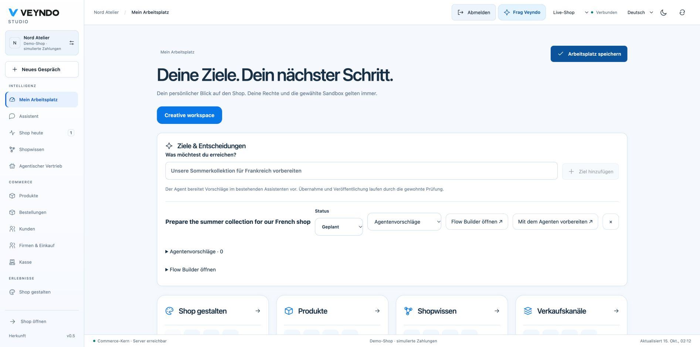
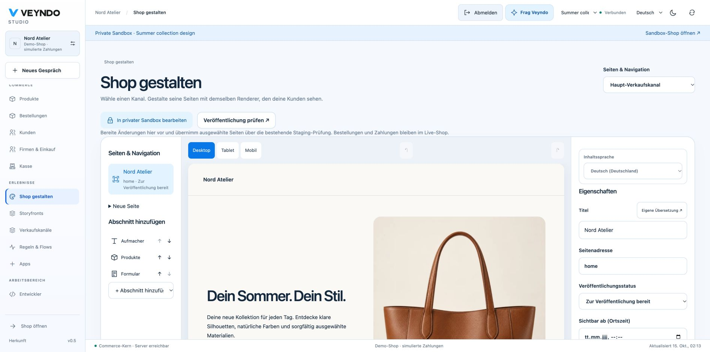
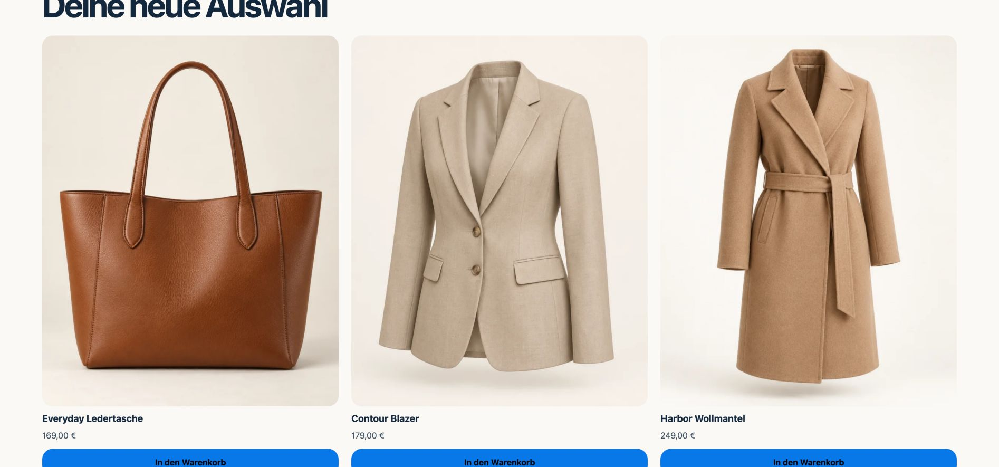
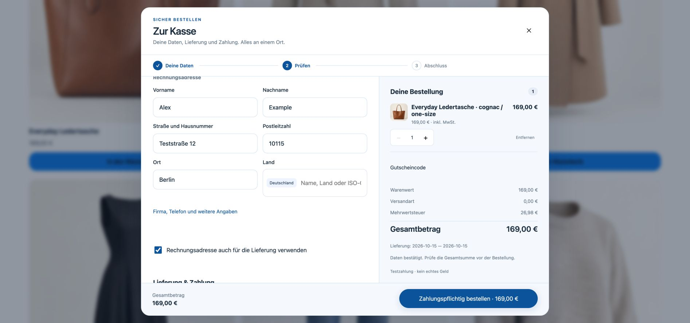
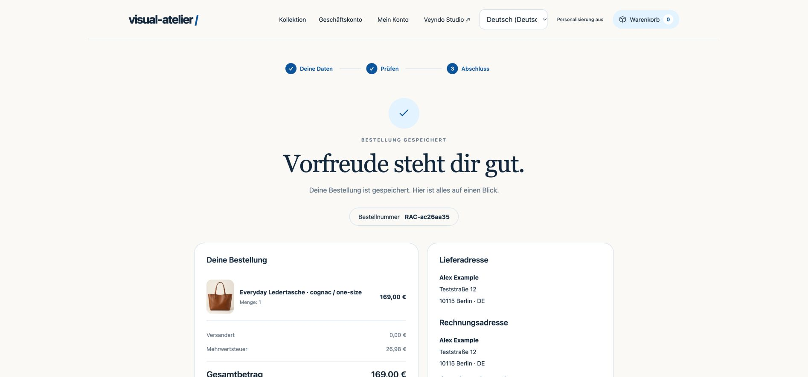

# Your workspace. Your shop. One controlled change path.

Veyndo now has a personal Studio entry and an app-owned visual editor for the
standard storefront. They use existing native identities, operations, app records,
proposal tasks, history, sandbox review and checkout. The private original
Storyfront editor continues to own Storyfront Experiences.

## Start with your work

Open **My workspace** after signing in with a personal merchant account. Select a
suggested starting layout for owner, service, purchasing, content or development.
Add cards, move them by dragging or with the up/down buttons, pin views and save
several named work areas. The shell, shop switch, language and live/sandbox switch
stay in their familiar positions.

Save the workspace before leaving through the sidebar. Opening a workspace card
also saves it first. Concurrent windows use optimistic revisions; a conflict is
shown instead of overwriting the newer version. The last twenty revisions can be
loaded into an editable draft. Preferences belong to the person and live shop;
they do not become shared sandbox/release units. Integration keys cannot impersonate
their creator to read these preferences.

Native product, customer and order grids can pin their current non-personal
filters/sort into this workspace. Free search, customer names/emails and order
search text are deliberately excluded. Opening a pin uses a short-lived in-memory
handoff, not a URL or a second saved-view database. Current server permissions
still govern every resulting query. Column order/density keep the existing grid owner.

## Work with the agent

Add a goal, for example **Prepare the summer collection for our French shop**.
Launch it in the existing assistant, associate an existing proposal, inspect the
proposal's sources/changes, and use the native approval action. A goal's own
status is a personal planning status; marking it stopped does not cancel a
separate provider operation or background job.

**Open Flow Builder** prepares an **inactive** native Flow draft from the goal.
Choose the real trigger, conditions, current authorized actions and language;
review it before saving/activating. This does not create a second autonomous
scheduler or promise that a sentence automatically completes a whole campaign.

## Design the standard shop

1. Open a Storefront sales channel and choose **Shop design**, or open it from the
   Experiences navigation.
2. Create/select a private sandbox. Live view is read-only in this editor.
3. Review the native **Shop design** and **Forms inbox** package consents. Their
   implementations remain in `extensions/apps/site-builder/` and `site-forms/`.
4. Open a page or create a Page, Campaign, Blog, Article or Form. A first ordinary
   page/campaign becomes `home`. Use lowercase letters, numbers and dashes for slugs.
5. Select a section in the real shared preview. Edit its heading inline or use the
   localized inspector; rich text uses the existing Tiptap/Markdown editor.
6. Pick actual channel products, appearance, spacing, typography and images. Switch
   desktop/tablet/mobile. Preview controls cannot place orders or submit forms.
7. Save, then choose **Review publication**. Select the intended app/page changes
   in the native staging review and publish explicitly.

The global `*` home supplies the inherited appearance. A channel home overrides
selected values; null/missing theme properties inherit. Selecting an inherited
page in a writable channel creates a channel-specific copy with a new stable ID.
Non-home page appearance is local to that document. The native header/footer and
product/cart routes retain the channel home theme.

A section has a stable ID. Undo/redo edits the current draft; retained page history
shows revision, time, actor/source and fields. Restore the entire page or a selected
section as a new draft, then save/review. Archiving a page removes it from public
projection after publication; deleting live orders or form responses is not a
page rollback operation.

## References and reviewed alternatives

Select a page/section, save it, then describe the change in **Design with the
agent**. Optionally supply up to three public HTTPS reference URLs and two
PNG/JPEG/WebP screenshots (up to 1 MiB each, 16 megapixels, 8192 pixels per side).
Choose style, structure and content separately.

The centrally configured inference provider returns two or three alternatives.
Review its interpretation and the capture status, compare before/after in the
same renderer, then explicitly apply one native task to the sandbox. Applying
one alternative invalidates competing alternatives bound to the old revision.
No model can publish, change prices or run reference HTML/scripts.

The server enforces deselected style/content/structure. A section edit cannot
silently change sibling sections or the global theme. HTML capture is bounded
source evidence, **not** a full rendered browser capture. Private DNS, credentials,
unsafe protocols, redirects and unavailable sources cannot be treated as successful
capture; upload a screenshot when the URL is incomplete. Provider failure preserves
the saved page and returns an actionable error. Vision quality requires a configured
provider/model that actually supports images; synthetic fixtures only test the contract.

## Blog and form workflows

A Blog section lists published Article pages of its category. Articles support
localized titles/text/SEO description, author, category and a start time. Page
navigation and article links use `#page/<slug>` in the current SPA. Metadata is
updated by the client; this is not server-rendered per-page SEO or a complete
editorial calendar.

Forms declare stable field IDs, localized labels, type and required state. The
published form requires privacy acknowledgement and a native current cart context.
The Rust public action validates the actual published page, channel and declared
fields, appends a fresh private response and emits **`app.site_forms.submitted`**
through the existing transactional outbox. It cannot overwrite an earlier response.

Use that registered event in the native Flow Builder for a review note or an
explicitly configured app action. Event payloads contain response identifiers,
not answer text. Staff need **both `customers.read` and `customers.pii`** to inspect
answers. Submissions cannot be cloned, published or restored via page/config history.
Current limits are five submissions/cart/minute and sixty/app/shop/minute, alongside
normal native app record/byte quotas. Delivery to email/CRM requires its separately
configured authorized app/Flow; an accepted form is not proof of external delivery.

## Same storefront, same checkout

The published shop reads the same app records, filtered on the server by published
state, start time and current channel. Drafts/future pages never become public
because a caller changes an app filter. Product data/prices still come from native
channel catalogue calculations; Add to cart, customer account and the original
checkout continue through their existing owners.

No payment implementation was added to the page editor. A simulated order verifies
the local integration path; it does not certify real provider settlement.

The published page and checkout were also exercised at a 390-pixel viewport,
without horizontal document overflow. See the [capture notes](assets/workspace-20261015/README.md)
for the exact local journey and the limits of this evidence.

## Native contracts and ownership

| Surface | Existing/shared owner |
| --- | --- |
| Personal preferences | `GET/PUT /api/studio/workspace`; MCP `studio.workspace.read/save`; forced tenant+actor RLS, current personal session, CAS, 20 retained versions |
| Designer products/channels/locales | `GET /api/merchant/site/context`; native channel/catalog/pricing owners |
| Page data | `site_builder` actions `editor_pages`, `save_page`; public action `pages` with native publication projection |
| Design references/plans | `POST /api/merchant/site/plan` and `/apply`; MCP `merchant.site.plan/apply`; central inference and native tasks |
| Record history | `/api/apps/{app}/entities/{entity}/{id}/history` and `.../{version}/restore`; MCP `merchant.app.history/restore` |
| Form intake | Public `site_forms.submit`; private `responses`; managed records, native cart, outbox, Flow jobs |
| Publication | Existing environment diff/selective release; installed package fence, current domain rights, live baseline and digest conflicts |
| Renderer | One app-owned `Renderer.tsx` for preview and published pages; no duplicated Storyfront renderer |

History is bounded to twenty versions per record and sixteen MiB per app. Reads
retain original read-scope requirements and project only current schema fields.
Restore revalidates current rights/schema/CAS and requires a declared save action;
append-only inboxes have none. SQL, provider/vision quality and UI behavior are not
mathematically proved. The extracted intake predicate proves only its exact
private/live/current-cart conjunction.

## Verification and known boundaries

Run the registered `visual_workspace` suite against an isolated PostgreSQL database.
It covers personal identity/CAS/history, own/foreign tenant/key rejection,
public draft/time/channel filtering, retained app history, selective release,
concurrent native save/release, private form intake/PII/append-only checks and
local synthetic-model alternatives/explicit apply/provider failure. Existing app,
commerce, account, checkout, staging, role and tenant suites remain separate regression
checks. Browser captures above use a disposable local fashion shop and simulated
payments. Public deployment and real-model design quality require their own acceptance.

Current bounded document limits: 24 sections/page, 24 selected products/section,
12 fields/form and the native JSON-field byte limit (8 KiB). Sandbox snapshot/release
retains the existing 1,000 records/entity limit. Product previews use the native
bounded catalogue, with search for selection. Full catalogue visual merchandising,
server-rendered page SEO, collaborative cursors, automatic cancellation of every
provider request and continuous whole-business autonomous goals remain further work.

Continue with [staging and releases](app-studio.md), [App platform](app-platform.md),
[localization](localization.md), [native checkout](checkout.md) and the
[original Storyfront integration](storyfront.md).
