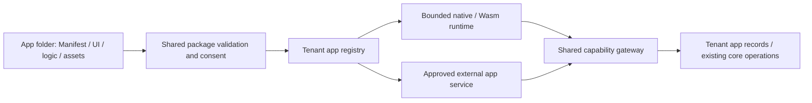

# App/package ownership

Every plugin keeps its own code and resources beneath its package root. Human,
visual and coding-agent edits use the same versioned Manifest. Installation never
copies app implementation into `src/`, `frontend/src/` or shared system folders.

| Owner | Files / execution boundary |
|---|---|
| `extensions/apps/returns-workspace/` | Private order-bound cases, app-declared lifecycle/immutable order identity, native views and bounded save/refresh AST; no refund/payment transition |
| `extensions/apps/product-advisor/` | Product-bound advice, private editor and explicit public read surface |
| `extensions/apps/erp-handoff/` | Integration workspace, app-owned Rust adapter/receipt schema/tests; actual ERP endpoint and independent service deployment need operator configuration |
| `extensions/apps/email/` | Typed settings, templates, SMTP/HTTP providers and their own Studio UI/translations |
| `extensions/apps/{google-analytics,gmail,slack}/src/` | Provider actions, settings/OAuth declarations, imports/notifications and Studio field descriptors in the independent connector process |
| `extensions/apps/google-analytics/storefront/` | Consent-bound GA4 tracking bridge |
| `extensions/apps/storyfront/studio/` | Public connection-management bridge; original generation/editor implementation remains private |
| `extensions/services/connectors/src/` | Shared connector authentication, OAuth, encrypted store, queue, workers and transport |
| `extensions/apps/paypal/src/` | Legacy host-native PayPal compatibility adapter; **not sandboxed** |
| `src/apps/`, shared frontend renderer/SDK | Generic package admission, runtime, storage, references, capabilities and rendering |

Only the connector binary compiles the connector host. The commerce library has
no connector runtime module. Trusted frontend bridges import the same host React
instance, and architecture/localization/translation/coverage gates include their
app folders. App imports cannot reach another app's implementation directly.

## Checks and limits

`scripts/testing/plugin_ownership.py` rejects known leaked paths, a connector module
in the commerce library, inline recipe builders and unsafe returns pattern exposure.
It also rejects files/symlinks escaping an app root. CI source inventories and the
Rust review ledger include extension Rust modules; moving a file does not remove
its verification obligations. These checks enforce the documented layout and
selected regressions, not automatic semantic classification of all future code.

A directory alone does not isolate code. Declarative apps use the bounded native
AST/F5 runtime; Wasm uses shared fuel/memory limits; network apps use the approved
service gateway. See [security boundaries](app-security.md). The retained PayPal
compatibility path still runs host-native for existing payment attempts. Moving
that adapter to a remote service requires a real attempt/configuration migration
and webhook/reconciliation regression checks, not just relocating a file.

Cross-system integration tests stay in the verification harness; genuinely
app-local tests belong in the app package. Shared routing may reference an app
module but must not become the owner of its business implementation.
