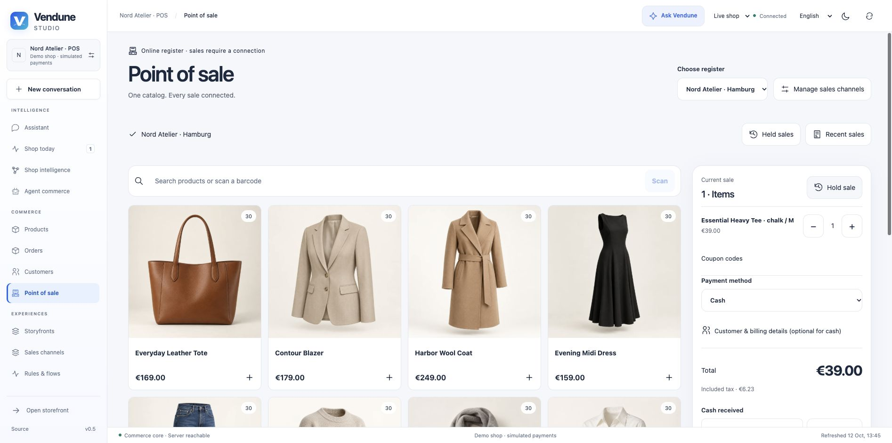
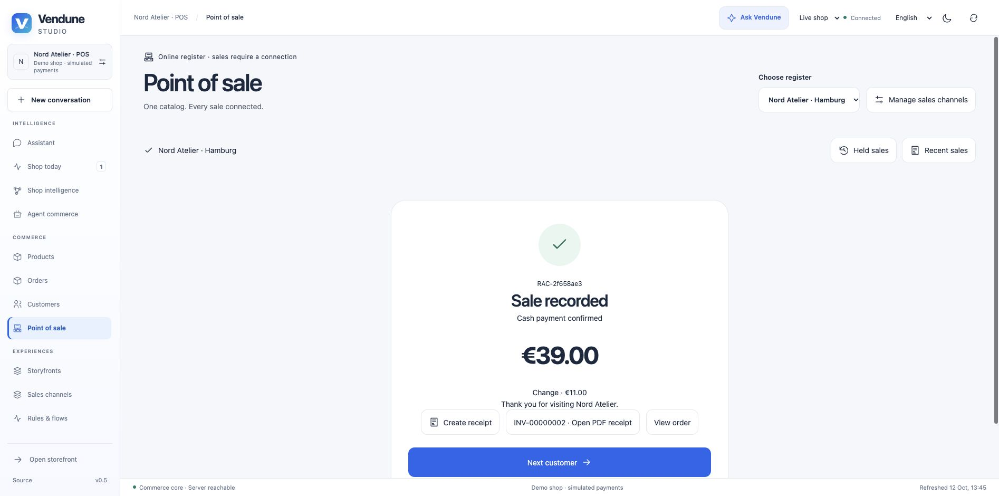
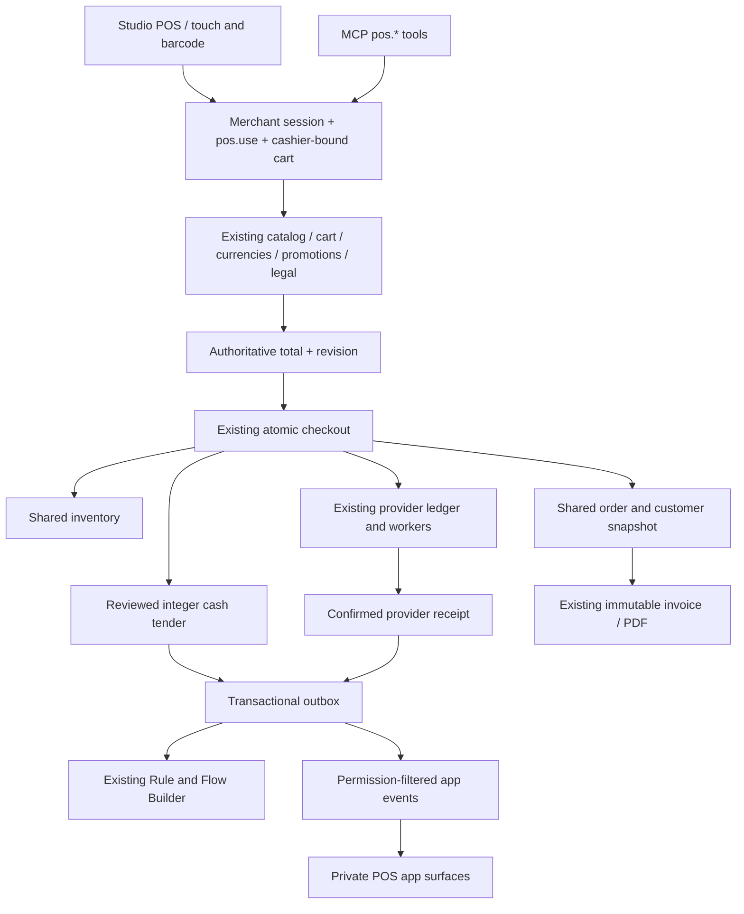

# Native point of sale

POS is a **sales-channel type in the existing Vendune commerce system**. A register
uses the same products, inventory, prices, taxes, currencies, promotions, orders,
provider ledger and immutable documents as a storefront. It has no second checkout
or register-specific database. The interface is an authenticated Studio workspace.

## Open a register

1. Open **Sales channels → Create channel** and select **Point of sale**.
2. Name the location with the shared content-language editor. Choose the location
   country from the enabled country catalogue and select its languages/products.
3. Choose two to six product columns, optional compact cards and a translated
   receipt footer. Missing translations inherit the shop main language.
4. Save. Vendune adds cash and free immediate collection **to this channel's existing
   settings override**, leaving the other channels' payment and delivery settings intact.
5. Open **Point of sale**, choose the register and search or scan a product number/EAN.
   Product families offer their native variants, including the main variant.

Channel inherited settings use the existing currency, tax, payment and company
editors. The same revision history, pause/resume and dependency-aware deletion apply.
A channel with orders is retained; historical sales cannot be erased by removing a register.
POS channels do not expose a public storefront or public Store API/UCP checkout.



[View native variant selection](assets/pos/variants.png) · [Mobile payment view](assets/pos/mobile.png)

On smaller screens, **Products / Current sale** switches views while keeping the
cart and its authoritative total. Product cards and payment controls remain touch-sized.

## A sale

Add products, adjust purchase-step-aware quantities, apply configured coupon codes
and optionally choose another enabled channel currency. All totals are returned by
Vendune; the browser does not calculate a discount or tax. The cart's final integer
minor-unit total and revision must match at completion.

For cash, enter the received amount or select **Exact amount**. Change uses integer
currency units with the configured precision, including zero-decimal currencies.
Underpayment is rejected before an order or stock deduction. Customer/contact and
billing data are optional for anonymous cash purchases, but existing provider and
legal requirements remain authoritative for other payments. Explicit digital-content
or legal acknowledgements are retained where required by shop policy.

**Hold sale** parks the current cashier's cart and starts another. Held carts survive
page reload. Another cashier cannot resume them by copying a token. Concurrent repeated
completion uses the same native idempotency key: one order and one stock deduction.
After a lost response the interface reads the existing committed order.

Payment-provider choices use the configured shared provider interface and onboarding.
For a redirect provider, the register waits for preparation, exposes the authorized
provider link and offers **Check payment** through the same durable reconciliation
jobs. Pending/ready is not displayed as paid. A confirmed capture updates the ordinary
order and emits one POS completion event. No terminal driver is included.

After completion, **Create receipt → Open PDF** uses the ordinary immutable invoice
owner and numbering. Seller data comes from shared/channel company settings. The
receipt footer is snapshotted into the order so later edits cannot rewrite it. Recent
register sales link to the existing order-management screen, including its normal
state transitions, cancellation documents and delivery/customer information.



## How the pieces connect



A POS sale uses immediate **collection**, rather than inventing a parcel shipment.
Location country is fixed by the register. Live channel state/location is rechecked
under the same settings/channel lock order before committing. Staging cannot settle
cash purchases. The current register requires an online server for each completed sale.

## HTTP and MCP

`GET /api/pos/channels` discovers the tenant's register channels without requiring
settings access. All register commands use `POST /api/pos/{channel}/{operation}`.
The same operations are discoverable as MCP tools:

| Operation | Purpose |
| --- | --- |
| `channels` | Discover tenant registers through the same cashier permission |
| `context`, `catalog`, `detail` | Configuration, bounded search/barcode and native variant pages |
| `create`, `cart`, `replace`, `select` | Cashier-owned cart, revision-bound quantities and checkout selection |
| `currency`, `coupons`, `accept` | Existing currency/promotion/explicit legal owners |
| `complete` | Reviewed minor-unit total, stable request key, optional cash tender |
| `payment`, `reconcile` | Owned attempt readiness and existing durable provider reconciliation |
| `held`, `sales` | Cashier's open parked carts and recent channel orders |

```json
{
  "channelId": "hamburg",
  "cartToken": "<owned cart token>",
  "revision": 3,
  "requestKey": "pos-<cart-id>",
  "totalMinor": "3900",
  "tenderMinor": "5000"
}
```

Give a cashier `pos.use`, `catalog.read` and `orders.write`. Viewing recent orders
also requires `orders.read`; cash settlement/reconciliation requires `payments.manage`.
Receipts use `documents.create`/`documents.read`. Team/API-key revocation remains
immediate. General merchant headers or a copied POS token cannot substitute for trusted
POS admission, including through generic MCP cart calls.

## Extend the register with apps

The existing Manifest/visual App Studio/coding-agent schema supports:

| Private surface | Host context |
| --- | --- |
| `admin.pos.catalog` | `salesChannelId` |
| `admin.pos.cart` | `salesChannelId` |
| `admin.pos.receipt` | `orderId` |

Declare a native view and a surface with `permission: "pos.use"`; reuse ordinary
entities, actions, team scopes, `coreReference` and context bindings. A native card
can display gift-wrapping guidance or a private order-bound service record. App
logic/data/assets belong to the app package. These slots grant no implicit customer
access, price override or financial receipt authority.

The shared Flow Builder includes `pos.sale_created` (unpaid/pending) and
`pos.sale_completed` (cash accepted or confirmed provider capture). Standard
`order.placed`, payment and document events remain available. Declarative apps can
expose permitted actions to flows; **service-runtime** apps may subscribe with
`events:pos.*`. Projected POS events contain order/channel/payment/amount/currency,
not cashier identity, tender or customer contact. Ordinary app consent, current
package fencing, event leases and tenant admission still apply.

## Verification and current limits

The registered `pos.py` suite uses real isolated PostgreSQL/HTTP: tenant/cashier
separation, public/forged-token denial, barcode, quantities, currency/coupons, stale
review, underpayment, channel pause, concurrent retries, stock, order, Flow execution
and authenticated PDF. `payment_providers.py` adds onboarding, redirect readiness,
confirmed capture and one completion event through a local provider fixture. No paid
provider call or real card charge is made. Frontend regression tests cover exact
tender precision, cart restore and recovery after a lost completion response.

The production cash-admission predicate has Lean properties for exact admission,
change conservation and unauthorized denial, with compiled conformance and negative
mutation checks. This is a scoped proof, not whole-system or fiscal certification.

This first native register has **no offline sale sync, cash-drawer/shift accounting,
receipt-printer driver, card-terminal SDK or fiscal-hardware certification**. Normal
PDF documents work; jurisdiction-specific fiscal registration remains separate work.
