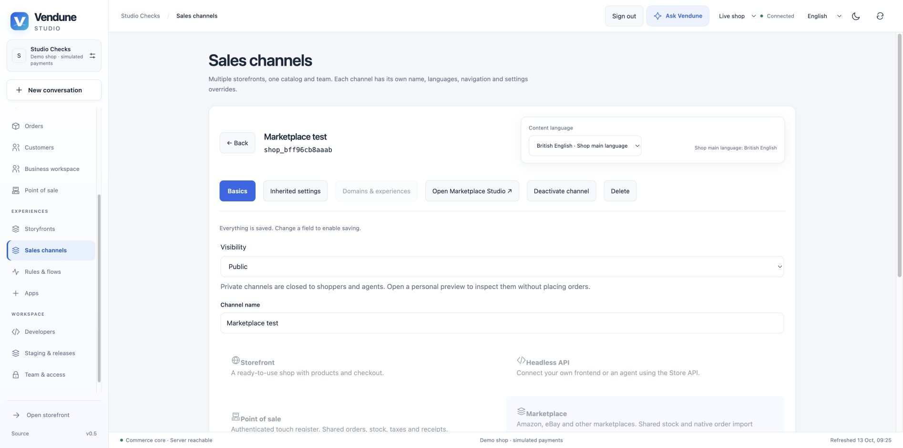
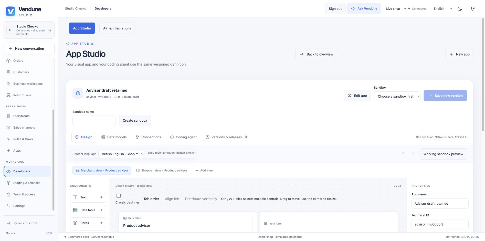
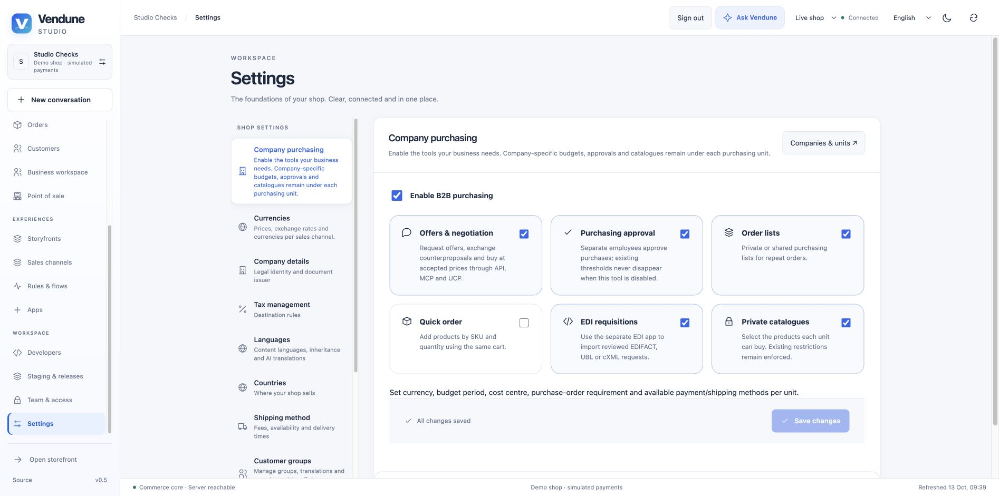

# Studio setup, roles and safe delegation

Veyndo uses the same tenant and permission owners for Studio, HTTP, MCP, API
keys, app callbacks and background Flow execution. A hidden menu is a convenience;
it is never the security boundary.

## Browser walkthroughs

These screenshots use a disposable local shop and synthetic customer records.
They demonstrate UI behavior; they are not a claim of public deployment.

## Create POS and marketplace channels

Open **Sales channels → Create channel**. The first step contains the name,
visibility and type-specific settings; the second selects languages and catalogue;
the third reviews the configuration before the versioned save.

New channels start in the shop's **main content language**, independently of the
Studio interface language. Missing names, POS countries, languages and catalogue
selections receive field errors. A name entered in another language does not
silently satisfy a missing main-language name. Existing channels retain the shared
translation editor and inheritance. The same backend validates creation, edits,
MCP writes and selected publication.

## Return from an app example

**Back to overview** returns to App Studio's assistants and app library. The App
Studio tab also returns there. Neither action deletes the current versioned or
autosaved draft. Close the assistant to continue the draft, or open an existing
version. Private previews are closed when leaving the designer.

## Reusable team roles

Open **Team & access → Roles**. Every tenant receives Owner, Admin, Editor and
Viewer definitions. Create a named role, select searchable permissions, then assign
it to members or invitations. Every option displays a translated label alongside
its technical scope, including API-key and App Studio action selectors.

- Roles are persisted per tenant, revisioned and audited through entity history.
  Restoring a role creates a new revision and repeats current delegation checks.
- Owner authority is reserved and immutable. The last active owner cannot be
  demoted. Other standard roles may be edited or paused; only unused custom roles
  may be deleted after dependency inspection and confirmation.
- Member overrides replace the role's permissions; selecting inheritance uses its
  current definition. Changing a role affects inherited grants, not independent
  explicit overrides. A paused role blocks its memberships even with overrides.
- No delegate may grant, retain on reassignment, or reactivate permissions they
  do not currently hold. Owner assignment additionally requires current ownership.
  Delegation and invitation acceptance serialize with role/member edits on the
  same tenant lifecycle lock and recheck the current actor.
- Existing broad settings, catalogue and app/team grants retain documented
  compatibility aliases. New channel, automation, developer, environment,
  knowledge, overview and app-read scopes support narrower roles. The authoritative
  list comes from `/api/auth/access`; platform-operator credentials stay separate.
- Integration keys intersect their explicit scopes with the creator's current
  active membership and role on each request. Editing a role never expands a key's
  original scope. Queued flows and callbacks rehydrate current grants.

Studio filters navigation, direct workspace admission and initial data loading.
It refreshes rights on focus and periodically, discarding old views when grants
change. Normal same-user session renewal preserves drafts through the login
overlay; rights changes reload the affected workspace. Servers still check every
request immediately, regardless of an old browser view.

## Personal data and shared reads

Customer records, addresses, full orders, order/customer history and document
PDFs require `customers.pii` as well as their domain scope. An order-reading scope
alone can authorize aggregate overview facts without authorizing customer data.
App callbacks retain explicit non-PII order/customer projections; full records still
require separately declared and approved PII consent plus current creator rights.
Merchant conversations/planning require `assistant.use`, `catalog.read`,
`orders.read` and `knowledge.read`, since their shared context combines these
sources. App actions retain their additional current permissions.

Flow status and cleaned node/action summaries are readable with
`automation.read`. Arbitrary stored app/AI outputs can contain data from any
domain; full raw results are conservatively restricted to actors holding all
registered scopes. Staging diffs filter actual records by domain rights; arbitrary
app records additionally require PII access. These are explicit access rules, not
a claim that every arbitrary third-party payload has been classified.

## Configure B2B centrally

Open **Settings → B2B** to activate or pause company purchasing, quotes,
approvals, repeat-order lists, quick order, EDI intake and private catalogues.
The switches are typed fields in the existing versioned commerce settings,
using the existing audit and outbox. They are shop-wide security policy and cannot
be relaxed through a sales-channel override. Existing installations retain enabled
features when the new fields are absent.

Disabling a feature rejects its native HTTP/MCP/UCP/buyer operation. It never
waives an existing approval threshold or budget to allow a purchase. Configure
financial policy explicitly on purchasing units. Existing stored companies and
policies remain inspectable and editable while purchasing is paused.

**Companies & purchasing** shows the available modules and links to settings.
**New company** uses one dialog: main-language name, VAT identifier and optional
existing customer. One native `b2b.company.create` transaction creates the company,
first purchasing unit and optional employee relationship; a foreign/invalid
customer rolls everything back. Customer linking requires the relevant customer
read/write and PII scopes. The searchable picker is debounced and returns at most
20 registered customers through indexed tenant-scoped SQL, with no passwords or
addresses. Guest purchases are not registered employee identities.

Catalog readers can search products, open details and inspect descriptions without
being offered product/category creation, uploads or active save controls. Installed
app slots retain their own granted capabilities; they do not inherit catalog writes.

## Owners and verification

| Responsibility | Source |
| --- | --- |
| Persisted roles, current grants, history/FKs/RLS | `migrations/082-workspace-roles.sql`, `src/auth/roles.rs` |
| Session/key identity and delegation | `src/auth/identity.sql`, `members.rs`, `invitations.rs`, `permissions.rs` |
| UI navigation and refreshed grants | `frontend/src/admin/shell/permissions.ts`, `useStudioPermissions.ts` |
| Shared permission labels and role editor | `frontend/src/admin/team/` |
| Channel wizard field validation | `frontend/src/admin/channels/ChannelEditor.tsx` |
| Native B2B configuration/onboarding | `src/b2b/settings.rs`, `onboarding.rs` |
| Bounded customer picker/search | `src/operations/customer_lookup.rs`, `migrations/083-customer-lookup.sql` |
| Real concurrent delegation/privacy/MCP checks | `scripts/workspace_roles.py`, `scripts/testing/role_races.py` |
| Shared access and setup UI regressions | `frontend/tests/unit/workspace-roles.test.tsx`, channel, B2B, App Studio and Studio workspace suites |

Run the affected database suites through `scripts/verify_integration.py --only
users workspace_roles merchant_operations tenant_isolation automation
channel_management b2b b2b_ucp pos staging`. The harness creates its own disposable
PostgreSQL database and uses synthetic people, local providers and simulated
payments. Frontend tests cover visible behavior and denied navigation. Formal
contracts cover their documented pure decision slice, not the whole SQL/UI system.
