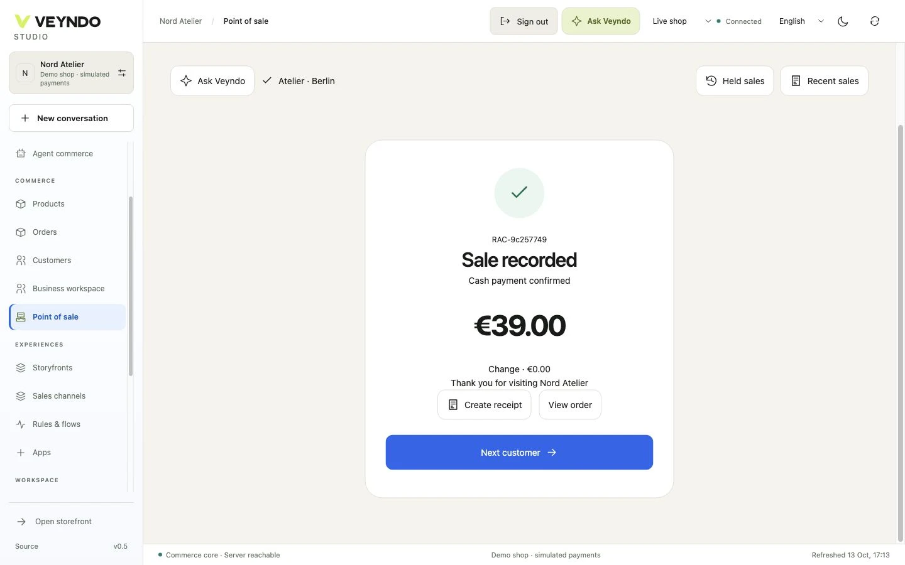
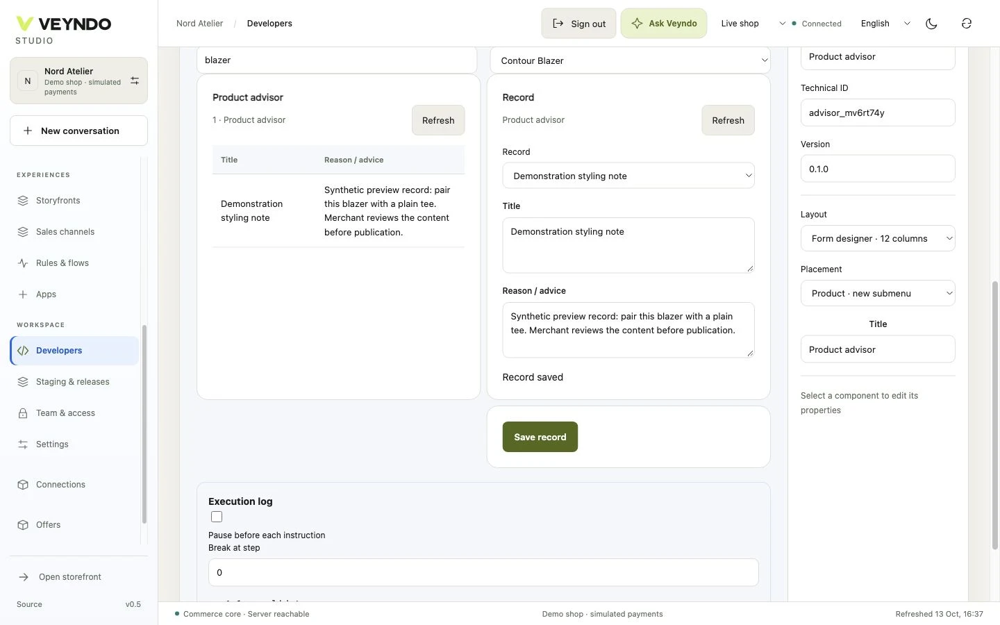

# New feature video tours

**Recorded 13 October 2026.** Three 1080p tours with English burned-in captions, optional WebVTT and no audio. [Watch the chapter player](https://sthamann.github.io/veyndo/index.html#demo). The German/English [team briefing](https://team.veyndo.ai/#tours) includes these films alongside the original Experience and SaaS tours.

## Capture boundary

These are actual application recordings from merged commit `c6b3c3c1a6050c36e5a64de900b873f856ab733e`, running against an isolated local PostgreSQL database and synthetic Nord Atelier shop. The films show current merged UI behavior, not a claim that every hosted service already runs that commit. No credentials or real customer records are published. No paid AI call, outgoing email, external marketplace sync or real payment is performed.

## Connected commerce

**1:10 · English · silent.** Complete a native cash sale, issue its shared receipt, inspect the order and configure business buying.

| Time | Chapter |
| --- | --- |
| 0:05 | Cashier |
| 0:25 | One Order System |
| 0:35 | Business Buying |
| 0:53 | Independent Apps |

Cash is recorded in an isolated demo. B2B policies and EDI permissions are shown; no fiscal device certification or external EDI delivery is claimed.

### Transcript

Connected commerce: a guided tour of the connected Veyndo prototype.
Cashier focus keeps products and the current sale together. Complete a cash sale and generate its receipt.
The same sale appears in order management, with payment, fulfillment, documents and history.
Configure company buying with a cost center, budget, approval threshold and employee permissions.
The EDI app declares its data, actions and permissions. Its independent adapter handles supported document profiles.
Explore the source, follow the guides and test a workflow of your own.

## Build and automate

**1:16 · English · silent.** Design an app visually, save a product-bound record in its working preview and publish just the app package from staging.

| Time | Chapter |
| --- | --- |
| 0:05 | Visual Design |
| 0:25 | Working Preview |
| 0:41 | Event Flows |
| 0:57 | Selective Release |

No paid model call is made. The Flow canvas branch is an unsaved edit; execution history shows the already saved POS note flow.

### Transcript

Build and automate: a guided tour of the connected Veyndo prototype.
Start from a working app pattern. Add controls, undo, switch merchant and shopper views, then inspect its data model.
Choose a real product in the sandbox, enter care advice and save it through the app’s actual data contract.
Inspect the cashier event flow and add a branch on its canvas. Completed executions show the earlier sale’s note.
Review the changed app package, select it and publish. Sandbox test records are not copied into the live shop.
Explore the source, follow the guides and test a workflow of your own.

## Connected intelligence

**1:12 · English · silent.** Edit channel-specific offer content, inspect consented visitor statistics and follow shopping events into the semantic product graph.

| Time | Chapter |
| --- | --- |
| 0:05 | Channel Content |
| 0:23 | Consented Signals |
| 0:37 | Connected Knowledge |
| 0:55 | Merchant Control |

Marketplace credentials are not connected. Visitor observations and orders are synthetic; graph links do not establish causal uplift or automatic model training.

### Transcript

Connected intelligence: a guided tour of the connected Veyndo prototype.
Override a marketplace title, description, images or mapped fields without replacing the original catalog product.
Explore browser, screen and referral groups alongside product views, cart additions and native order counts.
The graph connects observed products to their existing shop knowledge. Inspect a consented guest journey for its evidence.
Explore the knowledge connections and their origin. Merchant review controls which evidence can support customer-facing answers.
Explore the source, follow the guides and test a workflow of your own.

## Try the demonstrated workflows

- **POS:** create a POS sales channel, select a product and cash/pickup, complete a synthetic sale, create its invoice/receipt and open the same order in Studio. [POS guide](pos.md).
- **B2B:** edit company and unit policies, exact-currency budget, approval threshold, employee permissions and ordering rules. [B2B guide](b2b-commerce.md) · [Independent EDI app](edi.md).
- **App Studio:** choose a pattern, design a view, approve/install in a private sandbox, save a product-bound record through the working preview, then select only the app release unit. [Visual designer](app-studio.md).
- **Flows:** inspect the POS completion event and its recorded note executions; the filmed branch edit itself is not saved. [Rules and flows](automation.md).
- **Marketplaces:** review channel-specific listing content and field mapping before enabling credentials or publication. [Marketplace boundaries](marketplaces.md).
- **Visitor intelligence:** use current analytics consent, record synthetic shopping events, inspect reports and product-linked journeys. [Behavior intelligence](behavior-intelligence.md).

## Media and reproducibility

Chapter times, capture date, source commit, codec, dimensions, file sizes and hashes are stored in [the tour manifest](assets/showcase/tours.json). Source recordings are trimmed at scene boundaries; a final real frame may be held to leave reading time. No UI actions are reordered and UI colors are preserved. Titles and captions explain relationships and scope. Raw recordings, local authentication state and private code are excluded from publication.

The existing six workflow clips and their original capture provenance remain available below the new tours. Silent videos load on demand; native controls, keyboard-accessible tabs and chapter jumps remain available.
